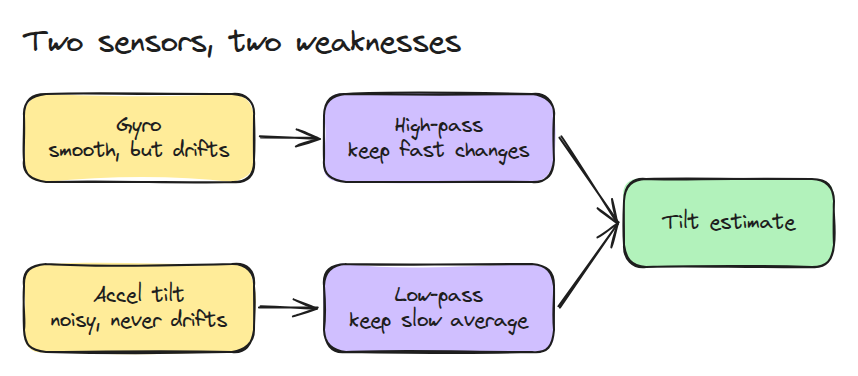
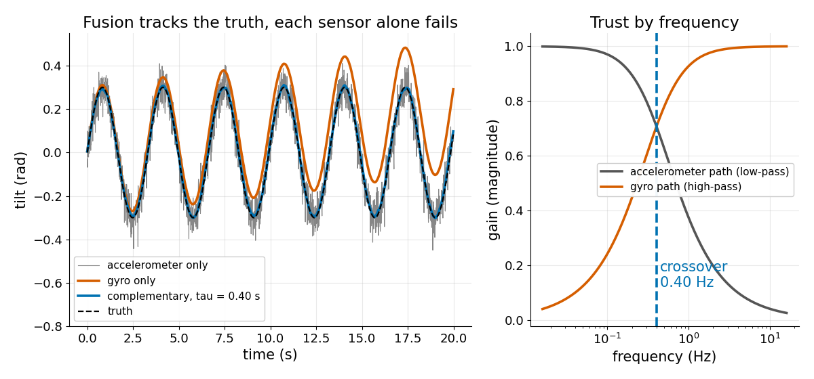
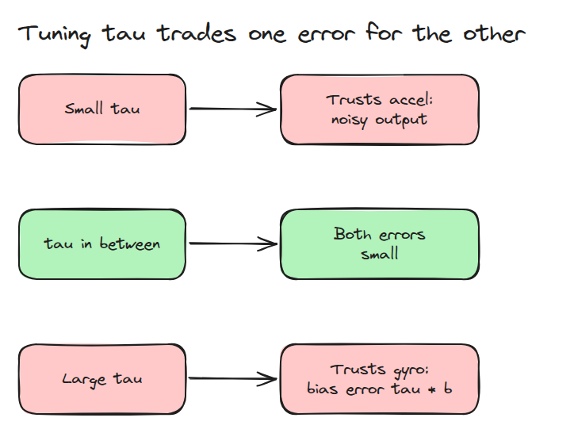
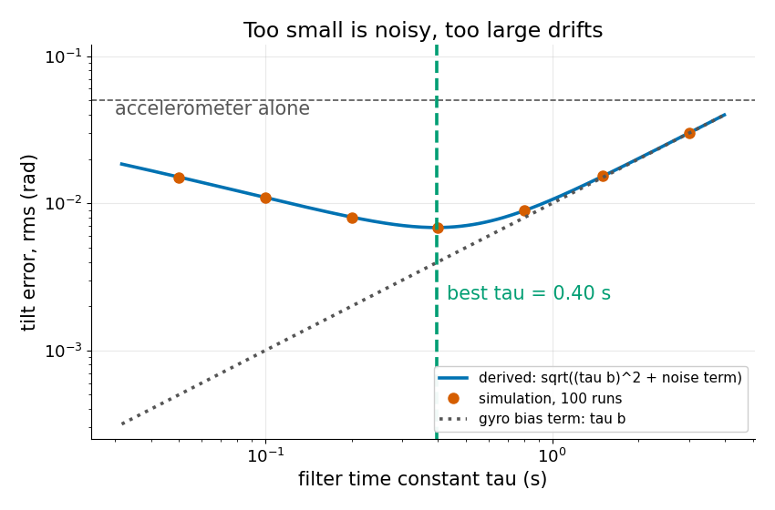

# 상보 필터 (Complementary Filter)

> gyro는 빠른 변화에는 맞고 오래 두면 틀립니다. 가속도계는 그 반대입니다. 시간상수 하나가 언제 누구를 믿을지 정합니다.

**유형:** 만들기   **선수 지식:** 07/03 IMU 적분과 Drift   **시간:** 약 15분

## 문제

가속도계로 기울기를 추정하면 각도가 너무 떨려서 균형 제어기가 같이 흔들립니다. 적분한 gyro로 바꾸면 각도는 매끄럽지만 진짜 값에서 서서히 멀어져 똑바로 서 있는데도 기울었다고 믿게 됩니다.

## 개념



*gyro는 high-pass에, 가속도계 기울기는 low-pass에 통과시킨 뒤 더합니다.*

필터는 `theta = a (theta + gyro dt) + (1 - a) acc`이고 `a = tau / (tau + dt)`입니다. 연속 시간에서 가속도계 경로는 `1 / (1 + j w tau)`이고 gyro 경로는 `j w tau / (1 + j w tau)`입니다.

둘의 합은 정확히 1이므로 진짜 기울기는 그대로 통과합니다. 두 경로는 `1 / (2 pi tau)` Hz에서 만나고 그 지점에서 각각의 gain은 `1 / sqrt(2)`입니다.



*왼쪽은 `tau = 0.40 s`일 때 합친 기울기가 진짜 값 위에 있고 가속도계는 잡음이 많으며 gyro는 drift하는 모습입니다. 오른쪽은 0.40 Hz 아래에서는 가속도계를, 위에서는 gyro를 믿는 모습입니다.*

상수 gyro bias `b`는 정확히 `tau b`의 정상상태 오차를 남깁니다. 표준편차가 `s`인 백색 가속도계 잡음은 `s^2 (1 - a) / (1 + a)`의 분산을 남깁니다.

`(tau b)^2 + s^2 dt / (2 tau)`를 최소로 만들면 `tau^3 = s^2 dt / (4 b^2)`가 나옵니다.



*`tau`가 작으면 가속도계 잡음이 통과하고 `tau`가 크면 gyro bias가 통과합니다.*



*예시 값은 `b = 0.01 rad/s`, `s = 0.05 rad`, `dt = 0.01 s`입니다. 시뮬레이션이 유도한 곡선 위에 놓이고 최솟값은 0.40 s에 있습니다.*

## 만들기

```python
def alpha(tau, dt):
    return tau / (tau + dt)

def complementary(gyro, acc, dt, tau, theta0=0.0):
    a, theta, out = alpha(tau, dt), np.full(gyro.shape[1], theta0, float), []
    for g, z in zip(gyro, acc):
        theta = a * (theta + g * dt) + (1 - a) * z
        out.append(theta)
    return np.array(out)
```

```bash
cd robotics-engineering-from-scratch
python3 -m pytest phases/07-state-estimation/04-complementary-filter -q
```

## 실제 도구로 보기

`imu_tools`의 `imu_complementary_filter`는 각속도와 가속도, 선택적으로 자기장 값을 complementary fusion으로 합쳐 orientation quaternion을 냅니다.

녹화 데이터에 돌려 보고 그 기울기를 이 레슨의 `tau` 트레이드오프와 비교해 보세요.

출처: imu_tools README, https://raw.githubusercontent.com/CCNYRoboticsLab/imu_tools/humble/README.md (2026년 11월 9일 확인).

## 결과물

`outputs/skill-complementary-filter-check.md`는 잰 bias와 잡음에 시간상수가 맞는지 검토합니다.

## 연습 문제

1. `tau = 2 s`, `b = 0.01 rad/s`일 때 gyro bias 오차를 계산하고 코드로 확인하세요.
2. `s`를 절반으로 줄였을 때 새 최적 `tau`를 예측하세요.
3. 로봇이 흔들릴 때만 잡음이 큰 가속도계로 바꿨다면 `tau`를 어떻게 해야 할지 말해 보세요.
