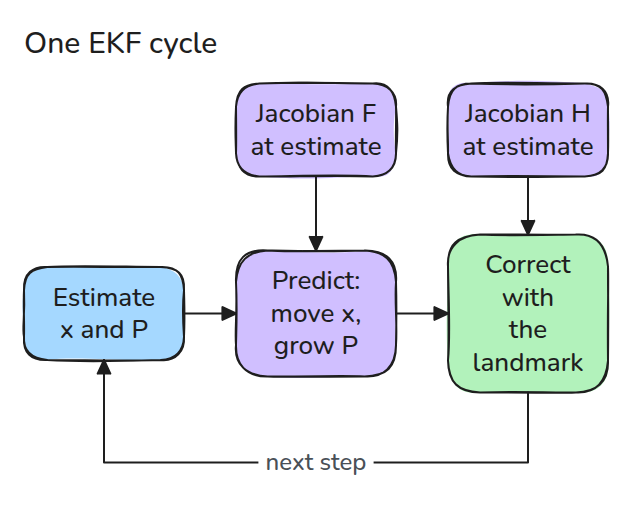
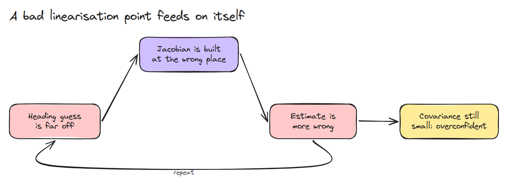
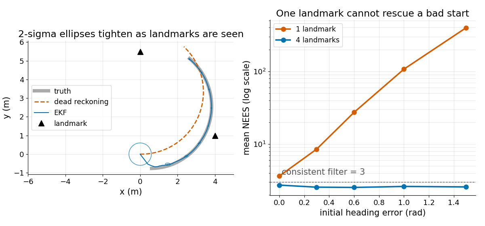

# Extended Kalman Filter

> Learn how a robot that drives in curves tracks its position, and why a wrong start can leave it confidently wrong.

**Type:** Build   **Prerequisites:** 07/02 Kalman Filter, 08/01 Differential Drive and Odometry   **Time:** ~15 minutes

## In Plain Words

A robot measures how far a post is and in which direction. An extended Kalman filter swaps the curved motion for a straight-line rule at its current estimate. The rule holds only near the truth: far off, the filter still reports small uncertainty while its error grows.

## Key Terms

- **EKF**: extended Kalman filter, a Kalman filter that straightens the model at the current estimate.
- **Linearise**: replace a curve by its straight-line approximation at one point.
- **Jacobian (`F`, `H`)**: the matrix of slopes that says how a small change in the state changes the output.
- **Heading**: the direction the robot faces.
- **Landmark**: a post at a known place that the robot measures.
- **NEES**: the error in units of the filter's own claimed uncertainty. It should average the state size.

## The Problem

A robot drives in a curve and tracks itself with one post as a landmark. Its heading guess starts 1 rad off, and the filter drifts away while reporting a small covariance. Heading sits inside every `cos` and `sin`, so `x' = F x` has no constant `F`.

## The Concept

A robot that is confidently wrong is more dangerous than one that is unsure.



*Both Jacobians are evaluated at the current estimate.*

The state is `[x, y, heading]`; the robot moves along a curve `f(x, u)` with speed `v` and turn rate `w`. `F` is the Jacobian of the motion, `H` that of the landmark's range and bearing `h(x)`. Covariance is predicted by `P = F P F^T + Q`. Bearing differences are wrapped.



*A wrong heading gives a wrong Jacobian, a wrong correction, a wronger heading. One reading cannot tell position error from heading error.*

NEES, `e^T P^-1 e`, averages the state size, 3, over runs.



*Left: the EKF follows the truth, dead reckoning bends away. Right: NEES stays near 3 with four landmarks, and grows from about 4 to several hundred with one.*


*Both start 1 rad off in heading. One post (blue): NEES averages 100.5 over 30 runs, the estimate ends 2.8 m off and its 2 sigma disc stays small. Four (green): 2.7. 1 m is drawn as 0.5 m.*

## Build It

```python
def jac_h(x, lm):
    dx, dy = lm - x[:2]
    q, r = dx*dx + dy*dy, np.hypot(dx, dy)
    return np.array([[-dx/r, -dy/r, 0], [dy/q, -dx/q, -1]])

H = jac_h(x, lm)                       # at the estimate
K = P @ H.T @ np.linalg.inv(H @ P @ H.T + R)
y = z - h(x, lm); y[1] = wrap(y[1])
x = x + K @ y
```

Tests compare both Jacobians with finite differences, check NEES near 3 over 150 seeds, and over 20 times larger with one landmark and a 1.5 rad heading error.

```bash
cd robotics-engineering-from-scratch
python3 -m pytest phases/07-state-estimation/05-extended-kalman-filter -q
python3 phases/07-state-estimation/05-extended-kalman-filter/code/main.py
```

## Use It

ROS's `robot_localization` ships `ekf_node` (`ekf_localization_node` in ROS 1 docs).

Sources: robot_localization state estimation nodes, https://docs.ros.org/en/melodic/api/robot_localization/html/state_estimation_nodes.html (2026-11-09), and the `ekf_node` target in its `CMakeLists.txt`, https://github.com/cra-ros-pkg/robot_localization (2026-11-10).

## Ship It

`outputs/skill-ekf-consistency-check.md` reviews an EKF for wrong Jacobians and overconfidence.

## Exercises

1. Drop the minus sign in `jac_f` and watch NEES.
2. Add a second landmark and find the smallest diverging heading error.
3. Inflate `Q` by 4 and compare NEES.
