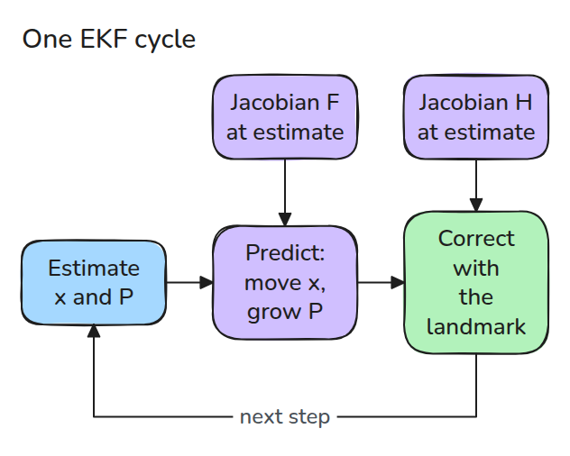
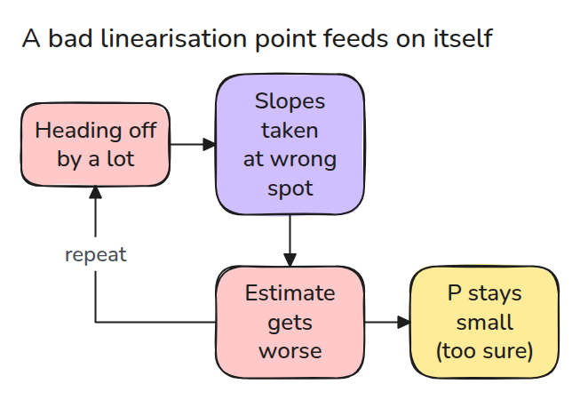
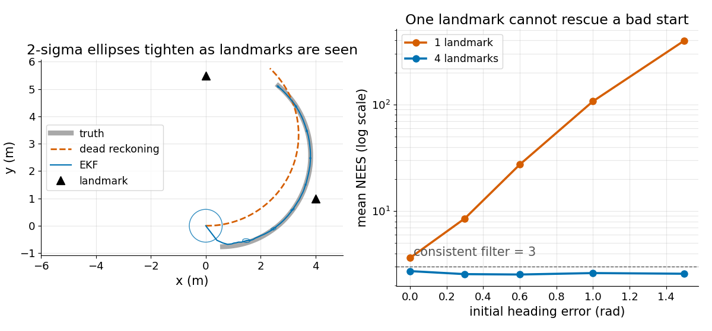

# Extended Kalman Filter

> Linearise the model at your current estimate and run a Kalman filter on that, which works only while the estimate is close enough to the truth.

**Type:** Build   **Prerequisites:** 07/02 Kalman Filter, 08/01 Differential Drive and Odometry   **Time:** ~15 minutes

## In Plain Words

A robot drives in a circle, measuring how far a post is and in which direction. To predict the next measurements it must know which way it faces, and a badly wrong guess spoils the prediction and the correction built on it.

An extended Kalman filter swaps the curved motion for a straight-line rule at its current estimate. The rule only holds near the truth. Far away, the filter can report small uncertainty while its real error grows.

## The Problem

The Kalman filter of 07/02 needs `x' = F x`, but a turning robot has its heading (the way it faces) inside every `cos` and `sin`, so no constant `F` exists. With a heading guess 1 rad off and one landmark (a post at a known place) in view, the filter drifts away while reporting a small covariance.

## The Concept



*Both Jacobians (slopes) are evaluated at the current estimate, because the true state is unknown.*

The state is `[x, y, heading]`; the robot moves with speed `v` and turn rate `w` along a curve `f(x, u)`. `F`, its matrix of slopes (the Jacobian), says how a small state change changes the next state. A landmark at a known place gives range and bearing `h(x)` (distance, direction) with slope matrix `H`. Covariance is predicted by `P = F P F^T + Q` and corrected by the Kalman update with `H`. Bearing differences are wrapped into `[-pi, pi]`, since 359 and -1 degrees are one direction.



*A wrong heading gives a wrong Jacobian, a wrong correction, and a wronger heading. One range and bearing reading cannot tell position error from heading error, so one landmark never fixes it.*

NEES, `e^T P^-1 e`, with `e` the estimate minus truth, is the error in units of the filter's own claimed uncertainty. Averaged over runs it should equal the state size, 3.



*Left: the EKF follows the truth, dead reckoning (no corrections) bends away. Right: against starting heading error, NEES stays near 3 with four landmarks and grows from about 4 to several hundred with one.*


*Both start 1 rad off in heading; watch the translucent estimate. With one post (blue) NEES averages 100.5 over 30 runs and the estimate ends 2.8 m off, though its plus or minus 2 sigma disc (claimed spread) stays small. With four (green) NEES averages 2.7 and it stays on the robot. 1 m is drawn as 0.5 m.*

## Build It

```python
def jac_h(x, lm):
    dx, dy = lm - x[:2]
    q, r = dx*dx + dy*dy, np.hypot(dx, dy)
    return np.array([[-dx/r, -dy/r, 0], [dy/q, -dx/q, -1]])

H = jac_h(x, lm)                       # at the estimate
K = P @ H.T @ np.linalg.inv(H @ P @ H.T + R)
y = z - h(x, lm); y[1] = wrap(y[1])
x = x + K @ y
```

Tests compare both Jacobians with finite differences, check NEES near 3 over 150 seeds, and check that one landmark with a 1.5 rad heading error multiplies NEES over 20 times.

```bash
cd robotics-engineering-from-scratch
python3 -m pytest phases/07-state-estimation/05-extended-kalman-filter -q
python3 phases/07-state-estimation/05-extended-kalman-filter/code/main.py
```

## Use It

ROS's `robot_localization` ships an extended Kalman filter node (`ekf_node` in its ROS 2 branch, `ekf_localization_node` in the older ROS 1 docs). Compare its covariance with this NEES check.

Sources: robot_localization state estimation nodes, https://docs.ros.org/en/melodic/api/robot_localization/html/state_estimation_nodes.html (opened 2026-11-09), and the `ekf_node` target in the package's `CMakeLists.txt`, https://github.com/cra-ros-pkg/robot_localization (opened 2026-11-10).

## Ship It

`outputs/skill-ekf-consistency-check.md` reviews an EKF for wrong Jacobians, unwrapped angles and overconfident covariance.

## Exercises

1. Drop the minus sign in `jac_f` and watch NEES.
2. Add a second landmark and find the smallest heading error that still diverges.
3. Inflate `Q` by 4 and compare NEES with 3.
