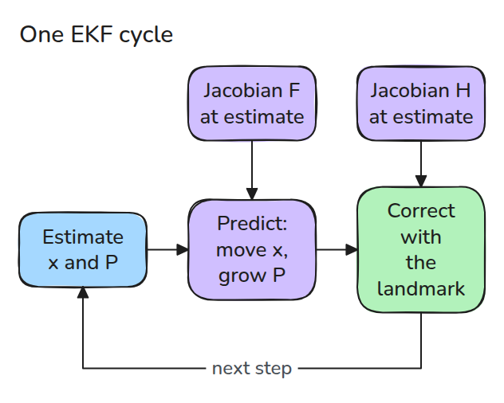
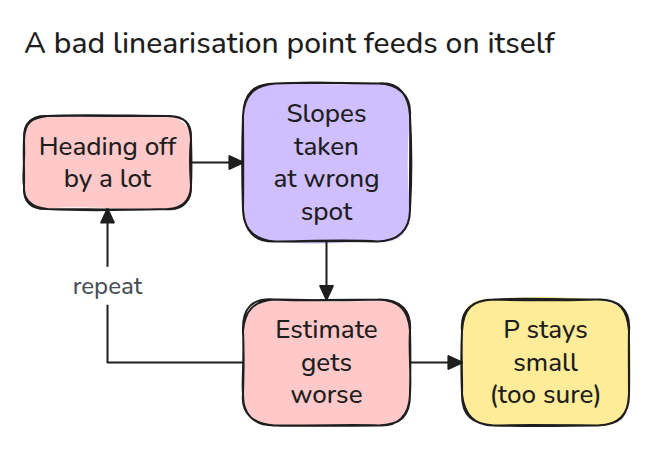
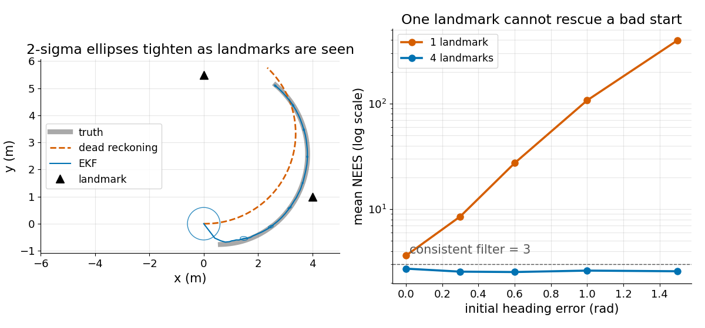

# 확장 칼만 필터 (Extended Kalman Filter)

> 모델을 현재 추정값에서 선형화하고 그 위에서 Kalman filter를 돌립니다. 추정값이 진짜 값에 충분히 가까울 때만 잘 맞습니다.

**유형:** 만들기   **선수 지식:** 07/02 칼만 필터, 08/01 차동 구동과 오도메트리   **시간:** 약 15분

## 쉽게 말하면

로봇이 원을 그리며 달리면서 기둥이 얼마나 멀리 어느 방향에 있는지 재요. 다음 측정값을 예측하려면 로봇이 어느 쪽을 보고 있는지 알아야 해요. 이 짐작이 크게 틀리면 예측이 어긋나고 그 위에서 한 보정도 어긋나요.

extended Kalman filter는 휘어진 움직임을 현재 추정값에서의 직선 규칙으로 바꿔요. 이 규칙은 진짜 값 가까이에서만 맞아요. 멀어지면 실제 오차는 커지는데도 filter는 불확실성이 작다고 보고할 수 있어요.

## 문제

07/02의 Kalman filter는 `x' = F x` 꼴을 요구합니다. 그런데 회전하는 로봇은 heading(바라보는 방향)이 `cos`와 `sin` 안에 들어 있어서 상수 `F`가 없습니다.

heading 추정이 1 rad 틀렸고 landmark(위치를 아는 기둥)가 하나뿐이면 필터는 공분산이 작다고 보고하면서 엉뚱한 곳으로 갑니다.

## 개념



*두 Jacobian(기울기) 모두 현재 추정값에서 계산합니다. 진짜 상태를 모르기 때문입니다.*

상태는 `[x, y, heading]`이고 로봇은 속도 `v`와 회전 속도 `w`로 곡선 `f(x, u)`를 따라 움직입니다. 그 기울기 행렬인 Jacobian `F`는 상태가 조금 바뀌면 다음 상태가 얼마나 바뀌는지를 알려 줍니다.

위치를 아는 landmark는 range와 bearing(거리와 방향) `h(x)`를 주고 그 기울기 행렬이 `H`입니다. 공분산은 `P = F P F^T + Q`로 예측하고 `H`를 쓴 Kalman update로 보정합니다.

bearing 차이는 `[-pi, pi]`로 wrap해야 합니다. 359도와 -1도는 같은 방향이기 때문입니다.



*heading이 틀리면 Jacobian이 틀리고 보정이 틀려서 heading이 더 틀어집니다. range와 bearing 측정 하나로는 위치 오차와 heading 오차를 가를 수 없어서 landmark 하나로는 끝내 바로잡지 못합니다.*

NEES `e^T P^-1 e`에서 `e`는 추정값에서 진짜 값을 뺀 오차이고 NEES는 filter가 스스로 주장한 불확실성을 단위로 잰 오차입니다.

여러 번 돌려 평균하면 상태 차원인 3이 되어야 합니다.



*왼쪽은 EKF가 진짜 경로를 따라가고 dead reckoning(보정 없음)은 휘어지는 모습입니다. 오른쪽은 처음 heading 오차에 따라 landmark가 네 개면 NEES가 3 근처에 머물고 하나면 약 4에서 수백까지 커지는 모습입니다.*


*둘 다 heading을 1 rad 틀리게 시작합니다. 기둥 하나(파랑)는 NEES가 30번 평균 100.5이고 추정이 2.8 m 벗어나도 ±2 sigma 원(주장하는 퍼짐)은 작습니다. 기둥 넷(초록)은 평균 2.7이고 로봇 위에 머뭅니다. 1 m는 0.5 m로 그렸습니다.*

## 만들기

```python
def jac_h(x, lm):
    dx, dy = lm - x[:2]
    q, r = dx*dx + dy*dy, np.hypot(dx, dy)
    return np.array([[-dx/r, -dy/r, 0], [dy/q, -dx/q, -1]])

H = jac_h(x, lm)                       # at the estimate
K = P @ H.T @ np.linalg.inv(H @ P @ H.T + R)
y = z - h(x, lm); y[1] = wrap(y[1])
x = x + K @ y
```

테스트는 두 Jacobian을 유한차분과 비교합니다. 시드 150개에서 NEES가 3 근처인지도 봅니다. 또 landmark 하나와 1.5 rad heading 오차에서 NEES가 20배 넘게 커지는지 확인합니다.

```bash
cd robotics-engineering-from-scratch
python3 -m pytest phases/07-state-estimation/05-extended-kalman-filter -q
python3 phases/07-state-estimation/05-extended-kalman-filter/code/main.py
```

## 실제 도구로 보기

ROS의 `robot_localization`은 extended Kalman filter 노드를 제공합니다. ROS 2 브랜치에서는 `ekf_node`이고 예전 ROS 1 문서에서는 `ekf_localization_node`입니다. 이 레슨의 NEES 검사와 공분산 동작을 비교해 보세요.

출처는 robot_localization의 state estimation nodes 문서(https://docs.ros.org/en/melodic/api/robot_localization/html/state_estimation_nodes.html, 2026년 11월 9일 확인)입니다.

다른 출처는 패키지 `CMakeLists.txt`의 `ekf_node` 타깃(https://github.com/cra-ros-pkg/robot_localization, 2026년 11월 10일 확인)입니다.

## 결과물

`outputs/skill-ekf-consistency-check.md`는 EKF의 잘못된 Jacobian, wrap 안 된 각도, 과신하는 공분산을 점검합니다.

## 연습 문제

1. `jac_f`에서 마이너스 부호를 빼 보고 NEES를 보세요.
2. landmark 하나인 경우에 두 번째를 더하고 여전히 발산하는 가장 작은 heading 오차를 찾으세요.
3. `Q`를 4배로 키우고 NEES를 3과 비교하세요.
