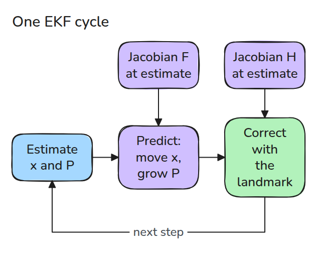
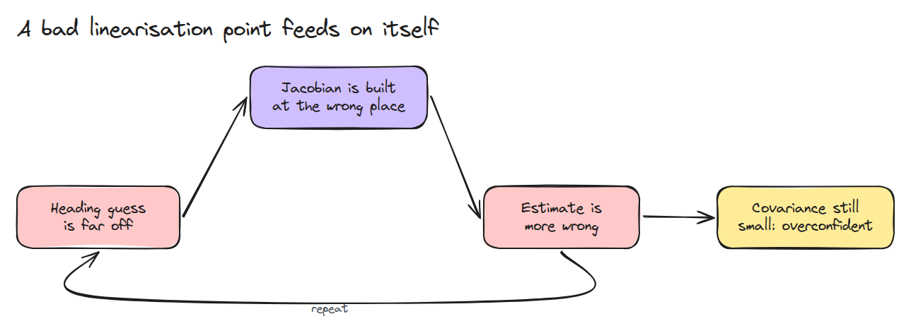

# 확장 칼만 필터 (Extended Kalman Filter)

> 곡선으로 달리는 로봇이 위치를 추적하는 법과 잘못된 출발이 어떻게 확신에 찬 오류가 되는지 배웁니다.

**유형:** 만들기   **선수 지식:** 07/02 칼만 필터, 08/01 차동 구동과 오도메트리   **시간:** 약 15분

## 쉽게 말하면

로봇이 기둥이 얼마나 멀리 어느 방향에 있는지 재요.

extended Kalman filter는 굽은 움직임을 현재 추정값에서 직선 규칙으로 바꿔요. 이 규칙은 진짜 값 가까이에서만 맞아요. 멀어지면 필터는 여전히 작은 불확실성을 보고하는데 실제 오차는 커져요.

## 핵심 용어

- **EKF**: extended Kalman filter로 현재 추정값에서 모델을 직선으로 펴는 Kalman filter입니다.
- **Linearise**: 곡선을 한 점에서의 직선 근사로 바꾸는 일입니다.
- **Jacobian (`F`, `H`)**: 상태가 조금 변할 때 출력이 얼마나 변하는지 알려 주는 기울기 matrix입니다.
- **Heading**: 로봇이 바라보는 방향입니다.
- **Landmark**: 로봇이 재는 위치를 아는 기둥입니다.
- **NEES**: 필터가 스스로 주장하는 불확실성을 단위로 잰 오차입니다. 평균이 상태 크기와 같아야 합니다.

## 문제

로봇이 곡선으로 달리면서 기둥 하나를 landmark로 삼아 자기 위치를 추적합니다. heading 추측이 1 rad 틀린 채 출발하면 필터는 작은 covariance를 보고하면서 멀어집니다.
heading이 모든 `cos`와 `sin` 안에 있어서 `x' = F x`를 만족하는 상수 `F`가 없습니다.

## 개념

확신에 차서 틀린 로봇은 자신 없어 하는 로봇보다 더 위험합니다.



*두 Jacobian은 모두 현재 추정값에서 계산합니다.*

state는 `[x, y, heading]`이고 로봇은 속도 `v`와 회전율 `w`로 곡선 `f(x, u)`를 따라 움직입니다. `F`는 움직임의 Jacobian이고 `H`는 landmark의 range와 bearing `h(x)`의 Jacobian입니다.
covariance는 `P = F P F^T + Q`로 predict하고 그다음 correct합니다. bearing 차이는 감쌉니다.



*틀린 heading은 틀린 Jacobian을, 틀린 보정을, 더 틀린 heading을 만듭니다. 읽기 하나로는 위치 오차와 heading 오차를 가를 수 없습니다.*

NEES `e^T P^-1 e`는 여러 번 실행하면 평균이 상태 크기인 3이 됩니다.


*왼쪽은 EKF가 진짜 궤적을 따르고 dead reckoning이 휘어지는 모습입니다. 오른쪽은 landmark 네 개에서는 NEES가 3 근처에 머물고 하나일 때는 약 4에서 수백으로 커지는 모습입니다.*


*둘 다 heading이 1 rad 틀린 채 시작합니다. 기둥 하나(파랑)는 30번 실행에서 NEES 평균이 100.5이고 추정이 2.8 m 어긋난 채 끝나며 2 sigma 원은 작게 남습니다. 넷(초록)은 2.7입니다. 1 m는 0.5 m로 그렸습니다.*

## 만들기

```python
def jac_h(x, lm):
    dx, dy = lm - x[:2]
    q, r = dx*dx + dy*dy, np.hypot(dx, dy)
    return np.array([[-dx/r, -dy/r, 0], [dy/q, -dx/q, -1]])

H = jac_h(x, lm)                       # at the estimate
K = P @ H.T @ np.linalg.inv(H @ P @ H.T + R)
y = z - h(x, lm); y[1] = wrap(y[1])
x = x + K @ y
```

테스트는 두 Jacobian을 유한 차분과 견주고 NEES가 150개 seed에서 3 근처인지 확인하며 landmark 하나와 1.5 rad heading 오차에서 20배 넘게 커지는지 확인합니다.

```bash
cd robotics-engineering-from-scratch
python3 -m pytest phases/07-state-estimation/05-extended-kalman-filter -q
python3 phases/07-state-estimation/05-extended-kalman-filter/code/main.py
```

## 실제 도구로 보기

ROS의 `robot_localization`은 `ekf_node`를 제공합니다(ROS 1 문서에서는 `ekf_localization_node`).

출처: robot_localization state estimation nodes, https://docs.ros.org/en/melodic/api/robot_localization/html/state_estimation_nodes.html (2026년 11월 9일 확인)과 패키지의 `CMakeLists.txt`에 있는 `ekf_node` 타깃, https://github.com/cra-ros-pkg/robot_localization (2026년 11월 10일 확인).

## 결과물

`outputs/skill-ekf-consistency-check.md`는 EKF에서 틀린 Jacobian과 과신을 점검합니다.

## 연습 문제

1. `jac_f`의 마이너스 부호를 지우고 NEES를 보세요.
2. landmark를 하나 더하고 그래도 발산하는 가장 작은 heading 오차를 찾으세요.
3. `Q`를 4배로 키우고 NEES를 비교하세요.
