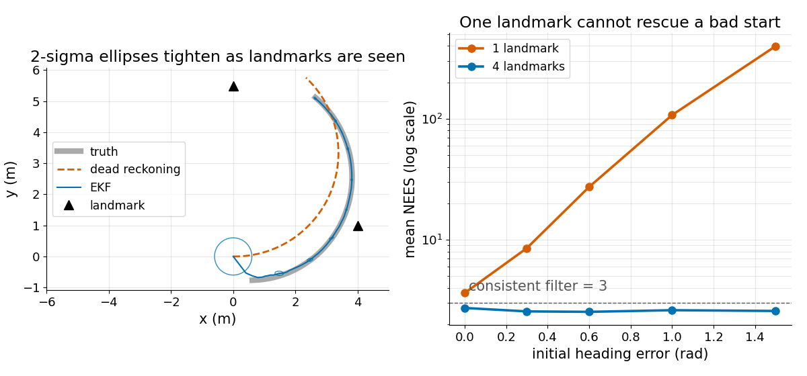

# 확장 칼만 필터 (Extended Kalman Filter)

> 곡선으로 달리는 로봇이 위치를 추적하는 법과 잘못된 출발이 어떻게 확신에 찬 오류가 되는지 배웁니다.

**유형:** 만들기   **선수 지식:** 07/02 칼만 필터   **시간:** 약 15분

## 쉽게 말하면

로봇이 굽은 길을 달리면서 기둥이 얼마나 멀리 있는지 재요.

필터는 로봇이 어디 있는지 추적하는 프로그램이고 그 곡선의 짧은 한 토막이 곧은 것처럼 가정해요. 이 가정은 로봇이 실제로 있는 곳 근처에서만 맞아요. 멀어지면 필터는 여전히 거의 확실하다고 말하는데 실제 오차는 커져요.

## 핵심 용어

- **EKF**: extended Kalman filter로 로봇이 어디 있는지 추적하며 현재 추정값에서 직선 규칙을 쓰는 프로그램입니다.
- **Linearise**: 곡선을 한 점에서의 직선 근사로 바꾸는 일입니다.
- **Heading**: 로봇이 바라보는 방향입니다.
- **Jacobian (`F`, `H`)**: 기울기 표(matrix)입니다. 로봇의 위치와 방향이 조금 변할 때 필터의 예측이 얼마나 변하는지 알려 줍니다.
- **Landmark**: 로봇이 재는 위치를 아는 기둥입니다.
- **NEES**: 필터의 불확실성이 실제 오차와 맞는지 보는 점수입니다. 정직한 필터는 추적하는 값의 개수만큼, 여기서는 약 3을 받습니다.

## 문제

로봇이 굽은 길을 달리면서 기둥 하나를 landmark로 삼아 자기 위치를 추적합니다. heading 추측이 틀린 채 출발하면 필터는 거의 확실하다고 말하면서 멀어집니다.

## 개념

확신에 차서 틀린 로봇은 자신 없어 하는 로봇보다 더 위험합니다.


*직선 규칙은 매 주기 다시 만듭니다.*

Kalman filter는 직선 움직임이 필요한데 로봇의 실제 경로는 곡선입니다. extended filter는 현재 추정값 둘레의 곡선 한 토막이 곧은 것처럼 가정하고 매 주기 그 토막을 다시 그립니다.


*틀린 heading은 틀린 규칙을, 틀린 보정을, 더 틀린 heading을 만듭니다.*

NEES는 필터가 주장하는 불확실성이 실제 오차와 맞는지 확인합니다.



*왼쪽은 EKF가 진짜 궤적을 따르는 모습입니다. 오른쪽은 landmark 네 개에서는 NEES가 점선(3) 근처에 머물고 하나일 때는 출발 오차가 커질수록 그 위로 높이 치솟는 모습입니다.*


*둘 다 heading이 틀린 채 시작합니다. 이 그림은 기둥 하나(파랑)와 넷(초록)을 견주고 맨 위 영상은 셋을 씁니다. 기둥이 하나이면 추측한 위치가 멀리 어긋난 채 끝나는데 그 둘레의 작은 원은 필터가 확신한다고 말합니다. 넷이면 로봇 위에 머뭅니다.*

<details><summary>The math (optional)</summary>

state는 `[x, y, heading]`이고 로봇은 속도 `v`와 회전율 `w`로 곡선 `f(x, u)`를 따라 움직입니다. `F`는 움직임의 Jacobian이고 `H`는 landmark의 range와 bearing `h(x)`의 Jacobian입니다.
covariance는 `P = F P F^T + Q`로 predict합니다. bearing 차이는 wrap합니다. NEES `e^T P^-1 e`의 평균은 상태 크기인 3입니다(위치 둘, 방향 하나).
heading 추측이 1 rad 틀리고 landmark가 하나이면 30번 실행에서 NEES 평균이 100.5이고 추정이 2.8 m 어긋난 채 끝납니다. 넷이면 2.7입니다. 그림에서 NEES는 landmark 네 개에서 3 근처에 머물고 하나일 때는 약 4에서 수백으로 커집니다.
테스트는 150개 seed에서 NEES가 3 근처인지, landmark 하나와 1.5 rad heading 오차에서 20배 넘게 커지는지 확인합니다. 1 m는 0.5 m로 그렸습니다.

</details>

## 만들기

```python
def jac_h(x, lm):
    dx, dy = lm - x[:2]
    q, r = dx*dx + dy*dy, np.hypot(dx, dy)
    return np.array([[-dx/r, -dy/r, 0], [dy/q, -dx/q, -1]])

H = jac_h(x, lm)                       # at the estimate
K = P @ H.T @ np.linalg.inv(H @ P @ H.T + R)
y = z - h(x, lm); y[1] = wrap(y[1])
x = x + K @ y
```

테스트는 두 Jacobian을 수치 기울기와 견줍니다.

```bash
cd robotics-engineering-from-scratch
python3 -m pytest phases/07-state-estimation/05-extended-kalman-filter -q
python3 phases/07-state-estimation/05-extended-kalman-filter/code/main.py
```

## 실제 도구로 보기

로봇 소프트웨어 패키지 `robot_localization`은 `ekf_node`를 제공합니다.

출처: robot_localization state estimation nodes, https://docs.ros.org/en/melodic/api/robot_localization/html/state_estimation_nodes.html (2026년 11월 9일 확인)과 패키지의 `CMakeLists.txt`에 있는 `ekf_node` 타깃, https://github.com/cra-ros-pkg/robot_localization (2026년 11월 10일 확인).

## 결과물

`outputs/skill-ekf-consistency-check.md`는 EKF의 과신을 점검합니다.

## 연습 문제

1. 움직임 Jacobian `jac_f`에서 마이너스 부호를 지우고 NEES를 보세요.
2. landmark를 하나 더하고 NEES를 보세요.
3. 움직임 잡음 숫자 `Q`를 4배로 키우고 NEES를 비교하세요.
