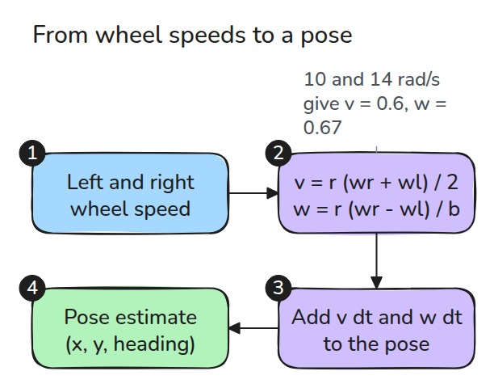
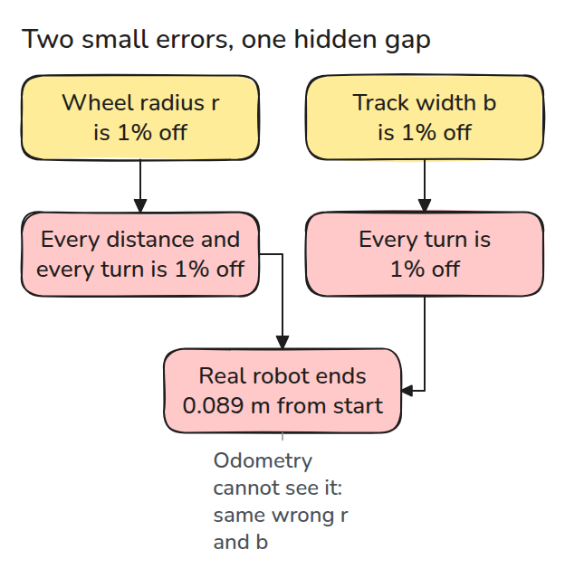
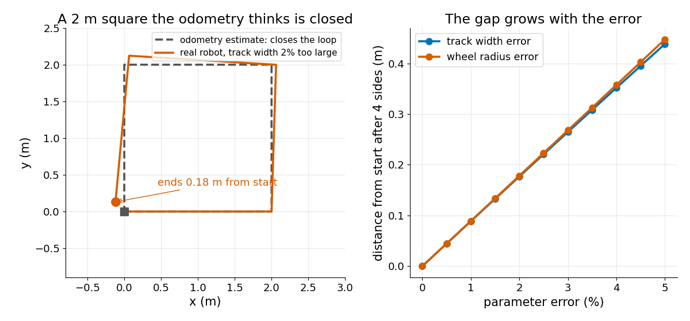

# Differential Drive and Odometry

> Wheel speeds give you a pose only if you know two lengths exactly, and the estimate cannot tell you when you do not.

**Type:** Build   **Prerequisites:** 01/01 Rotations and SE(3)   **Time:** ~15 minutes

## In Plain Words

Differential drive turns a robot by running its wheels at different speeds. Imagine walking a square but turning slightly less than [90°](https://mathworld.wolfram.com/RightAngle.html) at each corner. A notebook that records every turn as [90°](https://mathworld.wolfram.com/RightAngle.html) draws a closed square, although you miss the start.

A robot can make the same mistake. Wheel radius and the distance between the wheels determine distances and turns from wheel rotations. If planning and odometry use the same wrong values, the recorded path can close while the robot misses the start.

## The Problem

A mobile robot drives a 2 m square, and its odometry (a position guess from wheel turns) says it returned to the start. A tape measure says it stopped 18 cm away. The wheels turned as commanded, so two config numbers are wrong: wheel radius and wheel spacing.

## The Concept



*Wheel speeds become a forward speed and a turn rate, which add up to the pose.*

`wl` and `wr` are the spin speeds of the left and right wheels in rad/s, `r` is the wheel radius and `b` the track width, the distance between the wheels. A wheel's edge moves `r` times its spin, so the forward speed is the average of the two edges, `v = r (wr + wl) / 2`. The turn rate is their difference over `b`, `w = r (wr - wl) / b`.

For example, `r = 0.05 m`, `b = 0.30 m`, left wheel 10 rad/s, right wheel 14. Then `v = 0.6 m/s` and `w = 0.67 rad/s`. The right wheel covers more ground, so the robot circles left with radius `v / w = 0.9 m`.


*Blue: 10 and 10 rad/s, straight. Green: 10 and 14, circling left.*

Dead reckoning (tracking position by adding up motion) adds each step's `v dt` and `w dt` to the pose.



*The estimate uses the same wrong `r` and `b` as the plan, so it closes the loop and hides the problem.*



*Left: dashed gray is what odometry believes, orange the real route. Right: the gap grows with the error.*

Say the real `b` is 2% larger than the config. Every real turn is then 2% smaller: each corner turns `a = 88.2°`, not 90°, so the four sides no longer cancel and the robot ends 0.18 m from the start. A wrong `r` scales every side and turn alike and opens the loop as much. The gap is `L |1 + e^(ia) + e^(2ia) + e^(3ia)|` for side length `L` (tested).

## Build It

```python
def wheels_to_twist(wl, wr, r, b):
    return r * (wr + wl) / 2, r * (wr - wl) / b

def dead_reckon(wl, wr, dt, r, b, pose0=(0.0, 0.0, 0.0)):
    v, w = wheels_to_twist(np.asarray(wl, float), np.asarray(wr, float), r, b)
    dth = w * dt
    step = v * dt * np.sinc(dth / (2 * np.pi))  # chord of the arc
    th = pose0[2] + np.cumsum(dth) - dth / 2
```

`square_wheels()` plans the square with nominal `r` and `b`. `closure_error()` replays it with other values.

```bash
cd robotics-engineering-from-scratch
python3 -m pytest phases/08-mobile-robots/01-differential-drive-and-odometry -q
python3 phases/08-mobile-robots/01-differential-drive-and-odometry/code/main.py
```

## Use It

ROS 2's diff_drive_controller needs `wheel_separation` and `wheel_radius`. Its docs say a wrong separation misbehaves in curves and a wrong radius changes the speed. `wheel_separation_multiplier` corrects it.

Sources: control.ros.org, diff_drive_controller user doc (jazzy), opened 2026-11-09.

## Ship It

`outputs/skill-odometry-calibration-check.md` turns a measured closure gap into a suspected parameter and a calibration run.

## Exercises

1. Give the wheels different radii and show that a line bends.
2. Drive the square clockwise and show the gap vector mirrors the counter-clockwise one.
3. Add 1% wheel slip on turns and find which error it looks like.
