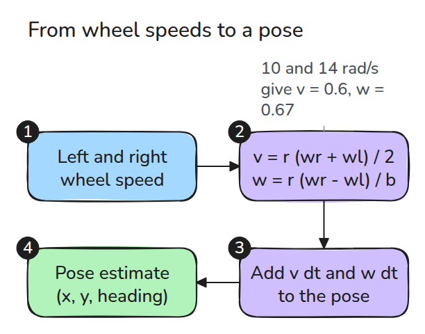
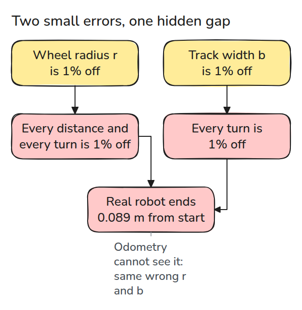
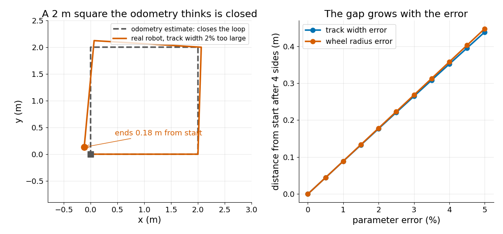

# Differential Drive and Odometry

> Learn why a robot can say it came home when it did not, and what causes it.

**Type:** Build   **Prerequisites:** none   **Time:** ~15 minutes

## In Plain Words

Walk a square but turn a little less than [90°](https://mathworld.wolfram.com/RightAngle.html) at each corner. A notebook that logs every turn as [90°](https://mathworld.wolfram.com/RightAngle.html) draws a closed square, yet you miss the start.

A robot with a wrong wheel size does the same.
Its notebook uses the same wrong value, so the path closes on paper.

## Key Terms

- **Differential drive**: a robot that steers by spinning its two wheels at different speeds.
- **Odometry**: a position guess made by adding up how far the wheels turned.
- **Wheel radius (`r`)**: the distance from a wheel's center to its edge.
- **Track width (`b`)**: the distance between the two wheels.

- **rad/s**: radians per second, a spin speed. One full turn is about 6.28 radians.

## The Problem

Picture a robot driving a square. Its record says it is back at the start, but a tape measure shows 18 cm. The wheels did what they were told, so the settings must be wrong: wheel radius and track width.

## The Concept

A robot that trusts a wrong position makes every later plan wrong too.

It counts how much each wheel turned. Equal turns mean a straight line. A faster wheel makes it curve toward the slower side.



*Wheel speeds in, forward speed and turn out.*


*Blue drives straight. Green curves left because its right wheel turns faster.*

Now make the settings slightly wrong. The robot still believes its own record, so the loop closes on paper. In reality the wheels are farther apart than the settings say, so every turn is a little too small and the four sides no longer cancel.



*Same mistake in notebook and commands, so the loop looks closed. Find the gap.*



*Gray is what the robot believes. Orange is where it really went.*

<details><summary>The math (optional)</summary>

`r` is the wheel radius and `b` the distance between the wheels. Forward speed is `v = r (wr + wl) / 2` and turn rate is `w = r (wr - wl) / b`. With `r = 0.05 m`, `b = 0.30 m` and wheels at 10 and 14 rad/s, `v = 0.6 m/s`, `w = 0.67 rad/s` and the circle has radius `v / w = 0.9 m`. If the real `b` is 2% larger, each turn is 88.2° instead of 90° and the robot ends 0.18 m from the start. The gap is `L |1 + e^(ia) + e^(2ia) + e^(3ia)|` (tested), where `L` is a side and `a` the turn angle.

</details>

## Build It

```python
def wheels_to_twist(wl, wr, r, b):
    return r * (wr + wl) / 2, r * (wr - wl) / b

def dead_reckon(wl, wr, dt, r, b, pose0=(0.0, 0.0, 0.0)):
    v, w = wheels_to_twist(np.asarray(wl, float), np.asarray(wr, float), r, b)
    dth = w * dt
    step = v * dt * np.sinc(dth / (2 * np.pi))  # chord of the arc
    th = pose0[2] + np.cumsum(dth) - dth / 2
```

`square_wheels()` plans the square. `closure_error()` replays it with other settings.

```bash
cd robotics-engineering-from-scratch
python3 -m pytest phases/08-mobile-robots/01-differential-drive-and-odometry -q
python3 phases/08-mobile-robots/01-differential-drive-and-odometry/code/main.py
```

## Use It

ROS 2, a robot software toolkit, has a ready-made wheeled-robot driver. It asks for the wheel spacing and size; a wrong spacing misbehaves in curves.

Sources: control.ros.org, diff_drive_controller user doc (jazzy), opened 2026-11-09.

## Ship It

`outputs/skill-odometry-calibration-check.md` turns a closure gap into a suspected setting.

## Exercises

1. Make the wheels slightly different sizes; watch a line bend.
2. Drive the square the other way; see which way the gap points.
3. Make one wheel slip a little. Compare the gap with the radius error and the track-width error.
