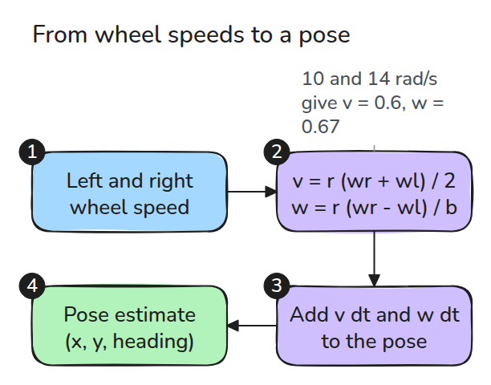
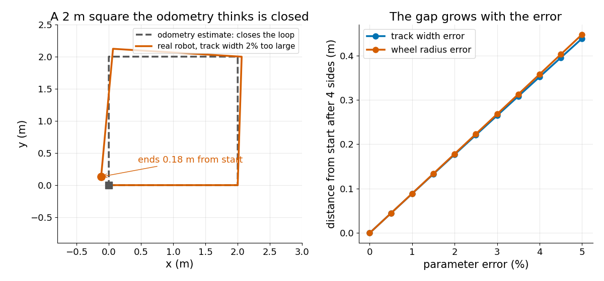

# 차동 구동과 Odometry (Differential Drive and Odometry)

> 로봇이 집에 돌아왔다고 말하는데 사실은 아닌 이유와 그 원인인 숫자 두 개를 알아봅니다.

**유형:** 만들기   **선수 지식:** 01/01 회전과 SE(3)   **시간:** 약 15분

## 쉽게 말하면

사각형으로 걷는데 모서리마다 [90도](https://mathworld.wolfram.com/RightAngle.html)보다 조금 덜 돈다고 해 보세요.
공책에는 매번 [90도](https://mathworld.wolfram.com/RightAngle.html)로 적으면 사각형이 닫혀도 나는 출발점에 못 돌아와요.

바퀴 크기가 틀린 로봇도 똑같아요.
공책이 같은 틀린 값을 쓰니 기록상으로는 길이 닫혀요.

## 핵심 용어

- **Differential drive**: 두 바퀴를 서로 다른 속도로 돌려서 방향을 바꾸는 로봇입니다.
- **Odometry**: 바퀴가 돈 만큼을 더해서 얻는 위치 추정값입니다.
- **Wheel radius (`r`)**: 바퀴 중심에서 가장자리까지의 거리입니다.
- **Track width (`b`)**: 두 바퀴 사이의 거리입니다.
- **Dead reckoning**: 아는 출발점에서 작은 움직임을 계속 더해서 위치를 추적하는 방법입니다.
- **rad/s**: 초당 radian으로 나타낸 회전 속도입니다. 한 바퀴는 약 6.28 radian입니다.

## 문제

로봇이 한 변이 2 m인 사각형을 그리며 달렸다고 상상해 보세요. odometry는 출발점으로 돌아왔다고 하지만 줄자로 재면 18 cm 떨어져 서 있습니다.

바퀴는 명령대로 돌았으므로 설정의 wheel radius나 track width가 틀린 것입니다.

## 개념

바퀴 숫자가 틀린 실제 로봇은 어긋난 위치를 믿고 그 위에 세운 계획도 모두 어긋납니다.



*속도를 더해 가면 자세(위치와 방향)가 됩니다.*

`wl`과 `wr`는 바퀴가 도는 속도(rad/s)입니다.
바퀴 가장자리는 도는 속도의 `r`배로 움직이므로 전진 속도는 양쪽 가장자리 속도의 평균인 `v = r (wr + wl) / 2`입니다. 회전율 `w`는 방향이 바뀌는 빠르기이고 가장자리 속도의 차이를 `b`로 나눈 `w = r (wr - wl) / b`입니다.

`r = 0.05 m`, `b = 0.30 m`이고 바퀴가 10과 14 rad/s라고 해 봅시다. 그러면 `v = 0.6 m/s`, `w = 0.67 rad/s`이고 로봇은 반지름 `v / w = 0.9 m`인 원을 그리며 왼쪽으로 돕니다.


*파랑은 10과 10 rad/s이고 초록은 10과 14 rad/s입니다.*


*같은 틀린 `r`과 `b`를 쓰므로 루프가 닫힙니다.*



*회색은 odometry가 믿는 경로이고 주황색은 실제 경로입니다.*

실제 `b`가 설정보다 2% 크다고 해 봅시다. 그러면 모서리마다 90도가 아니라 `a = 88.2°`만 돌아서 네 변이 상쇄되지 않고 로봇은 출발점에서 0.18 m 떨어져 끝납니다.
어긋난 거리는 `L |1 + e^(ia) + e^(2ia) + e^(3ia)|`이고 테스트로 확인했습니다. `L`은 한 변의 길이이고 `e^(ia)`는 `a`만큼 돌린 화살표입니다.

## 만들기

```python
def wheels_to_twist(wl, wr, r, b):
    return r * (wr + wl) / 2, r * (wr - wl) / b

def dead_reckon(wl, wr, dt, r, b, pose0=(0.0, 0.0, 0.0)):
    v, w = wheels_to_twist(np.asarray(wl, float), np.asarray(wr, float), r, b)
    dth = w * dt
    step = v * dt * np.sinc(dth / (2 * np.pi))  # chord of the arc
    th = pose0[2] + np.cumsum(dth) - dth / 2
```

`square_wheels()`는 기준값 `r`과 `b`로 사각형을 계획합니다. `closure_error()`는 같은 바퀴 명령을 다른 `r`과 `b`로 다시 재생합니다.

```bash
cd robotics-engineering-from-scratch
python3 -m pytest phases/08-mobile-robots/01-differential-drive-and-odometry -q
python3 phases/08-mobile-robots/01-differential-drive-and-odometry/code/main.py
```

## 실제 도구로 보기

ROS 2의 diff_drive_controller는 `wheel_separation`과 `wheel_radius`를 요구합니다. 문서는 separation이 틀리면 커브에서 이상하게 움직이고 radius가 틀리면 속도가 달라진다고 설명합니다.

출처: control.ros.org, diff_drive_controller 사용자 문서(jazzy), 2026년 11월 9일에 열어 확인했습니다.

## 결과물

`outputs/skill-odometry-calibration-check.md`는 잰 루프 어긋남을 의심되는 파라미터와 보정 주행으로 바꿔 줍니다.

## 연습 문제

1. 두 바퀴의 반지름을 다르게 주고 직선이 휘는 것을 보이세요.
2. 사각형을 시계 방향으로 달리고 어긋남이 반시계 방향일 때와 거울상임을 보이세요.
3. 회전할 때 바퀴가 1% 미끄러지게 하고 어느 오차처럼 보이는지 찾으세요.
