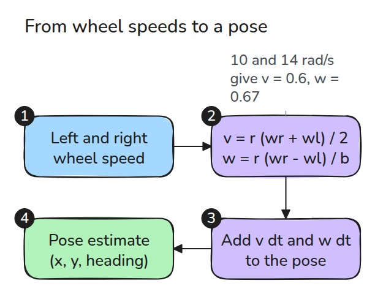
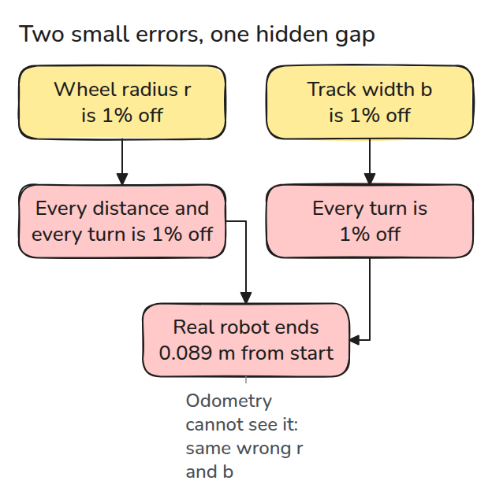
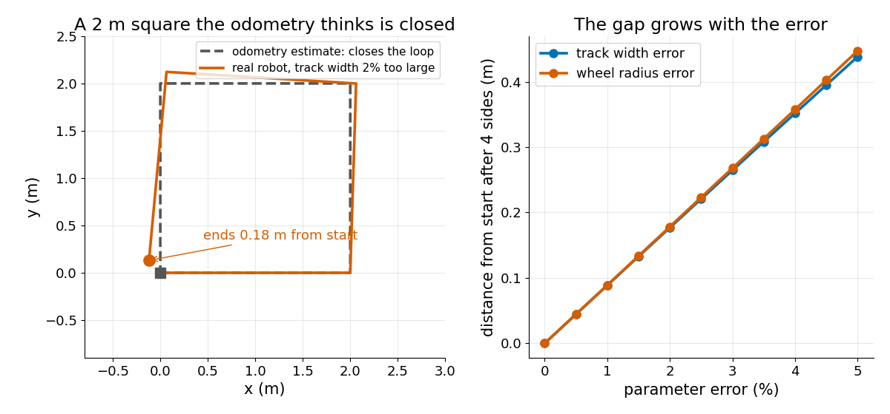

# 차동 구동과 Odometry (Differential Drive and Odometry)

> 바퀴 속도로 자세를 얻으려면 길이 두 개를 정확히 알아야 합니다. 추정값은 그 값이 틀렸다는 사실을 알려 주지 못합니다.

**유형:** 만들기   **선수 지식:** 01/01 회전과 SE(3)   **시간:** 약 15분

## 쉽게 말하면

differential drive는 양쪽 바퀴의 속도 차이로 방향을 바꿔요.
사각형으로 걷는데 모서리마다 [90도](https://mathworld.wolfram.com/RightAngle.html)보다 조금 덜 돈다고 해 보세요.
공책에는 매번 [90도](https://mathworld.wolfram.com/RightAngle.html)로 그리면 사각형이 닫혀도 나는 출발점에 못 돌아와요.

로봇은 wheel radius와 양쪽 바퀴 사이 간격으로 이동 거리와 회전 각도를 계산해요.
계획할 때와 odometry로 이동을 기록할 때 같은 잘못된 값을 쓰면 기록상으로는 출발점에 돌아와도 실제로는 빗나갈 수 있어요.

## 문제

모바일 로봇이 한 변이 2 m인 사각형을 달렸습니다. odometry(바퀴가 돈 만큼을 더해서 얻는 위치 추정값)는 출발점으로 돌아왔다고 하는데 줄자로 재면 18 cm 떨어져 서 있습니다.

바퀴는 명령대로 돌았으므로 설정 파일의 숫자 두 개가 틀린 것입니다. 바퀴 반지름(wheel radius)과 두 바퀴 사이 거리(track width)입니다.

## 개념



*바퀴 속도가 전진 속도와 회전율이 되고 이것을 더해 가면 자세가 됩니다.*

`wl`과 `wr`는 왼쪽과 오른쪽 바퀴가 도는 속도(rad/s)입니다. `r`은 wheel radius이고 `b`는 두 바퀴 사이 거리인 track width입니다.
바퀴 가장자리는 도는 속도의 `r`배로 움직이므로 전진 속도는 양쪽 가장자리 속도의 평균인 `v = r (wr + wl) / 2`입니다. 회전율은 가장자리 속도의 차이를 `b`로 나눈 `w = r (wr - wl) / b`입니다.

예를 들어 `r = 0.05 m`, `b = 0.30 m`이고 왼쪽 바퀴가 10 rad/s, 오른쪽 바퀴가 14 rad/s라고 해 봅시다. 그러면 `v = 0.6 m/s`, `w = 0.67 rad/s`입니다. 오른쪽 바퀴가 더 멀리 가므로 로봇은 반지름 `v / w = 0.9 m`인 원을 그리며 왼쪽으로 돕니다.


*파란 로버는 10과 10 rad/s로 직진하고 초록 로버는 10과 14 rad/s로 왼쪽으로 원을 그립니다.*

dead reckoning(움직임을 더해 위치를 추정하는 방법)은 매 step의 `v dt`와 `w dt`를 자세에 더합니다.



*추정값은 계획과 같은 틀린 `r`과 `b`를 쓰므로 루프를 닫아 버리고 문제를 드러내지 못합니다.*



*왼쪽의 회색 점선은 odometry가 믿는 사각형이고 주황색 선은 실제 경로입니다. 오른쪽은 오차가 클수록 어긋난 거리도 커지는 모습입니다.*

실제 `b`가 설정보다 2% 크다고 해 봅시다. 그러면 실제 회전은 계획보다 2% 작아서 모서리마다 90도가 아니라 `a = 88.2°`만 돕니다.
네 변이 더는 서로 상쇄되지 않아 로봇은 출발점에서 0.18 m 떨어져 끝납니다. `r`이 틀리면 모든 변과 회전이 같은 비율로 틀려서 똑같이 크게 어긋납니다. 어긋난 거리는 한 변의 길이 `L`에 대해 `L |1 + e^(ia) + e^(2ia) + e^(3ia)|`이고 테스트로 확인했습니다.

## 만들기

```python
def wheels_to_twist(wl, wr, r, b):
    return r * (wr + wl) / 2, r * (wr - wl) / b

def dead_reckon(wl, wr, dt, r, b, pose0=(0.0, 0.0, 0.0)):
    v, w = wheels_to_twist(np.asarray(wl, float), np.asarray(wr, float), r, b)
    dth = w * dt
    step = v * dt * np.sinc(dth / (2 * np.pi))  # chord of the arc
    th = pose0[2] + np.cumsum(dth) - dth / 2
```

`square_wheels()`는 기준값 `r`과 `b`로 사각형을 계획합니다. `closure_error()`는 같은 바퀴 명령을 다른 `r`과 `b`로 다시 재생합니다.

```bash
cd robotics-engineering-from-scratch
python3 -m pytest phases/08-mobile-robots/01-differential-drive-and-odometry -q
python3 phases/08-mobile-robots/01-differential-drive-and-odometry/code/main.py
```

## 실제 도구로 보기

ROS 2의 diff_drive_controller는 `wheel_separation`과 `wheel_radius`를 요구합니다. 문서는 separation이 틀리면 커브에서 로봇이 이상하게 움직이고 radius가 틀리면 기대보다 빠르거나 느리게 움직인다고 설명합니다. 보정 계수인 `wheel_separation_multiplier`도 있습니다.

출처: control.ros.org, diff_drive_controller 사용자 문서(jazzy), 2026년 11월 9일에 열어 확인했습니다.

## 결과물

`outputs/skill-odometry-calibration-check.md`는 잰 루프 어긋남을 의심되는 파라미터와 보정 주행으로 바꿔 줍니다.

## 연습 문제

1. 두 바퀴의 반지름을 다르게 주고 직선이 휘는 것을 보이세요.
2. 사각형을 시계 방향으로 달리고 어긋남 벡터가 반시계 방향으로 달렸을 때의 어긋남 벡터와 거울상임을 보이세요.
3. 회전할 때 바퀴가 1% 미끄러지게 하고 어느 오차처럼 보이는지 찾으세요.
