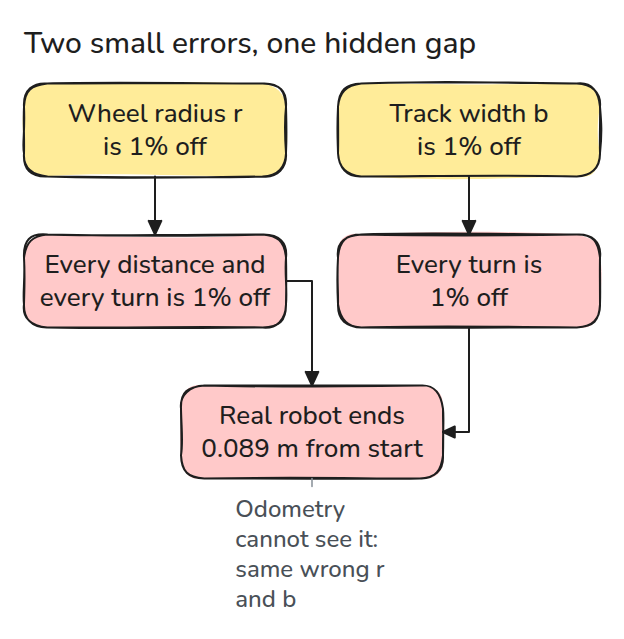

# 차동 구동과 Odometry (Differential Drive and Odometry)

> 로봇이 집에 돌아왔다고 말하는데 사실은 아닌 이유와 그 원인인 숫자 두 개를 알아봅니다.

**유형:** 만들기   **선수 지식:** 없음   **시간:** 약 15분

## 쉽게 말하면

사각형으로 걷는데 모서리마다 [90도](https://mathworld.wolfram.com/RightAngle.html)보다 조금 덜 돈다고 해 보세요.
공책에는 매번 [90도](https://mathworld.wolfram.com/RightAngle.html)로 적으면 사각형이 닫혀도 나는 출발점에 못 돌아와요.

바퀴 크기가 틀린 로봇도 똑같아요.
공책이 같은 틀린 값을 쓰니 기록상으로는 길이 닫혀요.

## 핵심 용어

- **Differential drive**: 두 바퀴를 서로 다른 속도로 돌려서 방향을 바꾸는 로봇입니다.
- **Odometry**: 바퀴가 돈 만큼을 더해서 얻는 위치 추정값입니다.
- **Wheel radius (`r`)**: 바퀴 중심에서 가장자리까지의 거리입니다.
- **Track width (`b`)**: 두 바퀴 사이의 거리입니다.

- **rad/s**: 초당 radian으로 나타낸 회전 속도입니다. 한 바퀴는 약 6.28 radian입니다.

## 문제

로봇이 사각형을 따라 달렸다고 상상해 보세요. 로봇의 기록은 출발점으로 돌아왔다고 하지만 줄자로 재면 18 cm입니다. 바퀴는 명령대로 돌았으므로 설정이 틀린 것입니다. 바퀴 반지름(wheel radius)과 track width입니다.

## 개념

틀린 위치를 믿는 로봇은 그 뒤의 계획도 모두 틀립니다.

로봇은 바퀴가 얼마나 돌았는지 세어서 얼마나 움직였는지 계산합니다. 두 바퀴가 똑같이 돌면 직진합니다. 한쪽 바퀴가 더 빨리 돌면 느린 쪽으로 휘어 돕니다.


*바퀴 속도가 들어가고 전진 속도와 회전이 나옵니다.*


*파랑은 직진합니다. 초록은 오른쪽 바퀴가 더 빨리 돌아서 왼쪽으로 휩니다.*

이제 설정을 아주 조금 틀리게 해 봅시다. 로봇은 자기 기록을 그대로 믿으므로 종이 위에서는 길이 닫힙니다. 실제로는 바퀴가 설정보다 더 멀리 떨어져 있어서 모든 회전이 조금씩 모자라고 네 변이 서로 상쇄되지 않습니다.



*공책과 명령이 같은 실수를 하므로 루프가 닫힌 것처럼 보입니다. 틈을 찾아보세요.*


*회색은 로봇이 믿는 경로이고 주황색은 실제로 간 경로입니다.*

<details><summary>The math (optional)</summary>

`r`은 바퀴 반지름이고 `b`는 두 바퀴 사이의 거리입니다.
전진 속도는 `v = r (wr + wl) / 2`이고 회전율은 `w = r (wr - wl) / b`입니다.
`r = 0.05 m`, `b = 0.30 m`이고 바퀴가 10과 14 rad/s이면 `v = 0.6 m/s`, `w = 0.67 rad/s`이고 원의 반지름은 `v / w = 0.9 m`입니다.
실제 `b`가 2% 크면 모서리마다 90°가 아니라 88.2°만 돌아서 로봇은 출발점에서 0.18 m 떨어져 끝납니다.
어긋난 거리는 `L |1 + e^(ia) + e^(2ia) + e^(3ia)|`이고 테스트로 확인했습니다.
`L`은 한 변이고 `a`는 회전 각도입니다.

</details>

## 만들기

```python
def wheels_to_twist(wl, wr, r, b):
    return r * (wr + wl) / 2, r * (wr - wl) / b

def dead_reckon(wl, wr, dt, r, b, pose0=(0.0, 0.0, 0.0)):
    v, w = wheels_to_twist(np.asarray(wl, float), np.asarray(wr, float), r, b)
    dth = w * dt
    step = v * dt * np.sinc(dth / (2 * np.pi))  # chord of the arc
    th = pose0[2] + np.cumsum(dth) - dth / 2
```

`square_wheels()`는 사각형을 계획하고 `closure_error()`는 다른 설정으로 그것을 다시 재생합니다.

```bash
cd robotics-engineering-from-scratch
python3 -m pytest phases/08-mobile-robots/01-differential-drive-and-odometry -q
python3 phases/08-mobile-robots/01-differential-drive-and-odometry/code/main.py
```

## 실제 도구로 보기

ROS 2는 로봇 소프트웨어 도구 모음이고 바퀴 달린 로봇용 완성된 드라이버가 있습니다. 이것은 바퀴 간격과 크기를 요구합니다. 문서는 간격이 틀리면 커브에서 이상하게 움직인다고 설명합니다.

출처: control.ros.org, diff_drive_controller 사용자 문서(jazzy), 2026년 11월 9일에 열어 확인했습니다.

## 결과물

`outputs/skill-odometry-calibration-check.md`는 잰 루프 어긋남을 의심되는 파라미터와 보정 주행으로 바꿔 줍니다.

## 연습 문제

1. 두 바퀴 크기를 조금 다르게 하고 직선이 휘는 것을 보세요.
2. 사각형을 반대 방향으로 달리고 어긋남이 어느 쪽을 가리키는지 보세요.
3. 바퀴 하나가 조금 미끄러지게 해 보세요. 그 틈을 radius 오차와 track width 오차와 비교하세요.
