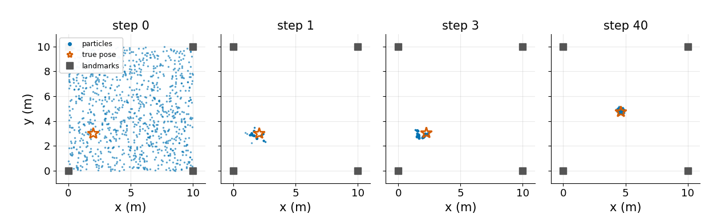

# Particle Filter Localisation

> Learn how a lost robot, even one picked up and moved, finds where it is by keeping many guesses.

**Type:** Build   **Prerequisites:** 08/01 Differential Drive and Odometry   **Time:** ~15 minutes

## In Plain Words

A rover stands in a room with four posts and measures its distance to each. It keeps many guesses of where it is, copies the guesses that match, drops the rest and moves them all as far as it drove.

Now someone carries the rover to another corner. Every old guess is far from the new spot. A few random guesses across the room give new measurements something to find.

## Key Terms

- **Particle**: one guess of the robot's pose, `(x, y, heading)`.
- **Particle filter**: a crowd of particles that is moved, scored by measurements and resampled.
- **Landmark**: an object at a known place, like a post, whose distance the robot can measure.
- **Weight**: a score for how well a particle's predicted distances match the measured ones.
- **Resampling**: copying high-weight particles and dropping low-weight ones, keeping the count fixed.
- **Kidnap**: the robot is picked up and put somewhere else without being told.

## The Problem

Picture a robot in a building with two look-alike hallways. Its wheel counts drift, and one best guess cannot say "either hallway". A crowd of guesses can, but a crowd can grow too sure of itself.

## The Concept

A robot needs this to know where it is on a map, and to recover when it is carried away.

It keeps hundreds of guesses of where it might be. Guesses that fit what it measures are copied; the rest are dropped. Then all guesses move as far as the robot drove.


*Move, score, copy.*



*The guesses gather on the star.*

If someone carries the robot away, every guess is far from the truth.


*After the carry, no guess is near.*

The fix: scatter a few random guesses at every step. One lands near the truth, and the crowd follows.


*Plain blue never finds it. Green, with random guesses, jumps to it.*


*Orange never recovers. Blue does.*

<details><summary>The math (optional)</summary>

A particle is a pose `(x, y, heading)`. Its weight grows as its predicted distances approach the measured ones. Far from the truth every weight underflows to zero, so keep weights as logs and subtract the largest before `exp`. Systematic resampling draws `N` evenly spaced pointers from one random offset, so the cloud size stays fixed. With 1000 particles and 4 landmarks the error is below 0.3 m after 40 steps. At step 40 the rover is carried 7.2 m, from (2, 3) to (8, 7). One step later the plain filter's estimate is 3.79 m away and ends 3.88 m away, never below 1.4 m. With 5% random particles it is 0.43 m away and ends 0.24 m away.

</details>

## Build It

```python
def log_weights(P, z, sigma, lm=LANDMARKS):
    return -0.5 * (((ranges(P, lm) - z) / sigma) ** 2).sum(axis=1)

def systematic_resample(w, rng):
    n = len(w)
    idx = np.searchsorted(np.cumsum(w), (rng.random() + np.arange(n)) / n)
    return np.minimum(idx, n - 1)
```

`pf_step()` chains predict, weight, resample and optional injection.

```bash
cd robotics-engineering-from-scratch
python3 -m pytest phases/08-mobile-robots/02-particle-filter-localisation -q
python3 phases/08-mobile-robots/02-particle-filter-localisation/code/figure.py
```

## Use It

Nav2's AMCL finds a robot on a known map from a laser scan.

Sources: Nav2 `nav2_amcl` README, github.com/ros-navigation/navigation2, opened 2026-11-09.

## Ship It

`outputs/skill-particle-filter-check.md` reviews a particle filter for depletion and kidnap handling.

## Exercises

1. Change the number of guesses; watch how fast they settle.
2. Turn the random guesses off and carry the robot again.
3. Put all the posts on one line; see which direction stays unclear.
