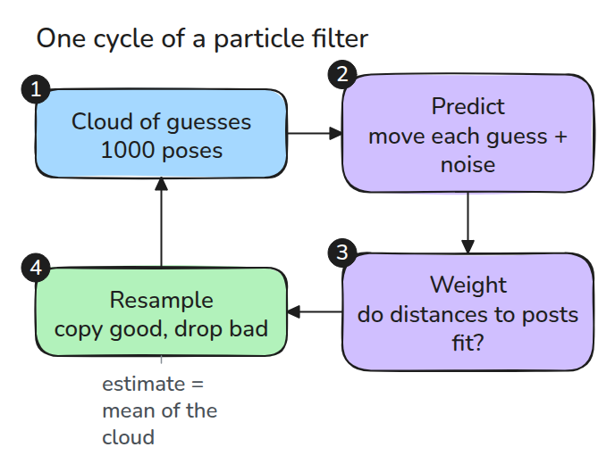
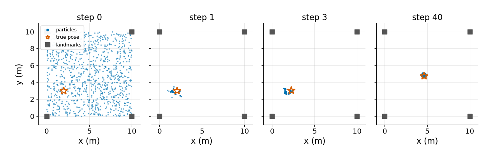
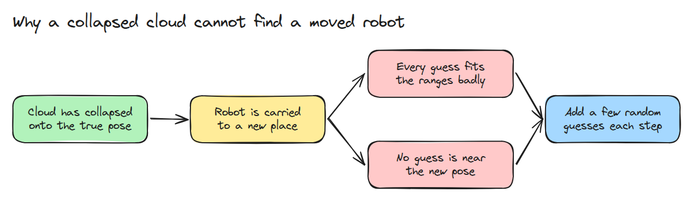
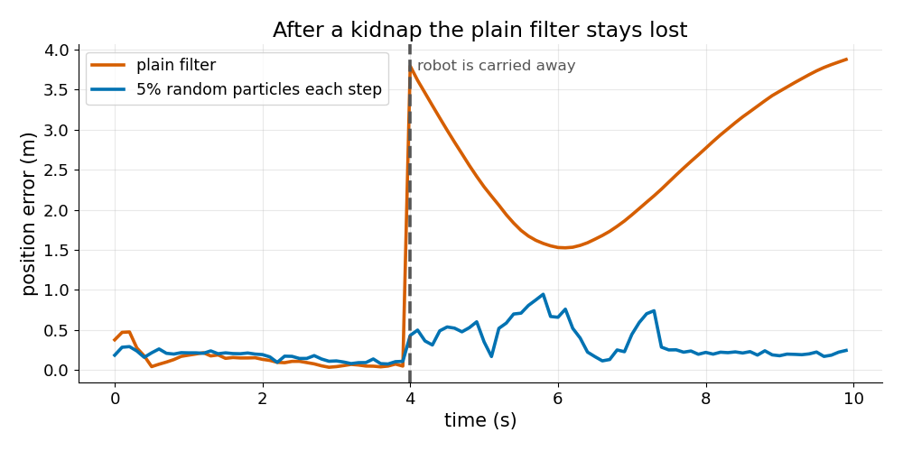

# Particle Filter Localisation

> Keep many guesses of where you are, let the measurements kill the bad ones, and keep a few wild guesses for the day you are moved.

**Type:** Build   **Prerequisites:** 08/01 Differential Drive and Odometry   **Time:** ~15 minutes

## In Plain Words

During a blindfolded treasure hunt at school, you keep several guesses about where you stand. Distances to familiar landmarks favour
some guesses over others. Keep more copies of the guesses that fit, then move them as you walk.

A particle filter does this with possible robot poses. If someone moves you unexpectedly, copying only the old guesses may leave every
guess wrong. Adding a few guesses from elsewhere gives new measurements a chance to find the real location.

## The Problem

Odometry drifts, so a robot on a known map needs outside measurements to say where it is. One Gaussian cannot hold "I could be in either corridor". A cloud of guesses can. But the cloud has a failure of its own: it can become so sure of itself that it can never be corrected.

## The Concept



*Each guess is moved with noise, scored by how well its ranges to the landmarks match the real ones, and then copied or dropped in proportion to its score.*

A guess is a pose `(x, y, heading)`. The weight is the Gaussian likelihood of the measured ranges. We compute it in log form and subtract the largest value before `exp`, so a cloud far from the truth does not underflow to all zeros. Systematic resampling draws `N` evenly spaced pointers from one random offset, which keeps the cloud size fixed.



*With 1000 particles and 4 landmarks the uniform cloud shrinks around the true pose within a few steps, and the error after 40 steps is below 0.3 m.*



*After a kidnap every guess fits badly, and none sits near the new pose.*



*The same run twice. The plain filter never gets back below 1.4 m. Replacing 5% of the particles with random ones each step recovers, at the price of a slightly noisier estimate.*

## Build It

```python
def log_weights(P, z, sigma, lm=LANDMARKS):
    return -0.5 * (((ranges(P, lm) - z) / sigma) ** 2).sum(axis=1)

def systematic_resample(w, rng):
    n = len(w)
    idx = np.searchsorted(np.cumsum(w), (rng.random() + np.arange(n)) / n)
    return np.minimum(idx, n - 1)
```

`pf_step()` chains predict, weight, resample and optional injection.

```bash
cd robotics-engineering-from-scratch
python3 -m pytest phases/08-mobile-robots/02-particle-filter-localisation -q
python3 phases/08-mobile-robots/02-particle-filter-localisation/code/figure.py
```

## Use It

Nav2's AMCL is a probabilistic localisation module that estimates position and orientation on a known map with a 2D laser scanner, and it has a `random_seed` for repeatable particle-filter runs. Compare its cloud spread with this lesson's when you change the motion noise.

Sources: Nav2 `nav2_amcl` README, github.com/ros-navigation/navigation2, opened 2026-11-09.

## Ship It

`outputs/skill-particle-filter-check.md` reviews a particle filter for depletion and kidnap handling.

## Exercises

1. Plot `n_eff` over time and resample only when it drops below N/2.
2. Remove the max-subtraction and find the step where the weights underflow.
3. Make the landmarks collinear and see which direction stays ambiguous.
