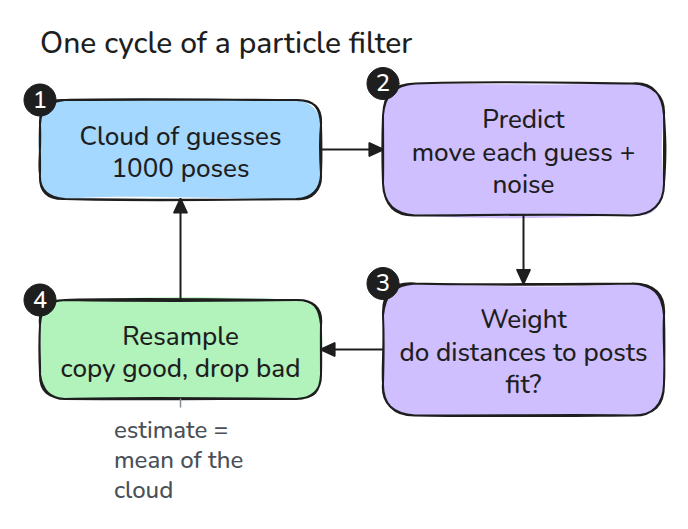
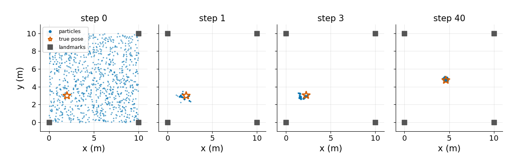
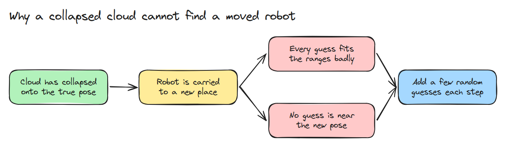
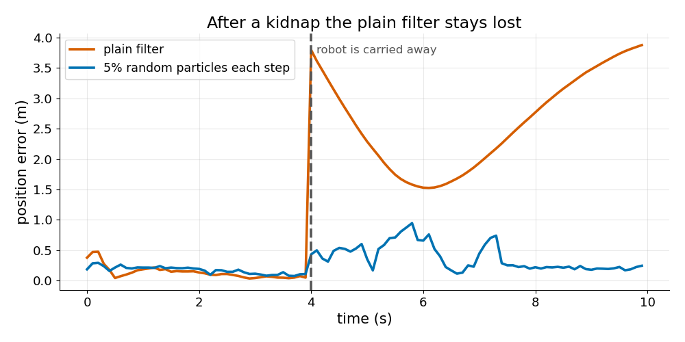

# Particle Filter 위치 추정 (Particle Filter Localisation)

> 길을 잃었거나 번쩍 들려 옮겨진 로봇이 여러 추측을 들고 자기 위치를 찾는 방법을 알아봅니다.

**유형:** 만들기   **선수 지식:** 08/01 차동 구동과 Odometry   **시간:** 약 15분

## 쉽게 말하면

로버가 기둥 네 개가 서 있는 방에서 각 기둥까지의 거리를 재요.
로버는 자기가 있을 만한 자리를 여러 곳 짐작해 두고 잘 맞는 추측은 복제하고 안 맞는 추측은 버려요. 그다음 추측을 모두 로버가 간 만큼 옮겨요.

이제 누가 로버를 다른 구석으로 옮겨 놓아요. 옛 추측은 모두 새 자리에서 멀어요. 방 곳곳에 무작위 추측을 조금 흩어 두면 새 측정이 찾을 거리가 생겨요.

## 핵심 용어

- **Particle**: 로봇 자세 `(x, y, heading)`에 대한 추측 하나입니다.
- **Particle filter**: 움직이고 측정으로 점수를 받고 resampling되는 particle 무리입니다.
- **Landmark**: 로봇이 거리를 잴 수 있는, 위치를 아는 물체입니다. 예를 들면 기둥입니다.
- **Weight**: particle이 예측한 거리가 측정한 거리와 얼마나 맞는지를 나타내는 점수입니다.
- **Resampling**: weight가 큰 particle은 복제하고 작은 것은 버리면서 개수는 그대로 둡니다.
- **Kidnap**: 로봇이 알리지 않고 들려서 다른 곳에 놓이는 일입니다.

## 문제

복도 두 개가 똑같이 생긴 건물에 로봇이 있다고 상상해 보세요. odometry는 오차가 쌓이고 가장 좋은 추측 하나로는 "어느 복도든 될 수 있다"를 말할 수 없지만 particle 구름은 말할 수 있습니다. 다만 구름이 자기 확신이 너무 커질 수도 있습니다.

## 개념

실제 로봇은 지도 위의 자기 위치를 알고 미끄러지거나 들려 옮겨진 뒤에 회복하는 데 이것이 필요합니다.



*noise와 함께 움직이고 점수를 매긴 뒤 점수에 따라 복제하거나 버립니다.*

particle이 예측한 거리가 측정한 거리에 가까울수록 weight가 커집니다(가우시안 likelihood). 참값에서 먼 구름은 weight가 전부 0으로 underflow하므로 weight를 로그로 두고 `exp` 전에 가장 큰 값을 뺍니다.
systematic resampling은 무작위 offset 하나에서 같은 간격의 포인터 `N`개를 뽑으므로 구름 크기가 일정합니다.



*particle 1000개와 landmark 4개에서 40 step 뒤 오차는 0.3 m 아래입니다.*



*kidnap 뒤에는 새 자세 근처에 particle이 하나도 없습니다.*

step 40에 로버가 `(2, 3)`에서 `(8, 7)`로 7.2 m 옮겨집니다. 한 step 뒤 일반 filter의 추정값은 로버에서 3.79 m 떨어져 있고 끝까지 3.88 m 떨어집니다. 무작위 particle을 5% 섞으면 0.43 m 떨어졌다가 끝에는 0.24 m 떨어집니다.


*키 큰 파랑(일반)은 들려 옮겨진 로버를 끝내 찾지 못하고 키 작은 초록(무작위 5%)은 로버에게 건너뜁니다.*



*주황색(일반)은 1.4 m 아래로 돌아오지 못합니다. 파란색(무작위 5%)은 추정이 조금 더 흔들리는 대가로 회복합니다.*

## 만들기

```python
def log_weights(P, z, sigma, lm=LANDMARKS):
    return -0.5 * (((ranges(P, lm) - z) / sigma) ** 2).sum(axis=1)

def systematic_resample(w, rng):
    n = len(w)
    idx = np.searchsorted(np.cumsum(w), (rng.random() + np.arange(n)) / n)
    return np.minimum(idx, n - 1)
```

`pf_step()`은 predict, weight, resample, 선택적 random particle 주입을 이어 줍니다.

```bash
cd robotics-engineering-from-scratch
python3 -m pytest phases/08-mobile-robots/02-particle-filter-localisation -q
python3 phases/08-mobile-robots/02-particle-filter-localisation/code/figure.py
```

## 실제 도구로 보기

Nav2의 AMCL은 2D 레이저 스캔으로 알려진 지도 위에서 로봇의 위치를 추정합니다. 구름의 퍼짐을 이 레슨과 비교해 보세요.

출처: Nav2 `nav2_amcl` README, github.com/ros-navigation/navigation2, 2026년 11월 9일에 열어 확인했습니다.

## 결과물

`outputs/skill-particle-filter-check.md`는 particle filter의 depletion과 kidnap 대응을 점검합니다.

## 연습 문제

1. `n_eff`(아직 쓸모 있는 particle의 수)를 그리고 N/2 아래일 때만 resampling하세요.
2. 가장 큰 값 빼기를 없애고 weight가 underflow하는 step을 찾으세요.
3. landmark를 한 직선 위에 놓고 어느 방향이 모호하게 남는지 보세요.
