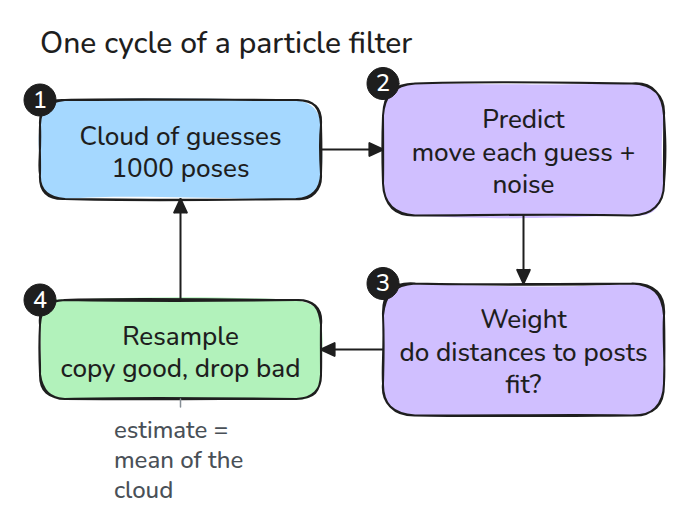
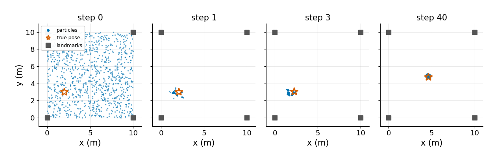
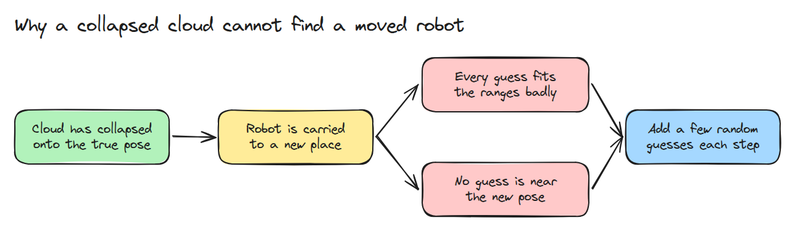
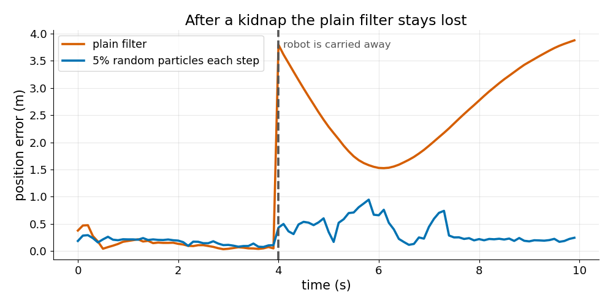

# Particle Filter 위치 추정 (Particle Filter Localisation)

> particle을 여러 개 들고 있다가 측정으로 나쁜 것을 죽입니다. 로봇이 옮겨지는 날을 위해 엉뚱한 particle도 몇 개 남겨 둡니다.

**유형:** 만들기   **선수 지식:** 08/01 차동 구동과 Odometry   **시간:** 약 15분

## 쉽게 말하면

학교에서 눈을 가리고 보물찾기를 한다고 해 보세요. 내가 서 있을 만한 자리를 여러 곳 짐작해 둬요. 익숙한 landmark까지의 거리와 잘 맞는 추측은 더 많이 남기고 걸을 때마다 그 자리들도 옮겨요.

particle filter는 로봇의 가능한 pose를 이렇게 다뤄요. 누가 갑자기 나를 다른 곳으로 옮기면 기존 추측이 모두 틀릴 수 있어요. 전혀 다른 자리의 추측도 조금 섞어야 새 측정으로 실제 위치를 찾을 기회가 생겨요.

## 문제

odometry는 drift하므로 알려진 지도 위의 로봇은 바깥 측정으로 자기 위치를 알아야 합니다.

가우시안 하나로는 "두 복도 중 어느 쪽일 수도 있다"를 담을 수 없지만 particle 구름은 담을 수 있습니다. 다만 구름에도 고유한 실패가 있습니다. 자기 확신이 너무 커져서 더는 고칠 수 없게 되는 것입니다.

## 개념



*각 particle은 noise와 함께 움직이고 landmark까지의 거리가 실제와 얼마나 맞는지로 점수를 받습니다. 그다음 점수에 비례해 복제되거나 버려집니다.*

particle 하나는 자세 `(x, y, heading)`입니다. weight는 측정한 거리의 가우시안 likelihood입니다.

로그 형태로 계산하고 `exp` 전에 가장 큰 값을 빼므로 참값에서 먼 구름도 weight가 전부 0으로 underflow하지 않습니다. systematic resampling은 무작위 offset 하나에서 같은 간격의 포인터 `N`개를 뽑으므로 구름 크기가 일정합니다.



*particle 1000개와 landmark 4개에서 균일한 구름은 몇 step 안에 참 자세 주위로 줄어들고 40 step 뒤 오차는 0.3 m 아래입니다.*



*kidnap 뒤에는 모든 particle이 잘 맞지 않고 새 자세 근처에는 particle이 하나도 없습니다.*



*같은 실행을 두 번 돌린 결과입니다. 일반 filter는 1.4 m 아래로 돌아오지 못합니다. 매 step particle 5%를 무작위로 바꾸면 회복하지만 추정이 조금 더 흔들립니다.*

## 만들기

```python
def log_weights(P, z, sigma, lm=LANDMARKS):
    return -0.5 * (((ranges(P, lm) - z) / sigma) ** 2).sum(axis=1)

def systematic_resample(w, rng):
    n = len(w)
    idx = np.searchsorted(np.cumsum(w), (rng.random() + np.arange(n)) / n)
    return np.minimum(idx, n - 1)
```

`pf_step()`은 예측, 가중, resampling, 선택적 주입을 이어 줍니다.

```bash
cd robotics-engineering-from-scratch
python3 -m pytest phases/08-mobile-robots/02-particle-filter-localisation -q
python3 phases/08-mobile-robots/02-particle-filter-localisation/code/figure.py
```

## 실제 도구로 보기

Nav2의 AMCL은 2D 레이저 스캐너로 알려진 지도 위의 위치와 방향을 추정하는 확률적 localisation 모듈입니다.

particle filter를 반복 가능하게 돌리는 `random_seed` 파라미터도 있습니다. 운동 noise를 바꿔 가며 구름의 퍼짐을 이 레슨과 비교해 보세요.

출처: Nav2 `nav2_amcl` README, github.com/ros-navigation/navigation2, 2026년 11월 9일에 열어 확인했습니다.

## 결과물

`outputs/skill-particle-filter-check.md`는 particle filter의 depletion과 kidnap 대응을 점검합니다.

## 연습 문제

1. `n_eff`를 시간에 따라 그리고 N/2 아래일 때만 resampling하세요.
2. max 빼기를 없애고 weight가 underflow하는 step을 찾으세요.
3. landmark를 일직선에 놓고 어느 방향이 모호하게 남는지 보세요.
