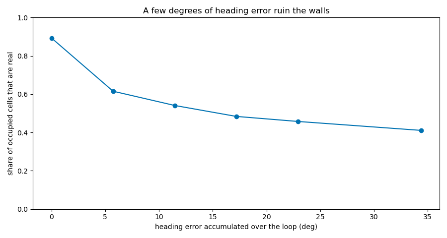

# Occupancy Grid and the SLAM Idea

> Learn how a robot draws a room map from laser beams, and why a small heading error ruins it.

**Type:** Build   **Prerequisites:** 08/01 Differential Drive and Odometry   **Time:** ~15 minutes

## In Plain Words

A rover measures a room with laser beams. A beam ends at the first thing it hits: the floor it crossed is empty, its end is an obstacle, and behind is unknown. An occupancy grid keeps this evidence in map squares.

If the rover's heading estimate worsens every step, obstacles land in the wrong squares and scans smear the map. SLAM corrects the pose from the map so far.

## Key Terms

- **Occupancy grid**: a map split into small squares, each holding a score for "something is here".
- **Cell**: one square of the occupancy grid.
- **Log-odds (`L`)**: a cell's evidence score. Positive means probably occupied, negative probably free, and 0 unknown.
- **SLAM**: mapping and locating at once, because each needs the other.
- **Heading**: the direction the robot faces.
- **Drift**: a small error that adds up step after step.

## The Problem

Picture a robot's map after one lap of a room: every wall twice, slanted, with a ghost room beside it. The scanner was fine; the robot drew each scan from a wrong place.

## The Concept

A robot plans routes and avoids walls with its map, so a smeared map breaks everything built on it.

The map is a grid of small squares. Each laser beam marks the squares it crossed as probably empty and the square where it stopped as probably wall. Seeing a wall again and again makes it certain.


*Empty before the wall, wall at the end.*


*Walls rise, floor sinks.*

This only works if the robot knows where it stood at each scan. A small heading error that grows each step smears the walls.


*Left: the room. Middle: right places. Right: drifted places.*


*SLAM solves the map and the position together.*



*A small heading error ruins walls.*

<details><summary>The math (optional)</summary>

Each cell holds a score `L` (log-odds): positive means probably occupied, negative probably free, 0 unknown. A beam end adds 0.85 and a crossed cell subtracts 0.4. `L` is clamped at +-5 so a changed world can still be learned, and `p = 1 - 1 / (1 + exp(L))` gives the probability. After three scans a wall cell has `L = 2.55` (`p = 0.93`) and a floor cell `L = -1.2` (`p = 0.23`). With 200 scans, a heading error of 0.003 rad per step (34° over the loop) leaves only 41% of occupied cells real. Under 6 degrees the real share already falls from 0.89 to 0.62.

</details>

## Build It

```python
def update(L, pose, r, angles, max_range=8.0):
    ...  # cells crossed: L -= 0.4, cell where each beam ended: L += 0.85
    return np.clip(L, -L_MAX, L_MAX).reshape(N, N)

def drift(poses, yaw_err):
    way = np.arctan2(d[:, 1], d[:, 0]) + yaw_err * k[1:]
```

`scan()` sends beams through a hidden world. `build_map()` places scans at the positions you give it.

```bash
cd robotics-engineering-from-scratch
python3 -m pytest phases/08-mobile-robots/03-occupancy-grid-and-slam-idea -q
python3 phases/08-mobile-robots/03-occupancy-grid-and-slam-idea/code/main.py
```

## Use It

Nav2's map server loads and saves grid maps like this one.

Sources: Nav2 `nav2_map_server` README, github.com/ros-navigation/navigation2, opened 2026-11-09.

## Ship It

`outputs/skill-occupancy-grid-check.md` diagnoses a smeared or doubled map.

## Exercises

1. Make the laser noisier; watch the walls thicken.
2. Count the squares still unknown after one scan.
3. Give one scan a wrong position; see the damage.
