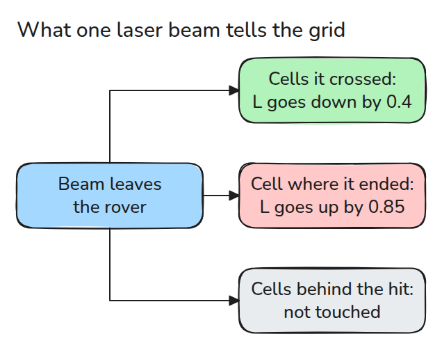
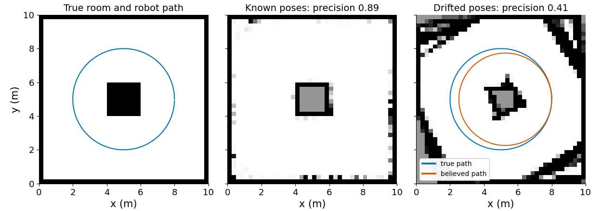
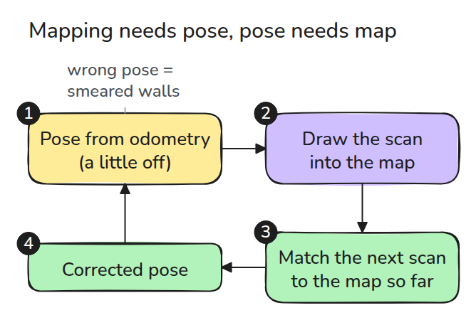

# Occupancy Grid and the SLAM Idea

> Learn how a robot draws a room map from laser beams, and why a small heading error ruins it.

**Type:** Build   **Prerequisites:** 08/01 Differential Drive and Odometry   **Time:** ~15 minutes

## In Plain Words

A rover measures a room with laser beams. A beam ends at the first thing it hits: the floor it crossed is empty, its end is an obstacle, and behind is unknown. An occupancy grid keeps this evidence in map squares.

If the rover's heading estimate worsens every step, obstacles land in the wrong squares and scans smear the map. SLAM corrects the pose from the map so far.

## Key Terms

- **Occupancy grid**: a map split into small squares, each holding a score for "something is here".
- **Cell**: one square of the occupancy grid.
- **Log-odds (`L`)**: a cell's evidence score. Positive means probably occupied, negative probably free, and 0 unknown.
- **SLAM**: mapping and locating at once, because each needs the other.
- **Heading**: the direction the robot faces.
- **Drift**: a small error that adds up step after step.

## The Problem

Picture a laser robot's map after one lap of a room: every wall twice, slanted, with a ghost room beside it. The scanner was fine; the robot drew each scan from a place it wrongly believed it was in.

## The Concept

A real robot plans routes and avoids walls with its map, so a smeared map breaks what follows.



*One beam lowers crossed cells and raises its end cell.*

A beam end is strong evidence and adds `0.85` to `L`. A crossed cell is weaker evidence of free and subtracts `0.4`. `L` is capped at `+-5`, and `p = 1 - 1 / (1 + exp(L))` turns it into a probability. Each cell updates once per scan.

After three scans a wall cell hit every time has `L = 3 x 0.85 = 2.55`, so `p = 0.93`. A floor cell crossed every time has `L = 3 x -0.4 = -1.2`, so `p = 0.23`.


*Pillar height is `L`: wall pillars rise 0.85 per scan, floor pillars 0.4.*



*Left: room. Middle: 200 scans, known poses. Right: heading error of 0.003 rad per step (34° over the loop); only 41% of occupied cells are real.*



*SLAM: draw, match the next scan, correct the pose.*


*Under 6 degrees of heading error, the real share of occupied cells falls from 0.89 to 0.62.*

## Build It

```python
def update(L, pose, r, angles, max_range=8.0):
    ...  # cells crossed: L -= 0.4, cell where each beam ended: L += 0.85
    return np.clip(L, -L_MAX, L_MAX).reshape(N, N)

def drift(poses, yaw_err):
    way = np.arctan2(d[:, 1], d[:, 0]) + yaw_err * k[1:]
```

`scan()` sends beams through a hidden world; `build_map()` places scans at the poses you give it.

```bash
cd robotics-engineering-from-scratch
python3 -m pytest phases/08-mobile-robots/03-occupancy-grid-and-slam-idea -q
python3 phases/08-mobile-robots/03-occupancy-grid-and-slam-idea/code/main.py
```

## Use It

Nav2's map server loads and saves `nav_msgs/msg/OccupancyGrid` maps.

Sources: Nav2 `nav2_map_server` README, github.com/ros-navigation/navigation2, opened 2026-11-09.

## Ship It

`outputs/skill-occupancy-grid-check.md` diagnoses a smeared or doubled map.

## Exercises

1. Raise the beam noise; find when walls get two cells thick.
2. Add a `p < 0.35` free threshold and count unknown cells.
3. Give only the last scan a bad pose; see the damage.
