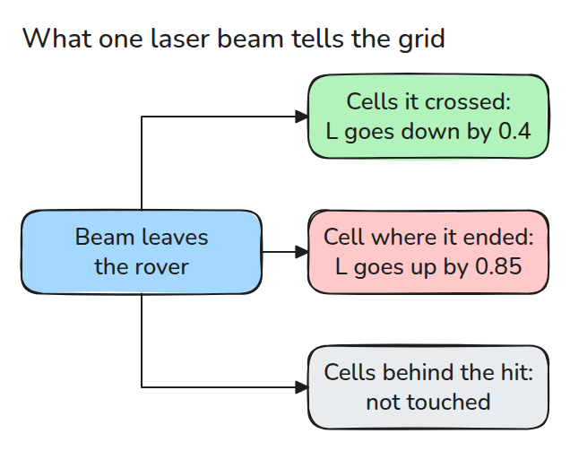
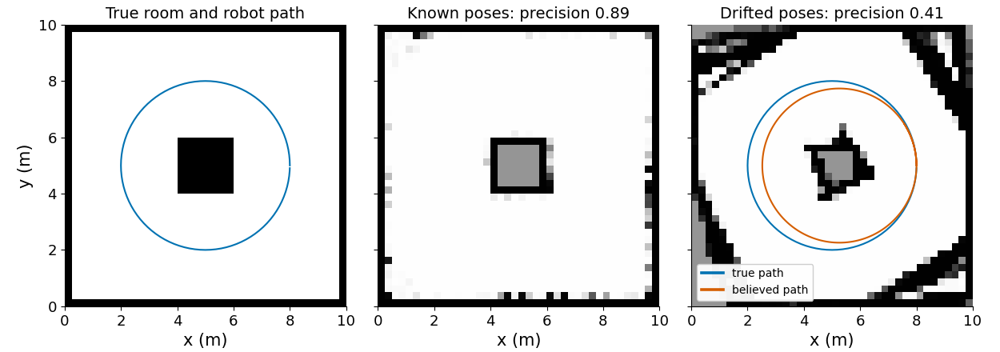
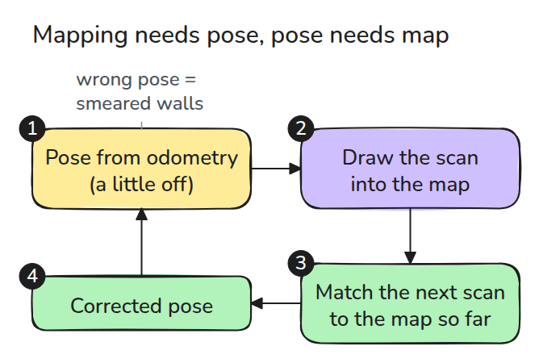
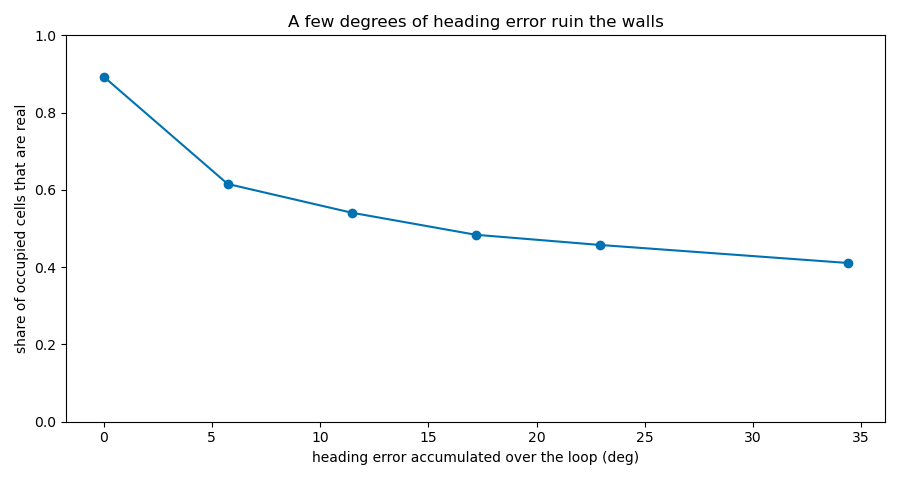

# Occupancy Grid and the SLAM Idea

> A map is only as good as the poses you drew it from, which is why mapping and localising have to be solved together.

**Type:** Build   **Prerequisites:** 08/01 Differential Drive and Odometry   **Time:** ~15 minutes

## In Plain Words

Sketch your classroom from different seats. A clear sightline tells you the space before a chair is empty, the chair marks an obstacle,
and what is behind it stays unknown. An occupancy grid collects that evidence in little map squares.

Now record the wrong seat or facing direction. Even accurate distances put the chair in the wrong place, so repeated views smear the
map. SLAM uses the developing map to correct the estimated pose before adding more observations.

## The Problem

You drive a laser robot around a room once and the saved map shows every wall twice, slanted, with a ghost room beside it. The scanner was fine. The robot believed it was somewhere it was not, and drew each scan from that wrong place.

## The Concept



*A beam lowers the log-odds of every cell it crossed, raises the cell where it ended, and says nothing about what lies behind.*

An occupancy grid stores one number `L` per cell, the log-odds of "occupied". Zero means unknown. We add `0.85` at a beam end and subtract `0.4` along its path, clamp at `+-5`, and convert with `p = 1 - 1 / (1 + exp(L))`. Each cell is touched once per scan, so a crowd of beams does not count the same wall twice.



*Left: the room. Middle: 200 scans from known poses. Gray is never seen, such as the inside of the box. Right: the same scans placed with a heading that gains 0.003 rad per step, and only 41% of the occupied cells are real.*



*SLAM closes the circle: match each scan to the map so far, correct the pose, then update the map.*



*Under 6 degrees of accumulated heading error already drops the real share of occupied cells from 0.89 to 0.62.*

The drift model keeps every step length exact and only rotates the direction by a small angle per step. That is the same kind of error as an off track width in the previous lesson.

## Build It

```python
def update(L, pose, r, angles, max_range=8.0):
    ...  # cells crossed: L -= 0.4, cell where each beam ended: L += 0.85
    return np.clip(L, -L_MAX, L_MAX).reshape(N, N)

def drift(poses, yaw_err):
    way = np.arctan2(d[:, 1], d[:, 0]) + yaw_err * k[1:]
```

`scan()` ray-marches a hidden true world. `build_map()` places the scans at the poses you give it, so you can feed it true or drifted ones.

```bash
cd robotics-engineering-from-scratch
python3 -m pytest phases/08-mobile-robots/03-occupancy-grid-and-slam-idea -q
python3 phases/08-mobile-robots/03-occupancy-grid-and-slam-idea/code/main.py
```

## Use It

Nav2's map server loads and saves `nav_msgs/msg/OccupancyGrid` maps, so a grid like this one is the format the navigation stack reads. A real mapping package estimates the poses and the grid together.

Sources: Nav2 `nav2_map_server` README, github.com/ros-navigation/navigation2, opened 2026-11-09.

## Ship It

`outputs/skill-occupancy-grid-check.md` diagnoses a smeared or doubled map.

## Exercises

1. Raise the beam noise and find when walls become two cells thick.
2. Add a `p < 0.35` free threshold and count unknown cells.
3. Give only the final scan a bad pose and see how local the damage stays.
