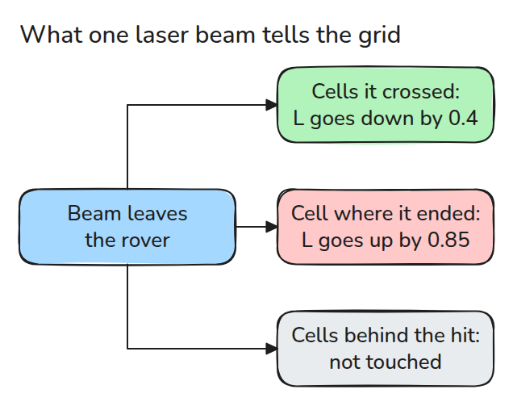
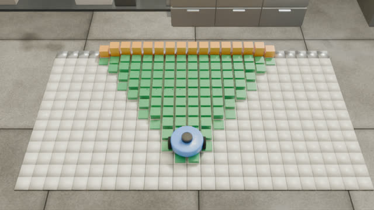
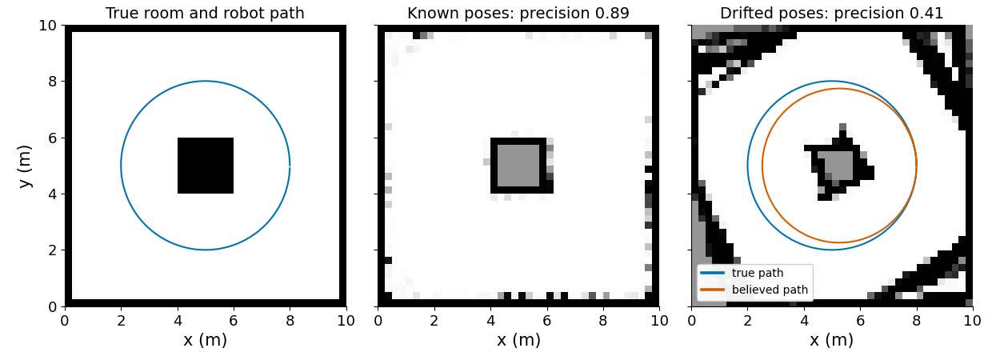
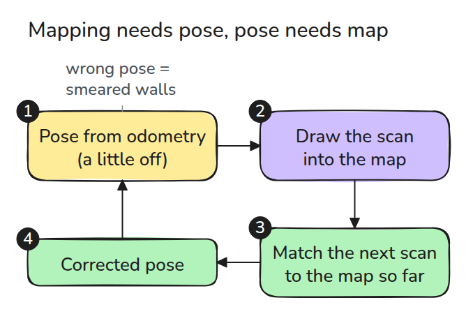
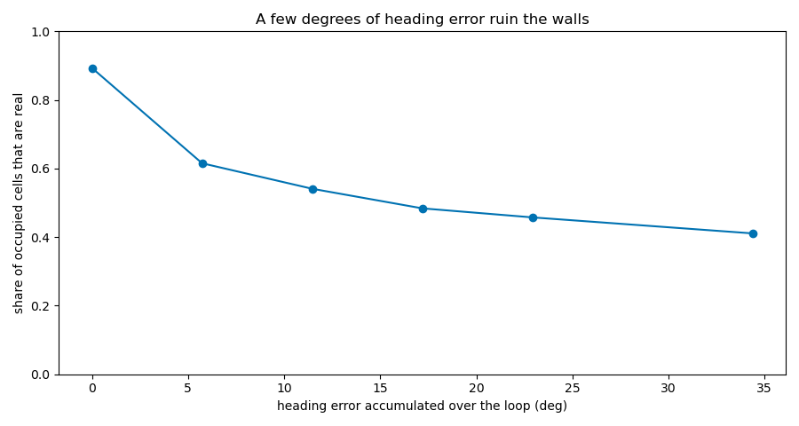

# Occupancy Grid와 SLAM의 발상 (Occupancy Grid and the SLAM Idea)

> 로봇이 레이저로 방 지도를 그리는 방법과 방향이 조금만 틀려도 지도가 망가지는 이유를 알아봅니다.

**유형:** 만들기   **선수 지식:** 08/01 차동 구동과 Odometry   **시간:** 약 15분

## 쉽게 말하면

로버가 방을 레이저 빔으로 재요. 빔은 처음 닿은 것에서 끝나요.
빔이 지나온 바닥은 비어 있고 끝난 자리는 장애물이며 그 뒤는 알 수 없어요. occupancy grid는 이런 단서를 작은 칸마다 모아요.

로버의 heading 추정이 step마다 더 틀어지면 장애물이 엉뚱한 칸에 그려져요. 그러면 스캔을 거듭할수록 지도가 번져요.

SLAM은 지금까지 만든 지도로 로버의 위치를 고쳐요.

## 핵심 용어

- **Scan**: 레이저 빔을 한 번 훑는 것입니다.
- **Occupancy grid**: 지도를 작은 칸으로 나누고 칸마다 "여기 무언가 있다"는 점수를 담은 것입니다.
- **Log-odds (`L`)**: 칸 하나의 증거 점수입니다. 양수면 막혀 있을 가능성이 높고 음수면 비어 있을 가능성이 높으며 0은 모른다는 뜻입니다.
- **SLAM**: 지도를 그리면서 동시에 그 위에서 자기 위치를 찾는 방법입니다.
- **Heading**: 로봇이 바라보는 방향입니다.
- **Drift**: step마다 쌓이는 작은 오차입니다.

## 문제

로봇이 방을 한 바퀴 돈 뒤의 지도를 상상해 보세요. 벽이 두 겹으로 비스듬히 그려지고 옆에 유령 방이 생깁니다. 스캐너는 멀쩡했고 로봇이 틀린 자리에서 스캔을 그렸을 뿐입니다.

## 개념

로봇은 지도로 경로를 짜기 때문에 지도가 번지면 그 뒤의 모든 일이 틀어집니다.

지도는 작은 칸으로 나눈 격자입니다. 레이저 빔 하나는 지나온 칸은 아마 비었다고 표시하고 끝난 칸은 아마 벽이라고 표시합니다. 되풀이해서 본 벽은 확실해집니다.



*벽 앞은 비었고 끝은 벽입니다.*

[](../assets/clip-example.mp4)

*기둥 하나가 칸 하나의 점수입니다. 벽은 오르고 바닥은 내려갑니다.*

이 방법은 로봇이 스캔할 때마다 자기가 어디에 서 있었는지 알아야 제대로 동작합니다. step마다 커지는 작은 heading 오차가 벽을 번지게 합니다.



*왼쪽은 방, 가운데는 참 위치로 그린 지도, 오른쪽은 어긋난 위치로 그린 지도입니다.*



*지도가 위치를 고치고 위치가 지도를 더합니다.*



*heading 오차가 커지면 진짜 벽인 칸의 비율이 빠르게 떨어집니다.*

<details><summary>The math (optional)</summary>

칸마다 점수 `L`(log-odds)이 있습니다.
양수면 막혀 있을 가능성이 높고 음수면 비어 있을 가능성이 높으며 0은 모른다는 뜻입니다.
빔이 끝난 칸은 0.85를 더하고 빔이 지나간 칸은 0.4를 뺍니다.
`L`은 +-5에서 잘라 두므로 세상이 바뀌어도 다시 배울 수 있습니다. 확률은 `p = 1 - 1 / (1 + exp(L))`로 구합니다.
세 번 스캔한 뒤 벽 칸은 `L = 2.55`(`p = 0.93`)이고 바닥 칸은 `L = -1.2`(`p = 0.23`)입니다.
스캔 200개를 쓰고 방향 오차가 step마다 0.003 rad씩 커지면(루프 전체에서 34°) 막혔다고 표시한 칸 중 진짜 벽은 41%만 남습니다.
오차가 6도 아래여도 진짜 벽의 비율은 이미 0.89에서 0.62로 떨어집니다.

</details>

## 만들기

```python
def update(L, pose, r, angles, max_range=8.0):
    ...  # cells crossed: L -= 0.4, cell where each beam ended: L += 0.85
    return np.clip(L, -L_MAX, L_MAX).reshape(N, N)

def drift(poses, yaw_err):
    way = np.arctan2(d[:, 1], d[:, 0]) + yaw_err * k[1:]
```

`scan()`은 숨겨진 세계에 빔을 쏘고 `build_map()`은 받은 위치에 스캔을 배치합니다.

```bash
cd robotics-engineering-from-scratch
python3 -m pytest phases/08-mobile-robots/03-occupancy-grid-and-slam-idea -q
python3 phases/08-mobile-robots/03-occupancy-grid-and-slam-idea/code/main.py
```

## 실제 도구로 보기

Nav2는 로봇 내비게이션 패키지이고 이런 격자 지도를 읽고 저장합니다.

출처: Nav2 `nav2_map_server` README, github.com/ros-navigation/navigation2, 2026년 11월 9일에 열어 확인했습니다.

## 결과물

`outputs/skill-occupancy-grid-check.md`는 번지거나 두 겹이 된 지도를 진단합니다.

## 연습 문제

1. 레이저 노이즈를 키우고 벽이 두꺼워지는 것을 보세요.
2. 스캔 한 번 뒤에 비어 있지도 벽도 아닌 칸이 몇 개인지 세어 보세요.
3. 스캔 하나에 틀린 위치를 주고 피해가 어떤지 보세요.
