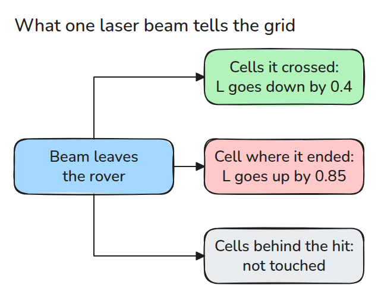
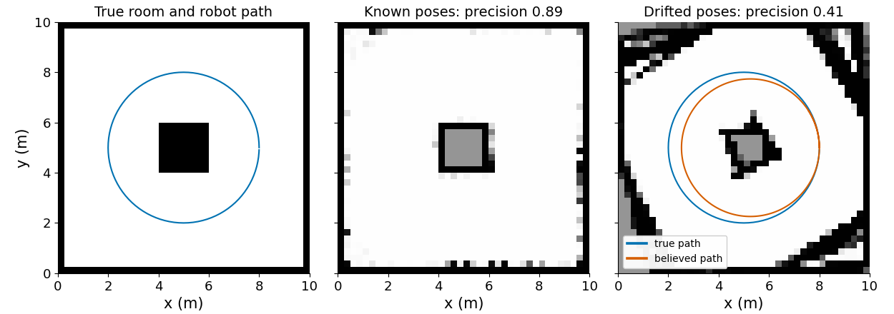
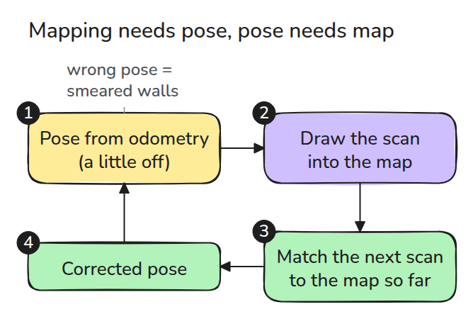
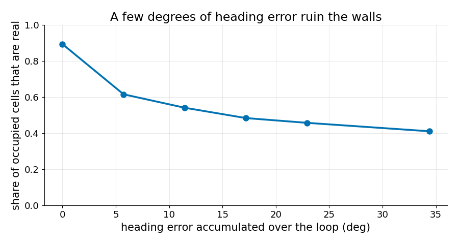

# Occupancy Grid와 SLAM의 발상 (Occupancy Grid and the SLAM Idea)

> 지도는 그것을 그린 자세만큼만 좋으므로 mapping과 localisation은 함께 풀어야 합니다.

**유형:** 만들기   **선수 지식:** 08/01 차동 구동과 Odometry   **시간:** 약 15분

## 쉽게 말하면

로버가 가운데 상자가 있는 방에서 레이저 빔으로 거리를 재요. 빔은 처음 닿은 것에서 끝나요.
빔이 지나온 바닥은 비어 있고 끝난 자리는 장애물이며 그 뒤는 알 수 없어요. occupancy grid는 이런 단서를 작은 칸마다 모아요.

로버의 heading 추정이 조금 틀리고 step마다 더 틀어진다고 해 보세요. 거리는 맞아도 상자가 엉뚱한 칸에 그려져서 스캔을 거듭할수록 지도가 번져요.
SLAM(지도를 만들면서 동시에 자기 위치를 찾는 방법)은 새 스캔을 더하기 전에 지금까지 만든 지도로 자세를 고쳐요.

## 문제

레이저 로봇으로 방을 한 바퀴 돌았더니 저장된 지도에 벽이 두 겹으로 비스듬히 그려지고 옆에 유령 방이 생깁니다. 스캐너는 멀쩡했습니다. 로봇이 자기가 있지 않은 곳에 있다고 믿고 그 틀린 자리에서 스캔을 그렸을 뿐입니다.

## 개념



*빔 하나는 지나온 cell의 점수를 낮추고 끝난 cell의 점수를 높입니다. 그 뒤에 무엇이 있는지는 말하지 않습니다.*

occupancy grid는 cell마다 증거 점수 `L` 하나를 저장합니다. 이 점수는 "점유됨"의 log-odds입니다. 양수면 점유되었을 가능성이 높고 음수면 비어 있을 가능성이 높으며 0은 모른다는 뜻입니다.

빔이 끝난 곳은 강한 증거라서 `0.85`를 더합니다. 빔이 지나간 cell은 비어 있다는 약한 증거라서 `0.4`를 뺍니다. `L`은 `+-5`에서 자르고 `p = 1 - 1 / (1 + exp(L))`가 점수를 확률로 바꿉니다. 한 스캔에서 cell은 한 번만 갱신하므로 빔이 많아도 같은 벽을 두 번 세지 않습니다.

세 번 스캔한 뒤 매번 빔이 닿은 벽 cell은 `L = 3 x 0.85 = 2.55`이므로 `p = 0.93`입니다. 매번 빔이 지나간 바닥 cell은 `L = 3 x -0.4 = -1.2`이므로 `p = 0.23`입니다.


*기둥 높이는 `L`의 크기입니다. 스캔할 때마다 주황색 벽 기둥(더 점유됨)은 0.85씩, 초록색 바닥 기둥(더 비어 있음)은 0.4씩 높아집니다.*



*왼쪽은 방입니다. 가운데는 알려진 자세에서 얻은 스캔 200개입니다. 오른쪽은 같은 스캔을 step마다 0.003 rad씩 커지는 방향 오차(루프 전체에서 34°)로 배치한 결과이고 점유 cell 중 41%만 진짜입니다.*



*SLAM은 이 원을 닫습니다. 스캔을 자세에 맞춰 그리고 다음 스캔을 지금까지의 지도에 맞춰 자세를 고친 뒤 다시 그립니다.*



*방향 오차는 루프 전체에서 쌓인 회전 오차입니다. 6도 미만인데도 점유 cell 중 진짜의 비율이 0.89에서 0.62로 떨어집니다.*

drift 모델은 step 길이는 정확히 두고 step마다 작은 heading 오차를 더합니다.

## 만들기

```python
def update(L, pose, r, angles, max_range=8.0):
    ...  # cells crossed: L -= 0.4, cell where each beam ended: L += 0.85
    return np.clip(L, -L_MAX, L_MAX).reshape(N, N)

def drift(poses, yaw_err):
    way = np.arctan2(d[:, 1], d[:, 0]) + yaw_err * k[1:]
```

`scan()`은 숨겨진 참 세계로 빔을 쏩니다. `build_map()`은 받은 자세에 스캔을 배치하므로 참 자세와 drift한 자세를 모두 넣을 수 있습니다.

```bash
cd robotics-engineering-from-scratch
python3 -m pytest phases/08-mobile-robots/03-occupancy-grid-and-slam-idea -q
python3 phases/08-mobile-robots/03-occupancy-grid-and-slam-idea/code/main.py
```

## 실제 도구로 보기

Nav2의 map server는 `nav_msgs/msg/OccupancyGrid` 지도를 읽고 저장하며 navigation stack이 읽는 형식이 이것입니다. 실제 mapping 패키지는 자세와 grid를 함께 추정합니다.

출처: Nav2 `nav2_map_server` README, github.com/ros-navigation/navigation2, 2026년 11월 9일에 열어 확인했습니다.

## 결과물

`outputs/skill-occupancy-grid-check.md`는 번지거나 두 겹이 된 지도를 진단합니다.

## 연습 문제

1. 빔 noise를 키우고 벽이 두 cell 두께가 되는 시점을 찾으세요.
2. 자유 영역 기준 `p < 0.35`를 넣고 모르는 cell 수를 세세요.
3. 마지막 스캔 하나에만 틀린 자세를 주고 피해가 얼마나 국소적인지 보세요.
