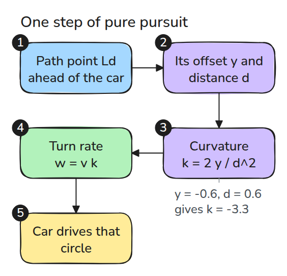
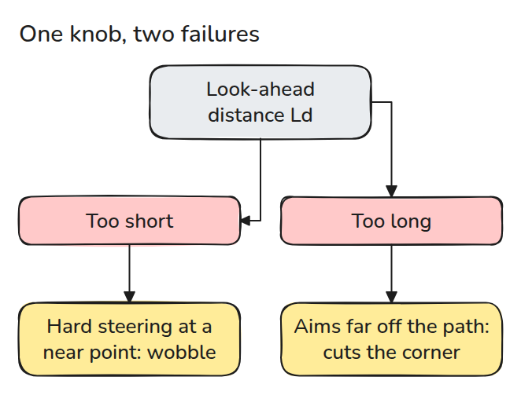

# Path Following with Pure Pursuit

> Learn how a robot follows a path by aiming ahead, and how one number trades wobble for cut corners.

**Type:** Build   **Prerequisites:** 08/01 Differential Drive and Odometry   **Time:** ~15 minutes

## In Plain Words

A toy car follows a painted line by steering toward a point on the line a fixed distance ahead, the lookahead. A close point makes a small drift swing the car hard, and since its wheels respond late it overshoots the line.

A far point gives gentle corrections, but near a bend it lies beyond the corner, so the car cuts across.

## Key Terms

- **Pure pursuit**: steering a robot toward a point on the path a fixed distance ahead.
- **Lookahead (`Ld`)**: that fixed distance; the one knob you tune.
- **Curvature (`k`)**: how sharply a path bends. It is `1 / R` for a circle of radius `R`.
- **Robot frame**: coordinates that move with the robot, x forward and y left.
- **Gain**: how strongly the robot corrects a given error.
- **Lag**: the delay before the wheels follow a steering command.

## The Problem

Picture a delivery robot following a path with a right-angle corner. Aiming close, it snakes along the straight parts. Aiming far, it sails across the corner.

## The Concept

A real robot must neither wobble nor clip corners, and this one distance decides both.



*Steer along the circle through the point `Ld` ahead.*

In the robot frame the target is `d` away and `y` to the left. The circle through it has curvature `k = 2 y / d^2`, so a bigger `|k|` is a tighter turn. The turn rate is `w = v k` for speed `v`, reached gradually (assumed, not measured: two thirds of the gap closes every 0.4 s).

Start 0.6 m left of the path, so `y = -0.6`. With `Ld = 0.4 m` the target is the nearest path point, `d = 0.6`, so `k = 2 * -0.6 / 0.6^2 = -3.3`. With `Ld = 1.5 m`, `d = 1.5`, `k = -0.53`.


*Blue (`Ld = 0.4`) crosses the line after 1.0 s, green (`Ld = 1.5`) after 2.8 s.*



*Short steers hard; long cuts corners.*


*`Ld = 0.4 m` crosses the line 10 times but hugs the corner (0.17 m). 1.5 m misses it by 0.41 m, 4 m by 1.37 m.*

Without lag the short lookahead does not wobble: the wobble is high gain meeting a slow drive.

## Build It

```python
def curvature(pose, target):
    dx, dy = target - pose[:2]
    y = -np.sin(pose[2]) * dx + np.cos(pose[2]) * dy
    return 2 * y / (dx * dx + dy * dy)

def lookahead_point(path, pos, ld):
    i = np.linalg.norm(path - pos, axis=1).argmin()
    far = np.nonzero(np.linalg.norm(path[i:] - pos, axis=1) >= ld)[0]
    return path[i + far[0]] if len(far) else path[-1]
```

`follow()` runs the loop; `sign_changes()` counts line crossings.

```bash
cd robotics-engineering-from-scratch
python3 -m pytest phases/08-mobile-robots/04-path-following-pure-pursuit -q
python3 phases/08-mobile-robots/04-path-following-pure-pursuit/code/main.py
```

## Use It

Nav2's regulated pure pursuit controller steers toward a point ahead on the path. Its README says the right lookahead depends on robot size and speed.

Sources: Nav2 `nav2_regulated_pure_pursuit_controller` README, github.com/ros-navigation/navigation2, opened 2026-11-09.

## Ship It

`outputs/skill-pure-pursuit-tuning.md` tunes `Ld` from a wobble count and a corner cut.

## Exercises

1. Scale `Ld` with speed; compare the wobble at 0.5 and 2 m/s.
2. Round the corner with a short arc; re-measure the cut.
3. Find the smallest `Ld` with at most 2 line crossings at 0.2 s lag.
