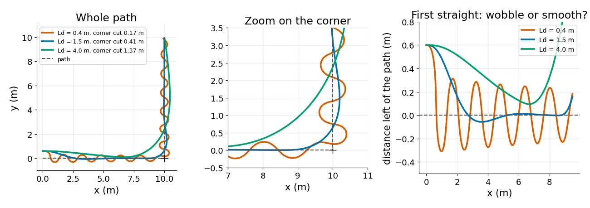

# Path Following with Pure Pursuit

> Learn how a robot follows a path by aiming ahead, and how one number trades wobble for cut corners.

**Type:** Build   **Prerequisites:** 08/01 Differential Drive and Odometry   **Time:** ~15 minutes

## In Plain Words

A toy car follows a painted line. It steers toward a point on the line a fixed distance ahead, the lookahead.

A close point makes a small drift swing the car hard. Its wheels respond late, so it overshoots the line.
A far point gives gentle corrections. But near a bend that point lies beyond the corner, so the car cuts across.

## Key Terms

- **Pure pursuit**: steering a robot toward a point on the path a fixed distance ahead.
- **Lookahead (`Ld`)**: that fixed distance; the one knob you tune.
- **Curvature (`k`)**: how sharply a path bends. A tight turn has a large curvature.
- **Robot frame**: coordinates that move with the robot, x forward and y left.
- **Gain**: how strongly the robot corrects a given error.
- **Lag**: the delay before the wheels follow a steering command.

## The Problem

Picture a delivery robot following a path with a sharp corner. Aiming at a point close ahead, it snakes along the straight parts. Aiming far ahead, it sails across the corner.

## The Concept

A robot must neither wobble nor clip corners, and one distance decides both.

It always aims at a point on the path a fixed distance ahead, and steers along the curve, a piece of a circle, that ends at that point. That distance is the lookahead.


*Aim ahead, steer along the circle.*

Aim close and every small drift causes a hard turn, so a robot with slow wheels wobbles. Aim far and the target lies beyond the corner, so the robot cuts it.


*Blue aims close and turns hard, swinging across the line. Green aims far and turns gently.*


*A short lookahead steers hard. A long one cuts corners.*



*Three lookaheads: the short one wobbles, the long ones cut the corner.*

<details><summary>The math (optional)</summary>

In the robot's frame the target is `d` away and `y` to the left, so the circle through it has curvature `k = 2 y / d^2`; a bigger `|k|` is a tighter turn. The turn rate is `w = v k` for speed `v`, reached gradually (assumed: two thirds of the gap closes every 0.4 s). Starting 0.6 m left of the path, `Ld = 0.4 m` gives `d = 0.6` and `k = -3.3`; `Ld = 1.5 m` gives `d = 1.5` and `k = -0.53`. Blue (`Ld = 0.4`) crosses the line after 1.0 s, green (`Ld = 1.5`) after 2.8 s. `Ld = 0.4 m` crosses the line 10 times but hugs the corner (0.17 m); 1.5 m misses it by 0.41 m, 4 m by 1.37 m. Without lag the short lookahead does not wobble (tested).

</details>

## Build It

```python
def curvature(pose, target):
    dx, dy = target - pose[:2]
    y = -np.sin(pose[2]) * dx + np.cos(pose[2]) * dy
    return 2 * y / (dx * dx + dy * dy)

def lookahead_point(path, pos, ld):
    i = np.linalg.norm(path - pos, axis=1).argmin()
    far = np.nonzero(np.linalg.norm(path[i:] - pos, axis=1) >= ld)[0]
    return path[i + far[0]] if len(far) else path[-1]
```

`follow()` runs the loop. `sign_changes()` counts line crossings.

```bash
cd robotics-engineering-from-scratch
python3 -m pytest phases/08-mobile-robots/04-path-following-pure-pursuit -q
python3 phases/08-mobile-robots/04-path-following-pure-pursuit/code/main.py
```

## Use It

Nav2, a robot-navigation package, has a pure pursuit steering rule that aims at a point ahead on the path. Its README says the right distance depends on robot size and speed.

Sources: Nav2 `nav2_regulated_pure_pursuit_controller` README, github.com/ros-navigation/navigation2, opened 2026-11-09.

## Ship It

`outputs/skill-pure-pursuit-tuning.md` tunes `Ld` from a wobble count and a corner cut.

## Exercises

1. Make the lookahead longer and shorter; watch the wobble and the corner.
2. Replace the sharp corner with a gentle curve and see how much less the robot cuts across.
3. Slow the wheels down and see what the short lookahead does.
