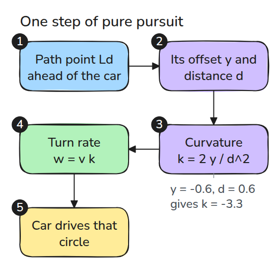
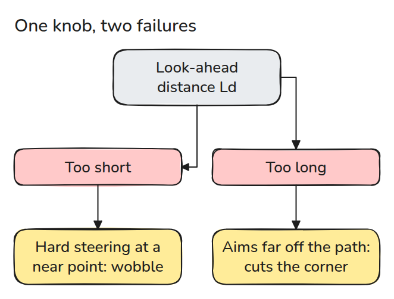
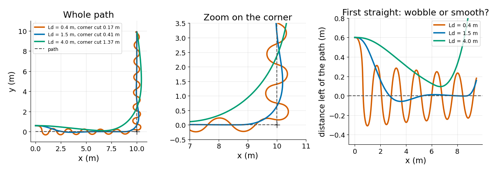

# Path Following with Pure Pursuit

> Aim at a point a fixed distance ahead on the path, and let that one distance trade wobble against cut corners.

**Type:** Build   **Prerequisites:** 08/01 Differential Drive and Odometry   **Time:** ~15 minutes

## In Plain Words

A toy car follows a painted line by steering toward a point on the line a fixed distance ahead. This is pure pursuit, and that distance is the lookahead. If the point is close, a small sideways drift makes the car swing hard, and because its wheels respond late it crosses the line and swings back.

If the point is far, the corrections are gentle. But near a bend the point lies beyond the corner, so the car cuts across it.

## The Problem

You give a mobile robot a path with a right-angle corner. With a short lookahead it snakes along the straight parts, and with a long one it sails across the corner and hits whatever is standing there.

## The Concept



*Pick the path point `Ld` ahead, measure its side offset, and steer along the circle that reaches it.*

In the robot frame (x forward, y left), the target is `d` away and `y` to the left, (negative: right). The circle that starts along the heading and passes through it has curvature `k = 2 y / d^2`, because `d^2 = 2 y R` for radius `R`. Curvature is `1 / R`, so a bigger `|k|` is a tighter turn. The turn rate is `w = v k` for forward speed `v`. It reaches `w` gradually, closing about two thirds of the gap every 0.4 s, our assumption, not a measurement.

Start 0.6 m left of the path, pointing along it, so `y = -0.6`. With `Ld = 0.4 m` no path point is that close, so the nearest one is the target: `d = 0.6` and `k = 2 * -0.6 / 0.6^2 = -3.3`, a circle of radius 0.3 m. With `Ld = 1.5 m`, `d = 1.5` and `k = 2 * -0.6 / 1.5^2 = -0.53`, radius 1.9 m.


*The thin arcs are the first steering circles. Blue (`Ld = 0.4`) is across the line after 1.0 s, green (`Ld = 1.5`) after 2.8 s.*



*A short `Ld` steers hard at a nearby point. A long `Ld` aims far off the path near a corner.*



*Same start; the distance to the corner is the corner cut. `Ld = 0.4 m` crosses the line 10 times but hugs the corner (0.17 m). 1.5 m settles and misses it by 0.41 m, 4 m by 1.37 m.*

A test shows the short lookahead does not wobble without the lag, so the wobble is strong correction (high gain) meeting a slow drive.

## Build It

```python
def curvature(pose, target):
    dx, dy = target - pose[:2]
    y = -np.sin(pose[2]) * dx + np.cos(pose[2]) * dy
    return 2 * y / (dx * dx + dy * dy)

def lookahead_point(path, pos, ld):
    i = np.linalg.norm(path - pos, axis=1).argmin()
    far = np.nonzero(np.linalg.norm(path[i:] - pos, axis=1) >= ld)[0]
    return path[i + far[0]] if len(far) else path[-1]
```

`follow()` runs the loop and returns the trajectory. `sign_changes()` counts line crossings.

```bash
cd robotics-engineering-from-scratch
python3 -m pytest phases/08-mobile-robots/04-path-following-pure-pursuit -q
python3 phases/08-mobile-robots/04-path-following-pure-pursuit/code/main.py
```

## Use It

Nav2's regulated pure pursuit controller steers toward a point ahead on the path. Its README says the right lookahead depends on robot size, responsiveness, update rate and speed, and offers a velocity-scaled one.

Sources: Nav2 `nav2_regulated_pure_pursuit_controller` README, github.com/ros-navigation/navigation2, opened 2026-11-09.

## Ship It

`outputs/skill-pure-pursuit-tuning.md` tunes `Ld` from a wobble count and a corner cut.

## Exercises

1. Scale `Ld` with speed and compare the wobble at 0.5 and 2 m/s.
2. Round the corner with a short arc and measure the cut again.
3. Find the smallest `Ld` with at most 2 line crossings for a lag of 0.2 s.
