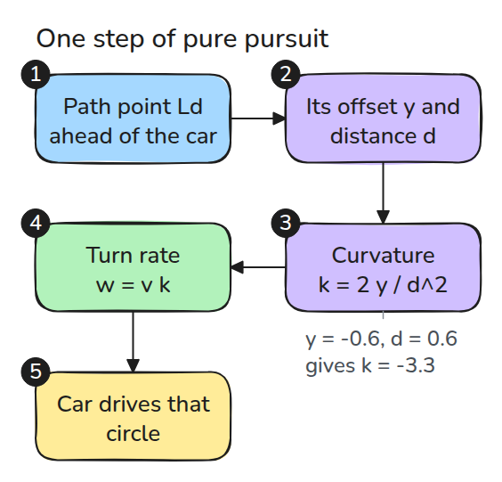
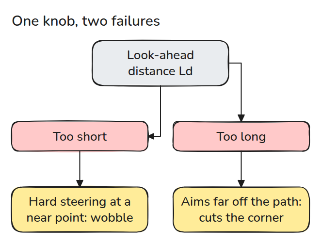
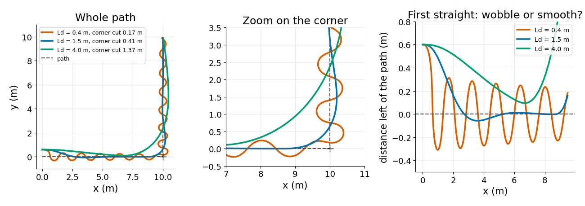

# Pure Pursuit로 경로 따라가기 (Path Following with Pure Pursuit)

> 로봇이 앞쪽의 한 점을 겨냥해 경로를 따라가는 방법과 숫자 하나가 흔들림과 코너 절단을 맞바꾸는 이유를 알아봅니다.

**유형:** 만들기   **선수 지식:** 08/01 차동 구동과 Odometry   **시간:** 약 15분

## 쉽게 말하면

장난감 자동차가 바닥에 그린 선을 따라가요. 선 위의 앞쪽 한 점을 향해 핸들을 돌리고 그 앞쪽 거리가 lookahead예요.
점이 가까우면 옆으로 조금만 벗어나도 차가 크게 휙 돌아요. 바퀴가 늦게 반응해서 선을 넘어가면 다시 반대쪽으로 휙 돌아요.

점이 멀면 방향을 부드럽게 고쳐요. 하지만 굽은 길 근처에서는 점이 모퉁이 너머에 있어서 차가 코너를 가로질러요.

## 핵심 용어

- **Pure pursuit**: 경로 위에서 일정 거리 앞의 점을 향해 로봇을 조향하는 방법입니다.
- **Lookahead (`Ld`)**: 그 일정한 거리입니다. 조정하는 손잡이는 이것 하나입니다.
- **Curvature (`k`)**: 경로가 얼마나 급하게 굽는지입니다. 급하게 돌수록 curvature가 큽니다.
- **Robot frame**: 로봇과 함께 움직이는 좌표계입니다. x는 앞, y는 왼쪽입니다.
- **Gain**: 오차 하나에 로봇이 얼마나 세게 보정하는지입니다.
- **Lag**: 조향 명령 뒤에 바퀴가 따라오기까지의 지연입니다.

## 문제

배달 로봇이 급한 코너가 있는 경로를 따라간다고 상상해 보세요. 가까운 점을 겨냥하면 직선에서 뱀처럼 흔들리고 먼 점을 겨냥하면 코너를 가로지릅니다.

## 개념

로봇은 흔들리지도 코너를 자르지도 않아야 하는데 거리 하나가 둘을 정합니다.

로봇은 늘 경로 위에서 일정 거리 앞의 점을 겨냥하고 그 점에 닿는, 원의 한 조각인 곡선을 따라 조향합니다. 그 거리가 lookahead입니다.



*앞을 겨냥하고 원을 따라 조향합니다.*

가까운 점을 겨냥하면 작은 어긋남에도 크게 돌아서 바퀴가 느린 로봇은 흔들립니다. 먼 점을 겨냥하면 목표가 코너 너머에 있어서 코너를 자릅니다.


*파랑은 가까이 겨냥해서 크게 돌며 선을 넘어 흔들리고 초록은 멀리 겨냥해서 완만하게 돕니다.*



*짧은 lookahead는 세게 조향하고 긴 lookahead는 코너를 자릅니다.*



*lookahead 세 가지입니다. 짧은 것은 흔들리고 긴 것은 코너를 자릅니다.*

<details><summary>The math (optional)</summary>

로봇 좌표계에서 목표점은 `d`만큼 떨어져 있고 왼쪽으로 `y`만큼 벗어나 있으므로 그 점을 지나는 원의 곡률은 `k = 2 y / d^2`이고 `|k|`가 클수록 급하게 돕니다.
회전율은 속도 `v`에 대해 `w = v k`이고 서서히 도달합니다(가정: 0.4초마다 차이의 3분의 2를 줄입니다).
경로 왼쪽 0.6 m에서 출발하면 `Ld = 0.4 m`는 `d = 0.6`, `k = -3.3`이고 `Ld = 1.5 m`는 `d = 1.5`, `k = -0.53`입니다.
파랑(`Ld = 0.4`)은 1.0초 뒤에 선을 넘고 초록(`Ld = 1.5`)은 2.8초 뒤에 넘습니다.
`Ld = 0.4 m`는 선을 10번 가로지르지만 코너에 0.17 m까지 붙고 1.5 m는 코너를 0.41 m, 4 m는 1.37 m 비켜 갑니다.
지연이 없으면 짧은 lookahead도 흔들리지 않습니다(테스트로 확인).

</details>

## 만들기

```python
def curvature(pose, target):
    dx, dy = target - pose[:2]
    y = -np.sin(pose[2]) * dx + np.cos(pose[2]) * dy
    return 2 * y / (dx * dx + dy * dy)

def lookahead_point(path, pos, ld):
    i = np.linalg.norm(path - pos, axis=1).argmin()
    far = np.nonzero(np.linalg.norm(path[i:] - pos, axis=1) >= ld)[0]
    return path[i + far[0]] if len(far) else path[-1]
```

`follow()`는 루프를 돌리고 `sign_changes()`는 선을 가로지른 횟수를 셉니다.

```bash
cd robotics-engineering-from-scratch
python3 -m pytest phases/08-mobile-robots/04-path-following-pure-pursuit -q
python3 phases/08-mobile-robots/04-path-following-pure-pursuit/code/main.py
```

## 실제 도구로 보기

Nav2는 로봇 내비게이션 패키지이고 앞쪽 경로 위의 점을 겨냥하는 pure pursuit 조향 규칙이 있습니다. README는 알맞은 거리가 로봇 크기와 속도에 달려 있다고 말합니다.

출처: Nav2 `nav2_regulated_pure_pursuit_controller` README, github.com/ros-navigation/navigation2, 2026년 11월 9일에 열어 확인했습니다.

## 결과물

`outputs/skill-pure-pursuit-tuning.md`는 흔들림 횟수와 코너 절단으로 `Ld`를 조정합니다.

## 연습 문제

1. lookahead를 길게도 짧게도 해 보고 흔들림과 코너를 보세요.
2. 급한 코너를 완만한 곡선으로 바꾸고 로봇이 코너를 덜 자르는 것을 보세요.
3. 바퀴를 느리게 만들고 짧은 lookahead가 어떻게 되는지 보세요.
