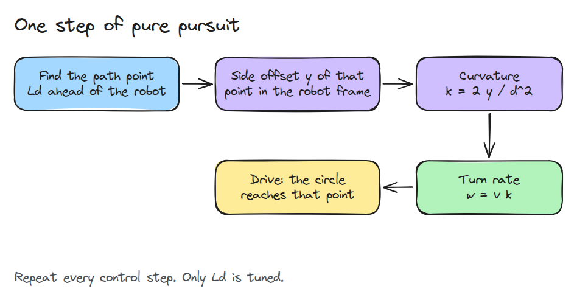
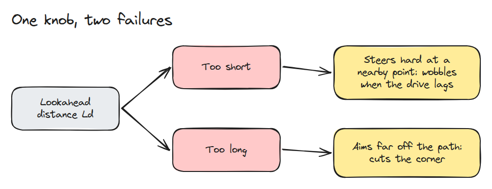
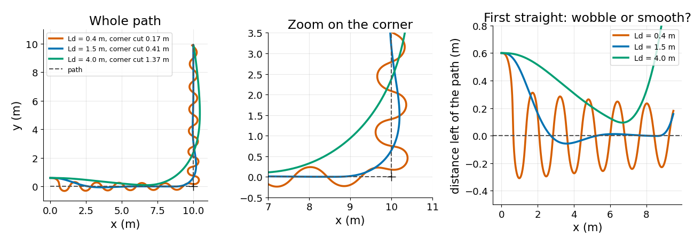

# Pure Pursuit로 경로 따라가기 (Path Following with Pure Pursuit)

> 경로 위에서 일정 거리 앞의 점을 겨냥하면 그 거리 하나가 흔들림과 코너 절단을 맞바꿉니다.

**유형:** 만들기   **선수 지식:** 08/01 차동 구동과 Odometry   **시간:** 약 15분

## 문제

모바일 로봇에 직각 코너가 있는 경로를 줍니다. lookahead가 짧으면 직선에서 뱀처럼 흔들리고 길면 코너를 가로질러 거기 서 있는 것에 부딪힙니다.

## 개념



*경로에서 `Ld` 앞의 점을 고르고 그 점이 로봇 옆으로 얼마나 떨어졌는지 재서 그 점에 닿는 원을 따라 조향합니다.*

목표점을 로봇 좌표계에 놓고 옆 방향 offset을 `y`, 거리를 `d`라고 합니다. 진행 방향으로 출발해 그 점을 지나는 원의 곡률은 `k = 2 y / d^2`이고 테스트가 이를 `2 sin(a) / d`와 대조합니다. 회전율은 `w = v k`입니다.

시뮬레이션의 구동부는 1차 지연을 거쳐 `w`를 따라갑니다. 실제 바퀴 구동은 회전율을 순간적으로 바꿀 수 없기 때문입니다. 시간 상수 0.4초는 측정값이 아니라 우리가 가정한 값입니다.



*짧은 `Ld`는 가까운 점을 향해 세게 조향합니다. 긴 `Ld`는 코너 근처에서 경로에서 멀리 떨어진 점을 겨냥합니다.*



*로봇은 경로 왼쪽 0.6 m에서 1 m/s로 출발합니다. `Ld = 0.4 m`는 첫 직선에서 선을 10번 가로지르고 코너에서 0.17 m 안으로 지나갑니다.*

*1.5 m는 안정되어 코너에서 0.41 m 떨어져 지나갑니다. 4 m는 코너까지 안정되지 못하고 1.37 m 떨어져 지나갑니다.*

지연이 없으면 짧은 lookahead도 흔들리지 않습니다. 테스트가 이를 보이므로 흔들림은 높은 gain이 구동부 지연을 만난 결과입니다.

## 만들기

```python
def curvature(pose, target):
    dx, dy = target - pose[:2]
    y = -np.sin(pose[2]) * dx + np.cos(pose[2]) * dy
    return 2 * y / (dx * dx + dy * dy)

def lookahead_point(path, pos, ld):
    i = np.linalg.norm(path - pos, axis=1).argmin()
    far = np.nonzero(np.linalg.norm(path[i:] - pos, axis=1) >= ld)[0]
    return path[i + far[0]] if len(far) else path[-1]
```

`follow()`는 루프를 돌려 궤적을 돌려주고 `sign_changes()`는 선을 가로지른 횟수를 셉니다.

```bash
cd robotics-engineering-from-scratch
python3 -m pytest phases/08-mobile-robots/04-path-following-pure-pursuit -q
python3 phases/08-mobile-robots/04-path-following-pure-pursuit/code/main.py
```

## 실제 도구로 보기

Nav2의 regulated pure pursuit controller도 같은 발상입니다. 로봇 앞의 경로 위 점을 찾아 그쪽으로 주행합니다.

README는 lookahead 선택이 로봇 크기와 반응성, 갱신 주기, 속도에 달려 있다고 말하며 속도에 비례하는 lookahead도 제공합니다.

출처: Nav2 `nav2_regulated_pure_pursuit_controller` README, github.com/ros-navigation/navigation2, 2026년 11월 9일에 열어 확인했습니다.

## 결과물

`outputs/skill-pure-pursuit-tuning.md`는 흔들림 횟수와 코너 절단으로 `Ld`를 조정합니다.

## 연습 문제

1. `Ld`를 속도에 비례시키고 0.5 m/s와 2 m/s의 흔들림을 비교하세요.
2. 경로의 코너를 짧은 호로 둥글게 만들고 절단을 다시 재세요.
3. 지연 0.2초에서 선 가로지름이 2번 이하인 가장 작은 `Ld`를 찾으세요.
