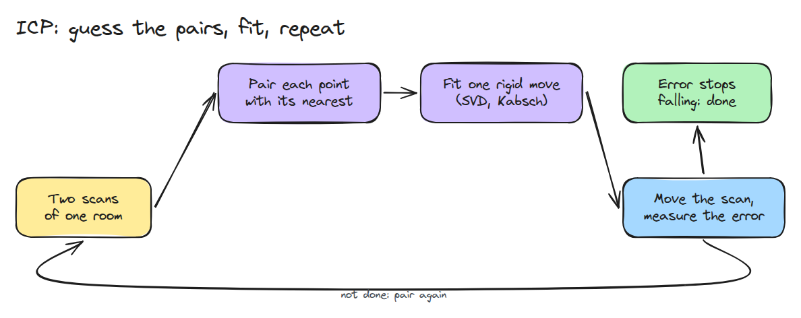
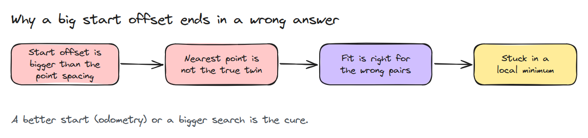
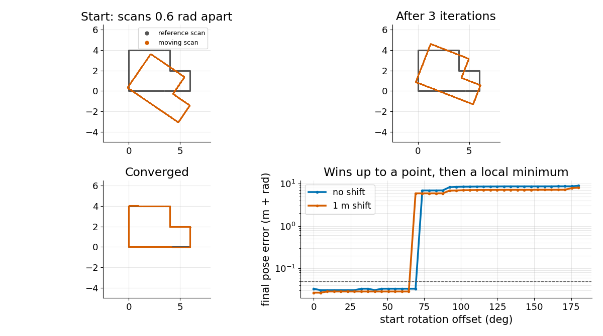

# Scan Matching with ICP

> Learn how a robot lines up two laser scans to work out how far it moved.

**Type:** Build   **Prerequisites:** 01/01 Rotations and SE(3), 08/01 Differential Drive and Odometry   **Time:** ~15 minutes

## In Plain Words

A rover scans an L-shaped room and gets dots along the walls. After moving a little it scans again, and the new dots miss the old ones. ICP pairs each new dot with the nearest old dot, slides and turns the new set to bring pairs closer, and repeats.

From far away, nearest dots pair the wrong walls, so the dots get closer while the move is wrong.

## Key Terms

- **ICP**: iterative closest point, the loop of pairing nearest dots and fitting a move.
- **Rigid move**: a turn plus a slide that keeps all distances inside the shape unchanged.
- **Nearest neighbour**: the closest dot in the other scan.
- **SVD**: a standard matrix tool; here it finds the best turn for a set of pairs.
- **Local minimum**: a dead end where small moves no longer reduce the error, although the answer is wrong.

## The Problem

Picture a robot that scans a room, drives a little, and scans again. Its wheel counts drift, so you want the real move from the two scans alone, which are just clouds of dots.

## The Concept

A robot uses this to correct its wheel-based guess with what its scanner sees.

ICP pairs each new dot with the nearest old dot, then slides and turns the whole new scan to bring the pairs closer. It repeats until the pairs stop getting closer.



*Pair, move, repeat.*

Starting close, the nearest dots are the true partners and the scans lock together. Starting far away, nearest dots belong to the wrong walls and the scans get stuck.


*Green settles. Blue pairs wrong walls and gets stuck.*



*A big offset pairs dots with the wrong wall.*



*Fine for small starting errors, stuck for big ones.*

<details><summary>The math (optional)</summary>

Centre both dot sets on their averages. The SVD (a standard matrix tool) of how paired dots line up gives the best turn `R`, with a sign fix that forbids a mirror image; the shift is `t = q_mean - R p_mean`. The dots sit 0.05 m apart. Started 0.2 rad off, the average distance to the nearest old dot is 0.39 m and 12 iterations bring it to 0.016 m. Started 2.6 rad off, it is 4.07 m and 25 iterations stop at 0.54 m, still 2.5 rad off. The error never rises: each fit is optimal for its pairs. The result is good up to a start rotation of about 65 to 70 degrees for this room; at 100 degrees it is a local minimum. One straight wall cannot fix sliding along it.

</details>

## Build It

```python
def kabsch(P, Q):
    pc, qc = P.mean(0), Q.mean(0)
    U, _, Vt = np.linalg.svd((P - pc).T @ (Q - qc))
    D = np.diag([1.0, np.sign(np.linalg.det(Vt.T @ U.T))])
    R = Vt.T @ D @ U.T
    return R, qc - R @ pc

match = dst[nearest(cur, dst)]
dR, dt = kabsch(cur, match)
cur = cur @ dR.T + dt
```

`icp()` repeats this and returns the total turn, shift and the error history.

```bash
cd robotics-engineering-from-scratch
python3 -m pytest phases/08-mobile-robots/05-icp-scan-matching -q
python3 phases/08-mobile-robots/05-icp-scan-matching/code/main.py
```

## Use It

Open3D's ICP registration takes a rough starting guess. Compare it with `icp()`.

Sources: Open3D ICP registration tutorial, https://www.open3d.org/docs/latest/tutorial/pipelines/icp_registration.html (opened 2026-11-10).

## Ship It

`outputs/skill-icp-check.md` audits a scan-matching step for bad starts, flat walls and false confidence.

## Exercises

1. Add a little noise to both scans and see how the answer changes.
2. Start ICP from a rough wheel guess and find how big a turn it can repair.
3. Remove a corner of the room and see what happens.
