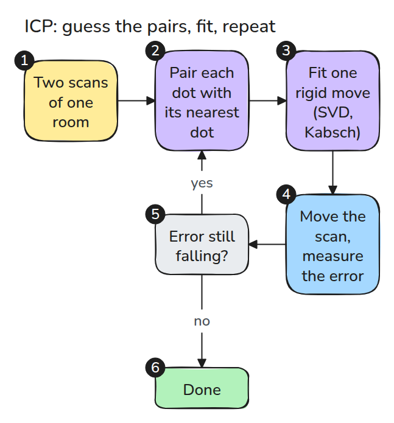
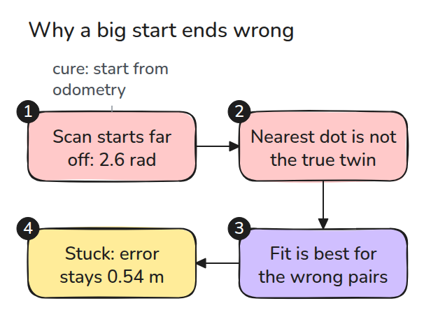
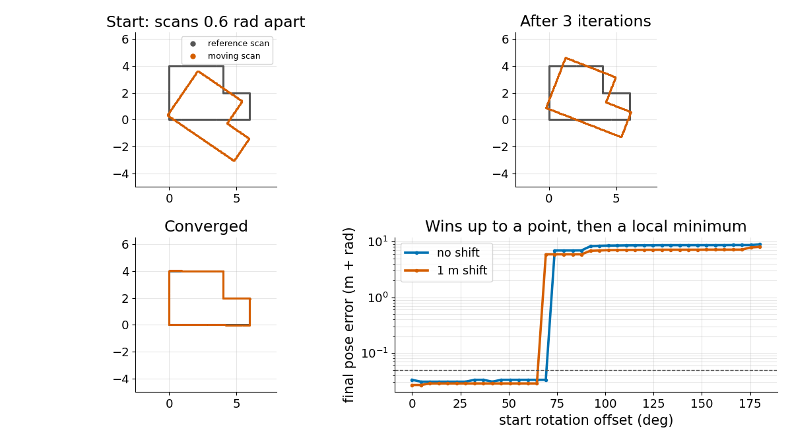

# Scan Matching with ICP

> To line up two scans, guess that each point's partner is its nearest neighbour, fit one rigid move, and repeat until the error stops falling.

**Type:** Build   **Prerequisites:** 01/01 Rotations and SE(3), 08/01 Differential Drive and Odometry   **Time:** ~15 minutes

## In Plain Words

A rover scans an L-shaped room and gets dots along the walls. After moving a little it scans again, and the new dots miss the old ones. Pair each new dot with the nearest old dot, slide and turn the whole new set to bring the pairs closer, and repeat. This is ICP, iterative closest point.

A small starting offset helps: nearest dots are then true partners. From far away they pair the wrong walls, so the dots get closer while the estimated move is wrong.

## The Problem

Wheel odometry (08/01) drifts, and a scanner sees the same room from two slightly different poses. You want the move between the scans, using a rule that works on raw unlabelled points.

## The Concept



*Each pass pairs points, fits one rigid move to those pairs, and applies it.*

If the pairs were right, one step would give the best turn `R` and shift `t`. Centre both dot sets on their averages. The SVD (a standard matrix tool) of how the paired dots line up gives `R`, and a sign fix on its last direction forbids a mirror image. Then `t = q_mean - R p_mean`. ICP does not know the pairs, so it guesses nearest dots.

The dots sit 0.05 m apart along the walls. The lesson's demo starts the second scan 0.2 rad off, where the average distance from a new dot to its nearest old dot is 0.39 m; 12 iterations bring it to 0.016 m. Started 2.6 rad off, that distance is 4.07 m, most pairs are wrong, and 25 iterations stop at 0.54 m, still 2.5 rad off.


*Grey dots are the room; thin lines join dots to nearest partners. Green (0.2 rad) settles on it. Blue (2.6 rad) pairs with wrong walls and gets stuck.*



*A small start offset keeps nearest dots as true partners. A large one puts the nearest dot on the wrong wall, and the fit locks in a wrong answer.*

The error never rises, because each fit is optimal for its pairs and re-pairing only shortens distances.



*Three panels show one run converging. The fourth shows final pose error against starting rotation: good up to about 65 to 70 degrees for this room, then a local minimum (a dead end where small moves no longer help).*

A tiny leftover error can still hide a wrong pose, and one straight wall poorly constrains sliding along it.

## Build It

```python
def kabsch(P, Q):
    pc, qc = P.mean(0), Q.mean(0)
    U, _, Vt = np.linalg.svd((P - pc).T @ (Q - qc))
    D = np.diag([1.0, np.sign(np.linalg.det(Vt.T @ U.T))])
    R = Vt.T @ D @ U.T
    return R, qc - R @ pc

match = dst[nearest(cur, dst)]
dR, dt = kabsch(cur, match)
cur = cur @ dR.T + dt
```

`icp()` repeats this and returns the total `R`, `t` and the error history.

```bash
cd robotics-engineering-from-scratch
python3 -m pytest phases/08-mobile-robots/05-icp-scan-matching -q
python3 phases/08-mobile-robots/05-icp-scan-matching/code/main.py
```

## Use It

Open3D's ICP registration takes a rough initial transformation and alternates finding correspondences with updating it. Compare it with `icp()`, starting from your odometry.

Sources: Open3D ICP registration tutorial, https://www.open3d.org/docs/latest/tutorial/pipelines/icp_registration.html (opened 2026-11-10).

## Ship It

`outputs/skill-icp-check.md` audits a scan-matching step for bad starts, flat walls and false confidence.

## Exercises

1. Add 2 cm of noise to both scans and compare the pose error with the spacing.
2. Start ICP from an odometry guess and find the largest rotation drift it repairs.
3. Ignore the worst 20% of pairs (a trimmed fit) and test with a missing corner.
