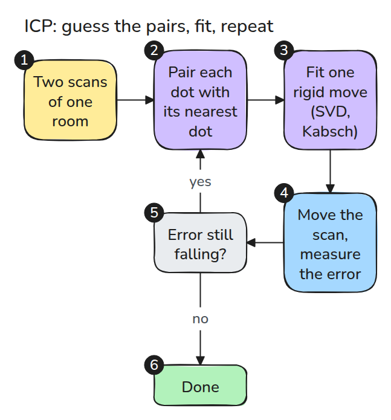
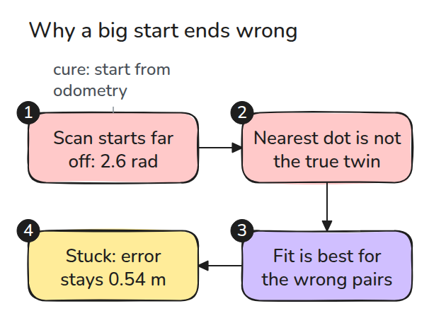
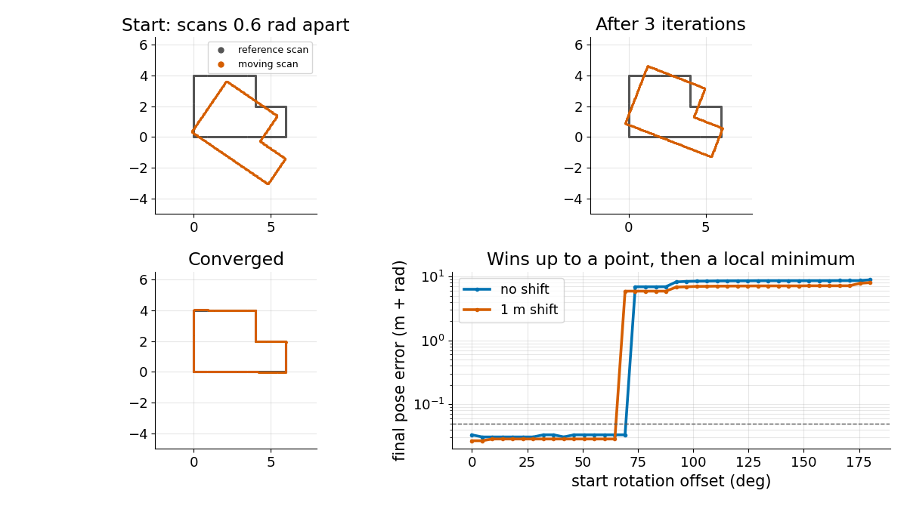

# ICP 스캔 정합 (Scan Matching with ICP)

> 두 스캔을 맞추려면 각 점의 짝이 가장 가까운 점이라고 추측하고 강체 이동 하나를 맞춘 뒤 오차가 줄지 않을 때까지 반복합니다.

**유형:** 만들기   **선수 지식:** 01/01 회전과 SE(3), 08/01 차동 구동과 Odometry   **시간:** 약 15분

## 쉽게 말하면

로버가 L자 방을 스캔해서 벽을 따라 점을 얻어요. 조금 움직인 뒤 다시 스캔하면 새 점들이 옛 점들과 어긋나요.
새 점마다 가장 가까운 옛 점을 짝짓고 새 점 전체를 밀고 돌려 짝 사이를 가깝게 한 뒤 이것을 반복해요. 이것이 ICP(iterative closest point)예요.

처음 어긋남이 작으면 가까운 점이 진짜 짝이라 잘 맞아요. 멀리서 시작하면 엉뚱한 벽끼리 짝이 되어서 점 사이 거리는 줄어도 추정한 이동은 틀려요.

## 문제

바퀴 odometry(08/01)는 drift합니다. 스캐너는 약간 다른 두 자세에서 같은 방을 두 번 봅니다. 두 스캔 사이의 이동을 알면 자세를 고칠 수 있으므로 라벨 없는 점에서도 쓸 수 있는 규칙이 필요합니다.

## 개념



*매 반복마다 점을 짝짓고 그 짝에 강체 이동(돌리고 미는 것) 하나를 맞춰 적용합니다.*

짝이 맞다면 한 번에 가장 좋은 회전 `R`과 이동 `t`가 나옵니다. 두 점 집합의 중심을 각자의 평균에 맞춥니다. 짝지은 점들이 어떻게 겹치는지를 나타내는 cross-covariance를 SVD(표준 행렬 도구)로 분해하면 `R`이 나옵니다.
마지막 방향의 부호를 바로잡아 거울상을 막습니다. 이동은 `t = q_mean - R p_mean`입니다. ICP는 짝을 모르므로 가장 가까운 점을 짝으로 추측합니다.

점은 벽을 따라 0.05 m 간격으로 놓여 있습니다. 레슨의 데모는 두 번째 스캔을 0.2 rad 어긋나게 시작하며 이때 새 점에서 가장 가까운 옛 점까지의 평균 거리는 0.39 m입니다. 12번 반복하면 0.016 m가 됩니다.
2.6 rad 어긋나게 시작하면 그 거리는 4.07 m이고 짝이 대부분 틀려서 25번 반복해도 0.54 m에서 멈추며 스캔은 여전히 2.5 rad 틀어져 있습니다.


*회색 점은 방이고 얇은 선은 스캔 점마다 가장 가까운 짝을 잇습니다. 초록(0.2 rad 시작)은 방에 맞습니다. 파랑(2.6 rad)은 엉뚱한 벽과 짝이 되어 갇힙니다.*



*시작 어긋남이 작으면 가장 가까운 점이 진짜 짝으로 남습니다. 크면 가장 가까운 점이 엉뚱한 벽에 있어서 맞춤이 틀린 답에 고정됩니다.*

오차는 오르지 않습니다. 각 맞춤은 그 짝에서 최적이고 다시 짝지으면 거리가 줄기만 하기 때문입니다.



*세 패널은 한 번의 수렴을 보여 줍니다. 네 번째 패널은 시작 회전에 따른 최종 자세 오차입니다. 이 방에서는 약 65~70도까지 좋고 그 뒤에는 local minimum(작은 움직임으로는 더 나아지지 않는 막다른 곳)입니다.*

맞춘 뒤 남는 오차가 아주 작아도 자세는 틀릴 수 있고 직선 벽 하나는 벽을 따른 이동을 충분히 구속하지 못합니다.

## 만들기

```python
def kabsch(P, Q):
    pc, qc = P.mean(0), Q.mean(0)
    U, _, Vt = np.linalg.svd((P - pc).T @ (Q - qc))
    D = np.diag([1.0, np.sign(np.linalg.det(Vt.T @ U.T))])
    R = Vt.T @ D @ U.T
    return R, qc - R @ pc

match = dst[nearest(cur, dst)]
dR, dt = kabsch(cur, match)
cur = cur @ dR.T + dt
```

`icp()`는 이것을 반복하고 전체 `R`, `t`와 오차 기록을 돌려줍니다.

```bash
cd robotics-engineering-from-scratch
python3 -m pytest phases/08-mobile-robots/05-icp-scan-matching -q
python3 phases/08-mobile-robots/05-icp-scan-matching/code/main.py
```

## 실제 도구로 보기

Open3D의 ICP registration은 대략적인 초기 변환을 받고 대응 찾기와 변환 갱신을 번갈아 합니다. `icp()`와 비교하고 odometry를 초기 추정으로 넣어 보세요.

출처는 Open3D의 ICP registration tutorial입니다(https://www.open3d.org/docs/latest/tutorial/pipelines/icp_registration.html, 2026년 11월 10일 확인).

## 결과물

`outputs/skill-icp-check.md`는 스캔 정합 단계의 나쁜 시작, 평평한 벽, 근거 없는 확신을 점검합니다.

## 연습 문제

1. 두 스캔에 2 cm 노이즈를 넣고 자세 오차를 점 간격과 비교하세요.
2. odometry 추정에서 ICP를 시작해 고칠 수 있는 가장 큰 회전 drift를 찾으세요.
3. 가장 나쁜 짝 20%를 무시하는 trimmed 맞춤을 넣고 모서리가 빠진 경우로 테스트하세요.
