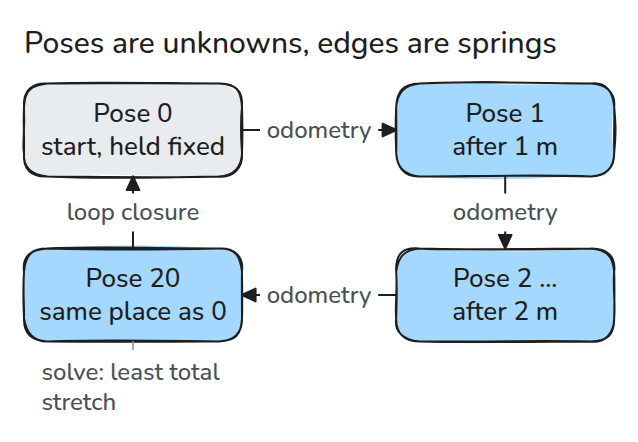
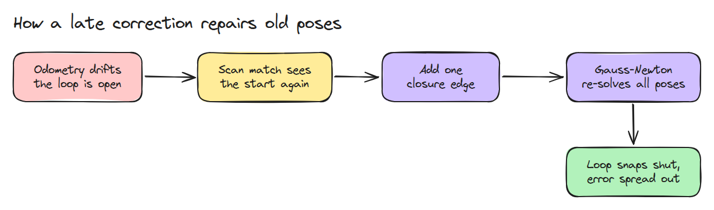

# Pose Graph and Loop Closure

> Learn how recognising a place you have been before can straighten a whole drifted trip at once.

**Type:** Build   **Prerequisites:** 08/05 Scan Matching with ICP, 07/02 Kalman Filter   **Time:** ~15 minutes

## In Plain Words

A rover drives a square, but wheel errors leave its path ending away from the start. Moving only the last pose leaves every earlier turn misplaced.

A pose graph joins each stop to the next with a spring, the measured move. Recognising the start adds one more spring. All poses then shift together to stretch every spring as little as possible, and a false match bends the map.

## Key Terms

- **Pose graph**: poses as unknowns, joined by measurements that act like springs.
- **Loop closure**: recognising a place already visited, which adds one more spring.
- **Residual**: how far a spring is stretched, the guess minus the measurement.
- **Gauss-Newton**: a method that repeats the step that most reduces the cost, treating residuals as straight lines.
- **rms error**: root mean square, the typical distance of a pose from the truth.

## The Problem

Picture a robot driving around a square. Wheel counts say it ended 1.4 m from the start, but a scan match says the last scan matches the first. Fixing only the last position leaves the rest of the trip bent.

## The Concept

A robot that returns to a known place can fix its whole map at once, not one point.

Think of the trip as a chain of positions joined by springs. Each spring is a measured move. Recognising the start adds one more spring from the end back to the beginning.



*Moves are springs. The loop adds one more.*

All positions then shift together to stretch every spring as little as possible. The correction spreads along the whole trip.


*Blue, a false match, bends the map. Green, a true match, closes the square.*



*One new spring, then everything is re-solved.*


*Drift opens the loop. Solving closes it.*

<details><summary>The math (optional)</summary>

A pose is `(x, y, heading)`. An edge from pose `i` to `j` carries a measurement `z`; its residual (how stretched the spring is) is `between(x_i, x_j) - z`, with the heading difference wrapped into one turn. Each residual is divided by its noise, so trusted springs are stiffer, and the cost is the sum of squared residuals. Gauss-Newton repeats the step that most reduces it. Sliding or turning the whole map changes no residual, so pose 0 is held fixed. Poses sit one per metre, 0 to 20; 5, 10, 15, 20 are corners. Odometry ends 1.42 m away with rms error 0.70 m. A true closure moves poses 5, 10, 15 and 20 by 0.20, 0.59, 1.03 and 1.41 m, and rms error falls to 0.09 m. A false closure raises it to 1.88 m and ends 3.6 m from the start.

</details>

## Build It

```python
def residuals(X, edges):
    out = []
    for i, j, z, w in edges:
        e = between(X[i], X[j]) - z
        e[2] = wrap(e[2])
        out.append(w * e)
    return np.concatenate(out)

J = jacobian(X, edges, free=range(1, len(X)))   # numeric, pose 0 held fixed
dx = np.linalg.lstsq(J, -residuals(X, edges), rcond=None)[0]
```

Tests check that cost never rises, pose 0 stays put and a wrong closure hurts.

```bash
cd robotics-engineering-from-scratch
python3 -m pytest phases/08-mobile-robots/06-pose-graph-and-loop-closure -q
python3 phases/08-mobile-robots/06-pose-graph-and-loop-closure/code/main.py
```

## Use It

Build this graph in g2o and compare positions with `solve()`.

Sources: Kümmerle et al., g2o: A General Framework for Graph Optimization (ICRA 2011), http://ais.informatik.uni-freiburg.de/publications/papers/kuemmerle11icra.pdf (abstract read, 2026-11-10).

## Ship It

`outputs/skill-pose-graph-check.md` audits a pose-graph solve for a missing anchor and a false closure.

## Exercises

1. Remove the heading error and see whether the closure still helps.
2. Make the closure measurement less certain and watch the error.
3. Add a second closure halfway round the square.
