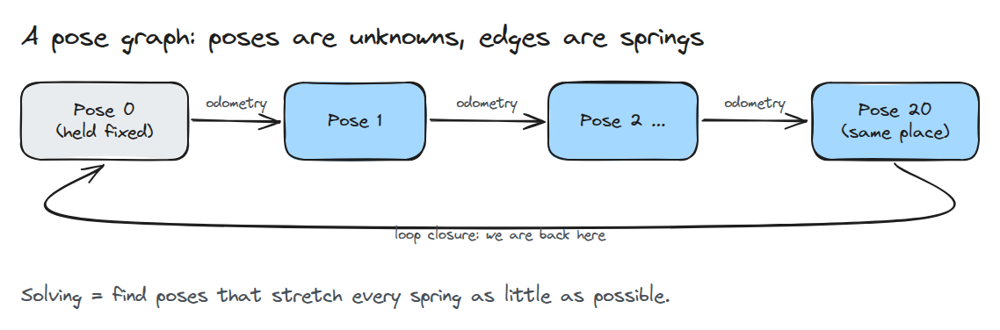
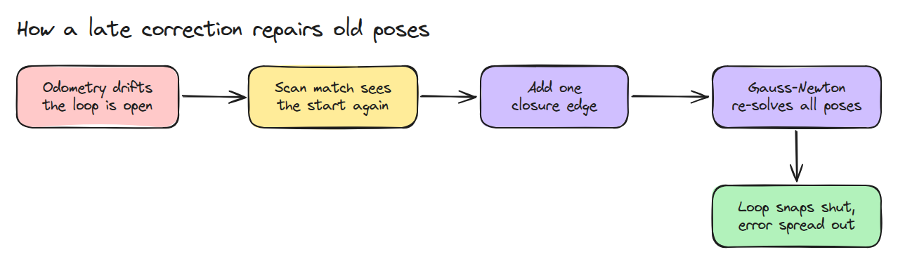
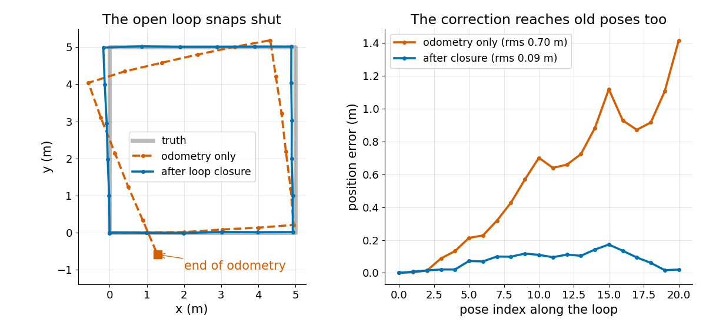

# Pose Graph and Loop Closure

> Treat poses as unknowns and measurements as springs between them, and one late "we are back here" measurement bends the whole drifted trajectory shut.

**Type:** Build   **Prerequisites:** 08/05 Scan Matching with ICP, 07/02 Kalman Filter   **Time:** ~15 minutes

## In Plain Words

Your sketch of a walk around school ends away from the entrance, although you recognise the entrance again. Moving only the final mark
leaves the earlier turns misplaced.

A pose graph links each recorded stop to its neighbours with measured movements. Recognising the entrance adds a loop closure linking
the end to the start. Hold the starting mark fixed and adjust the other poses together, giving more weight to reliable measurements. A
mistaken recognition can pull the whole map the wrong way.

## The Problem

You drive a 5 m square and odometry says the robot ended 1.4 m from where it started. A scan match (08/05) then reports that the last scan looks exactly like the first. Overwriting the last pose fixes one point and leaves every earlier pose and the map built from them still bent.

## The Concept



*Each odometry step is a spring between neighbouring poses. The loop closure is one more spring from the last pose to the first.*

A pose is `(x, y, heading)`. An edge from pose `i` to `j` carries a measurement `z`, the pose of `j` as seen from `i`. Its residual is `between(x_i, x_j) - z`, with the heading difference wrapped. Each residual is divided by its noise, so trusted springs are stiffer. The cost is the sum of squared residuals.



*One closure edge enters the graph and the solver re-solves every pose at once.*

Gauss-Newton linearises the residuals, solves a least-squares step and repeats. With every pose free, shifting or rotating the whole map changes no residual, so three directions are undetermined. Holding pose 0 fixed removes them.



*Left: odometry drifts open, and the solved trajectory lands on the square. Right: the error shrinks along the whole loop, not only at the end.*

A closure edge is a claim. A wrong one bends the map worse than none, which a test checks.

## Build It

```python
def residuals(X, edges):
    out = []
    for i, j, z, w in edges:
        e = between(X[i], X[j]) - z
        e[2] = wrap(e[2])
        out.append(w * e)
    return np.concatenate(out)

J = jacobian(X, edges, free=range(1, len(X)))   # numeric, pose 0 held fixed
dx = np.linalg.lstsq(J, -residuals(X, edges), rcond=None)[0]
```

Tests check that cost never rises, pose 0 does not move, the unanchored Jacobian has rank `3n - 3`, and a wrong closure gives a worse map.

```bash
cd robotics-engineering-from-scratch
python3 -m pytest phases/08-mobile-robots/06-pose-graph-and-loop-closure -q
python3 phases/08-mobile-robots/06-pose-graph-and-loop-closure/code/main.py
```

## Use It

g2o frames SLAM as a graph of poses and constraints solved by nonlinear least squares, with Gauss-Newton or Levenberg-Marquardt. Build the same graph there and compare the poses with `solve()`.

Sources: Kümmerle et al., g2o: A General Framework for Graph Optimization (ICRA 2011),
http://ais.informatik.uni-freiburg.de/publications/papers/kuemmerle11icra.pdf
(found by search 2026-11-10, abstract-level summary only).

## Ship It

`outputs/skill-pose-graph-check.md` audits a pose-graph solve for a missing anchor, bad edge weights and a false closure.

## Exercises

1. Remove the heading bias and see how far the closure still moves the map.
2. Make the loop closure 10 times less certain and watch the error spread.
3. Add a second closure between poses 5 and 15 and compare the error.
