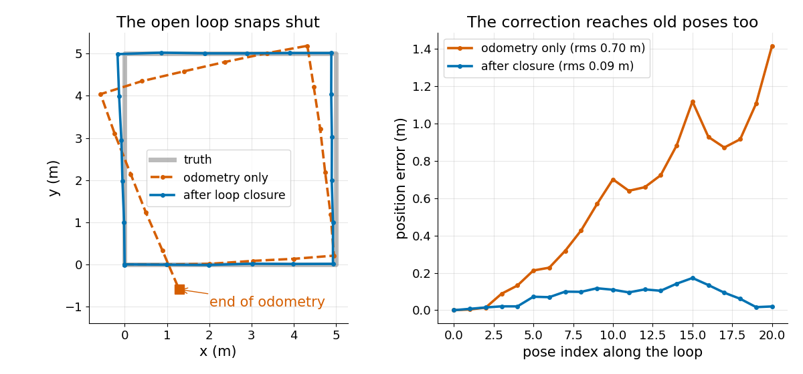

# Pose Graph and Loop Closure

> Learn how recognising a place you have been before can straighten a whole drifted trip at once.

**Type:** Build   **Prerequisites:** 08/05 Scan Matching with ICP, 07/02 Kalman Filter   **Time:** ~15 minutes

## In Plain Words

A rover drives a square, but wheel errors leave its path ending away from the start. Moving only the last pose leaves every earlier turn misplaced.

A pose graph joins each stop to the next with a spring, the measured move. Recognising the start adds one more spring. All poses then shift together to stretch every spring as little as possible, and a false match bends the map.

## Key Terms

- **Pose graph**: poses as unknowns, joined by measurements that act like springs.
- **Loop closure**: recognising a place already visited, which adds one more spring.
- **Residual**: how far a spring is stretched, the guess minus the measurement.
- **Gauss-Newton**: a method that repeats the step that most reduces the cost, treating residuals as straight lines.
- **rms error**: root mean square, the typical distance of a pose from the truth.

## The Problem

Picture a robot driving a 5 m square. Odometry says it ended 1.4 m from the start; a scan match (08/05) says the last scan matches the first. Fixing only the last pose leaves the rest bent.

## The Concept

A real robot that returns to a known place can fix its whole map at once, not one point.


*Odometry steps are springs; the loop closure adds one more.*

An edge from pose `i` to `j` carries a measurement `z`, the pose of `j` seen from `i`. Its residual is `between(x_i, x_j) - z`, with the heading difference wrapped into one turn. Dividing each residual by its noise makes trusted springs stiffer. The cost is the sum of squared residuals.

Poses sit one per metre, 0 to 20; 5, 10, 15, 20 are corners. Odometry ends 1.42 m away with rms error 0.70 m. A true closure moves poses 5, 10, 15 and 20 by 0.20, 0.59, 1.03 and 1.41 m, and rms error falls to 0.09 m. A false closure raises it to 1.88 m.


*Blue (false closure) ends 3.6 m from the start; green (true) closes the square.*


*Closure in, poses re-solved.*

Sliding or turning the whole map changes no residual, so pose 0 is held fixed.



*Left: drift opens the loop; solving closes it. Right: error shrinks.*

## Build It

```python
def residuals(X, edges):
    out = []
    for i, j, z, w in edges:
        e = between(X[i], X[j]) - z
        e[2] = wrap(e[2])
        out.append(w * e)
    return np.concatenate(out)

J = jacobian(X, edges, free=range(1, len(X)))   # numeric, pose 0 held fixed
dx = np.linalg.lstsq(J, -residuals(X, edges), rcond=None)[0]
```

Tests check that cost never rises, pose 0 stays put and a wrong closure hurts.

```bash
cd robotics-engineering-from-scratch
python3 -m pytest phases/08-mobile-robots/06-pose-graph-and-loop-closure -q
python3 phases/08-mobile-robots/06-pose-graph-and-loop-closure/code/main.py
```

## Use It

Build this graph in g2o and compare poses with `solve()`.

Sources: Kümmerle et al., g2o: A General Framework for Graph Optimization (ICRA 2011), http://ais.informatik.uni-freiburg.de/publications/papers/kuemmerle11icra.pdf (abstract read, 2026-11-10).

## Ship It

`outputs/skill-pose-graph-check.md` audits a pose-graph solve for a missing anchor and a false closure.

## Exercises

1. Remove the heading bias; does the closure still help?
2. Make the closure 10 times less certain; watch the error.
3. Add a second closure between poses 5 and 15.
