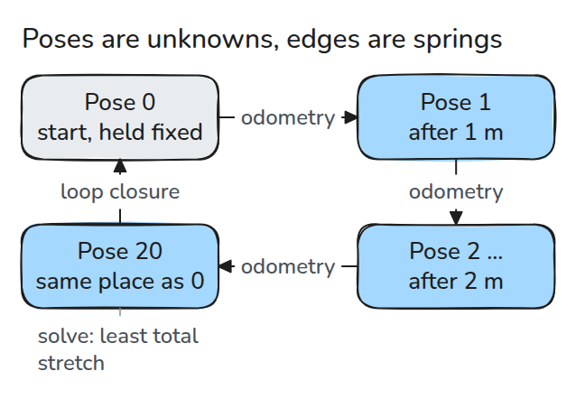
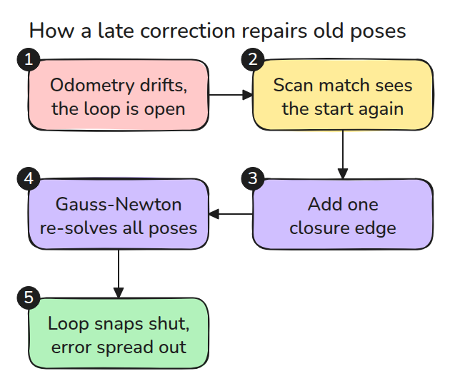
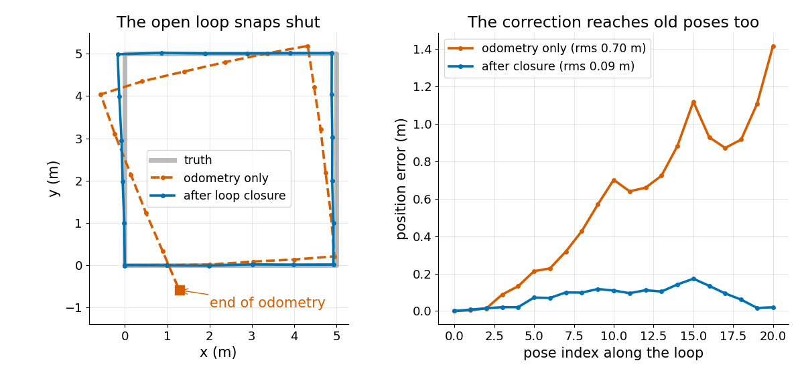

# Pose Graph와 루프 폐쇄 (Pose Graph and Loop Closure)

> pose를 미지수로 두고 측정을 그 사이의 스프링으로 보면 늦게 들어온 "여기로 돌아왔다"는 측정 하나가 drift한 궤적 전체를 닫아 줍니다.

**유형:** 만들기   **선수 지식:** 08/05 ICP 스캔 정합, 07/02 칼만 필터   **시간:** 약 15분

## 쉽게 말하면

로버가 사각형을 도는데 바퀴가 매 step마다 조금씩 틀려서 기록한 경로가 출발점에서 떨어져 끝나요. 마지막 pose만 옮기면 앞에서 돈 모퉁이들은 여전히 틀려요.

pose graph는 기록한 자리를 다음 자리와 측정한 이동으로 잇는데 이 연결이 스프링 같아요. 출발점을 알아보면 끝에서 시작으로 가는 스프링이 하나 더 생겨요.
첫 pose는 고정하고 모든 pose가 함께 움직여서 스프링이 되도록 덜 늘어나게 해요. 믿을 만한 스프링이 더 세게 당겨요. 잘못 알아보면 지도가 엉뚱하게 끌려가요.

## 문제

5 m 정사각형을 돌았는데 odometry는 로봇이 출발점에서 1.4 m 떨어져 끝났다고 말합니다. 스캔 정합(08/05)은 마지막 스캔이 첫 스캔과 똑같다고 알려 줍니다.
마지막 pose만 덮어쓰면 점 하나만 고쳐지고 이전의 모든 pose와 지도는 여전히 휘어 있습니다.

## 개념



*odometry 한 걸음이 이웃한 pose 사이의 스프링입니다. 루프 폐쇄는 마지막 pose에서 첫 pose로 가는 스프링 하나를 더합니다.*

pose는 `(x, y, heading)`입니다. pose `i`에서 `j`로 가는 edge는 `i`에서 본 `j`의 pose인 측정 `z`를 가집니다. 스프링이 얼마나 늘어났는지를 뜻하는 잔차(residual)는 `between(x_i, x_j) - z`입니다. 지금 추정에서 본 그 모습에서 측정값을 뺀 것이고 heading 차이는 한 바퀴 안으로 wrap합니다.
잔차를 각자의 노이즈로 나누어 믿을 만한 스프링일수록 뻣뻣하게 만듭니다. cost는 잔차 제곱의 합입니다.

정사각형의 pose 0부터 20은 1 m마다 하나씩 있어서 5, 10, 15, 20이 모서리입니다(20은 다시 출발점). odometry는 1.42 m 떨어져 끝나고 rms 오차(pose가 참 위치에서 떨어진 전형적인 거리)는 0.70 m입니다.
맞는 폐쇄는 이 어긋남을 루프를 따라 나누어 pose 5, 10, 15, 20을 각각 0.20, 0.59, 1.03, 1.41 m 옮기고 rms 오차는 0.09 m로 줄어듭니다. 틀린 폐쇄(끝을 3 m, 2 m 떨어진 곳과 맞춘 것)는 오차를 1.88 m로 키웁니다.


*주황색 스프링을 보세요. 파랑(틀린 폐쇄)은 출발점에서 3.6 m 떨어져 끝나고 초록(맞는 폐쇄)은 정사각형을 닫습니다.*



*폐쇄 edge 하나가 들어오면 모든 pose를 다시 풉니다.*

Gauss-Newton은 잔차를 직선으로 보고 cost를 가장 많이 줄이는 한 걸음을 반복합니다.
지도 전체를 x나 y로 밀거나 돌려도 잔차가 변하지 않아서 이 세 방향은 pose 0을 고정하기 전까지 정해지지 않습니다.



*왼쪽은 odometry가 열린 채 drift하고 푼 궤적이 정사각형에 겹치는 모습입니다. 오른쪽은 오차가 루프 전체에서 줄어드는 모습입니다.*


## 만들기

```python
def residuals(X, edges):
    out = []
    for i, j, z, w in edges:
        e = between(X[i], X[j]) - z
        e[2] = wrap(e[2])
        out.append(w * e)
    return np.concatenate(out)

J = jacobian(X, edges, free=range(1, len(X)))   # numeric, pose 0 held fixed
dx = np.linalg.lstsq(J, -residuals(X, edges), rcond=None)[0]
```

테스트는 cost가 오르지 않는지, pose 0이 움직이지 않는지, 틀린 폐쇄가 지도를 더 나쁘게 만드는지 확인합니다.

```bash
cd robotics-engineering-from-scratch
python3 -m pytest phases/08-mobile-robots/06-pose-graph-and-loop-closure -q
python3 phases/08-mobile-robots/06-pose-graph-and-loop-closure/code/main.py
```

## 실제 도구로 보기

g2o는 SLAM을 pose와 제약의 그래프로 보고 Gauss-Newton이나 Levenberg-Marquardt로 비선형 최소제곱을 풉니다. 같은 그래프를 그쪽에 만들어 `solve()`와 pose를 비교해 보세요.

출처는 Kümmerle 외, g2o: A General Framework for Graph Optimization (ICRA 2011)입니다(http://ais.informatik.uni-freiburg.de/publications/papers/kuemmerle11icra.pdf).
2026년 11월 10일 검색으로 찾았고 요약 수준만 읽었습니다.

## 결과물

`outputs/skill-pose-graph-check.md`는 pose graph 풀이의 빠진 anchor, 잘못된 edge 가중치, 거짓 폐쇄를 점검합니다.

## 연습 문제

1. heading bias를 없애도 폐쇄가 여전히 도움이 되는지 보세요.
2. 폐쇄의 확신을 10배 낮추고 오차를 보세요.
3. pose 5와 15 사이에 폐쇄를 하나 더 넣고 비교하세요.
