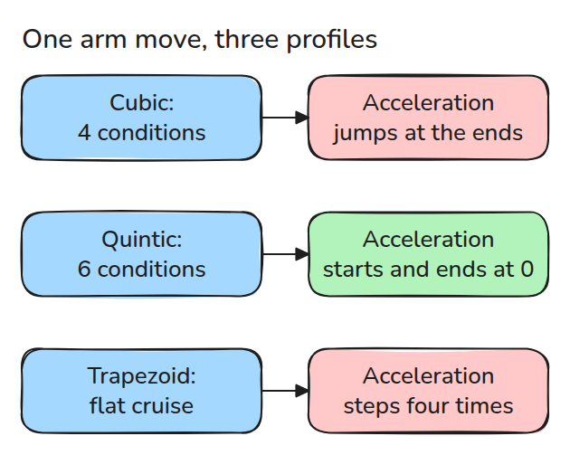
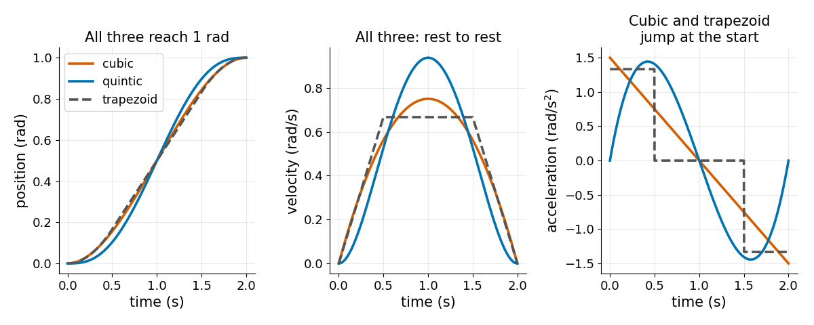
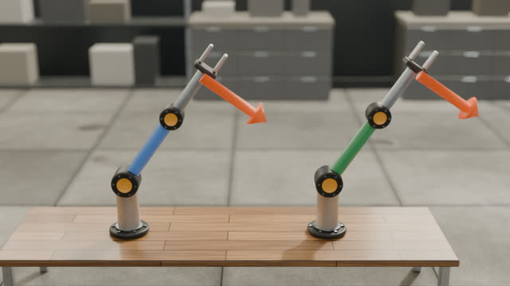

# Trajectory Profiles

> Learn why a smooth-looking move can still jolt a robot arm, and how to plan a gentler one.

**Type:** Build   **Prerequisites:** none   **Time:** ~15 minutes

## In Plain Words

A bench arm swings from one pose to another and stops. To change speed, the motor pushes. The faster the speed must change, the harder it pushes. That rate of change is acceleration.

If acceleration jumps from zero to a large value, the push jumps too and the arm gets a knock. A quintic profile starts and ends with zero acceleration, so the extra push for acceleration grows smoothly.

## Key Terms

- **Trajectory profile**: the plan of how a joint's position changes over time between two poses.
- **Acceleration**: how fast the speed changes; changing a joint's speed takes extra push from the motor.
- **Jerk**: how fast the acceleration changes. A jump in acceleration is a spike in jerk.
- **Quintic**: the simplest curve whose position, speed and acceleration are all set at both ends.
- **Torque**: the turning force a motor applies to a joint.
- **Control tick**: one step of the program that drives the motor; here 0.002 s.

## The Problem

Picture a robot arm moving between two poses along a smooth-looking curve. It reaches the target at rest, yet it knocks at the start of the move.

## The Concept

A real arm is worn and shaken by sudden pushes from its motors, so a plan should build the push up gradually.

Three plans for the same move differ only at the ends: a trapezoid (speed up, cruise, slow down), a cubic and a quintic. The first two make acceleration jump at the ends. The quintic eases in and eases out.



*Same move, three plans.*



*Only the quintic starts and ends with zero acceleration.*


*A jump in acceleration reaches the motor as a hard knock.*


*Checking the plan more often makes the jumpy plans look worse.*

[](../assets/clip-example.mp4)

*Blue jumps on and off. Green eases in.*

<details><summary>The math (optional)</summary>

A quintic is a polynomial of degree 5. Each condition fixes one number of a polynomial. Position and speed at both ends give four conditions, a cubic; adding acceleration at both ends gives six, a quintic. With `s = t/T` and `d = qf - q0`, the quintic is `q0 + d(10 s^3 - 15 s^4 + 6 s^5)`. Jerk is how fast acceleration changes. Halving the sample period doubles cubic and trapezoid jerk; the quintic stays at `60 d / T^3`. For a 1 rad move in 2 s sampled every 0.002 s, the trapezoid accelerates at 1.33 rad/s² for 0.5 s, so acceleration steps four times, each a jerk of 667. The quintic peaks at 7.5. Doubling the move time cuts the quintic's peak acceleration to a quarter.

</details>

## Build It

```python
def quintic(q0, qf, T):
    d = qf - q0
    return np.array([q0, 0.0, 0.0, 10*d/T**3, -15*d/T**4, 6*d/T**5])
```

`poly` evaluates position, velocity and acceleration. `trapezoid` speeds up, cruises, then slows. `peak_jerk` assumes the joint rests before and after.

```bash
cd robotics-engineering-from-scratch
python3 -m pytest phases/09-motion-planning/01-trajectory-profiles -q
python3 phases/09-motion-planning/01-trajectory-profiles/code/main.py
```

## Use It

SciPy, a Python maths library, can build the same quintic, and the last test compares them.

Sources: Craig, *Introduction to Robotics*, 3rd ed., ch. 7.

## Ship It

`outputs/skill-trajectory-profile-check.md` checks a profile's end conditions and jerk before it reaches a joint.

## Exercises

1. Make the move take twice as long and see how the peak acceleration changes.
2. Shorten the sample period and watch the jumpy plans get worse.
3. Make the move bigger and see how the peak acceleration changes.
