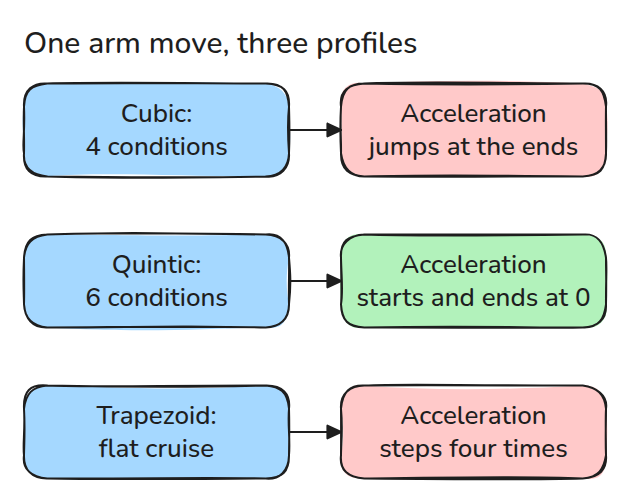
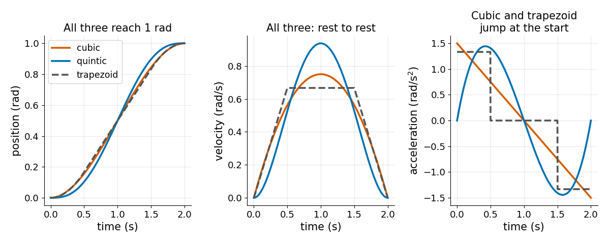
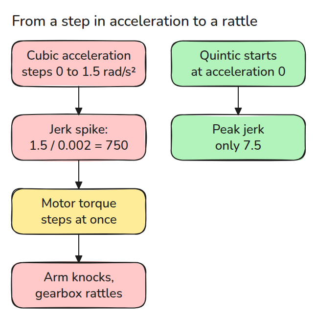
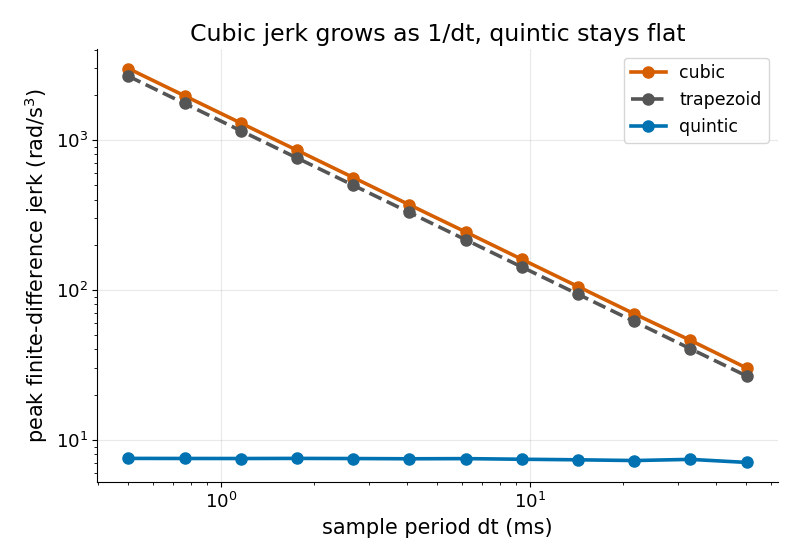

# Trajectory Profiles

> Joining two points with a path is easy. A path the motor can follow without a jerk takes six conditions, not four.

**Type:** Build   **Prerequisites:** high-school calculus   **Time:** ~15 minutes

## In Plain Words

A bench arm swings from one pose to another and stops. To change speed the motor pushes, and it pushes harder the faster the speed must change. That rate of change is acceleration.

If the plan makes acceleration jump from zero to a large value at once, the motor's push jumps too and the arm gets a knock. A quintic profile starts and ends with zero acceleration, so the push grows from nothing.

## The Problem

A joint moves between two poses along a smooth-looking curve and still knocks at the start. Position and speed are fine, because the curve ends at the right place at rest. Acceleration is the culprit: it jumps from zero to a large value in one control tick (one controller step, here 0.002 s).

## The Concept

The red boxes mark where acceleration misbehaves.



*Same move, three profiles. They differ in acceleration at the ends.*

A polynomial is a sum of powers of time, such as `a + b t + c t^2`, and each condition we demand fixes one of its numbers. Position and speed at both ends give four conditions, so the highest power is 3 (a cubic). Adding acceleration at both ends gives six, so it is 5 (a quintic). A trapezoid cruises between a constant speed-up and slow-down. With `s = t/T` and `d = qf - q0`, the quintic is `q0 + d(10 s^3 - 15 s^4 + 6 s^5)`.



*Look at the right panel, acceleration. All three reach the target at rest, but only the quintic starts and ends at zero.*

A jump in acceleration is a spike in jerk, the rate at which acceleration changes.



*Follow the arrows: the motor sees the spike in jerk as a step in torque, its turning force.*



*Watch the orange line climb as the sample period shrinks. Halving it doubles cubic and trapezoid jerk. The quintic stays at `60 d / T^3`.*

Worked example: a 1 rad move in 2 s, sampled every 0.002 s. The trapezoid accelerates at 1.33 rad/s² for 0.5 s, so acceleration steps four times: on, off, reverse, off. Each step gives a jerk of `1.33 / 0.002 = 667`. The quintic never steps and peaks at 7.5.


*Watch the red arrow, the joint's acceleration. Blue arm (trapezoid): it appears, vanishes, flips backward, vanishes. Green arm (quintic): it grows and fades smoothly.*

## Build It

```python
def quintic(q0, qf, T):
    d = qf - q0
    return np.array([q0, 0.0, 0.0, 10*d/T**3, -15*d/T**4, 6*d/T**5])
```

`poly` evaluates position, velocity and acceleration from coefficients. `trapezoid` accelerates for `ta`, cruises at `d/(T-ta)`, then decelerates. `peak_jerk` treats the joint as resting before and after the move, which is where the step comes from.

```bash
cd robotics-engineering-from-scratch
python3 -m pytest phases/09-motion-planning/01-trajectory-profiles -q
python3 phases/09-motion-planning/01-trajectory-profiles/code/main.py
```

## Use It

SciPy's `BPoly.from_derivatives` builds the same quintic from end derivatives, and the last test compares them.

Sources: Craig, *Introduction to Robotics*, 3rd ed., ch. 7 (trajectory generation).

## Ship It

`outputs/skill-trajectory-profile-check.md` checks a profile's boundary conditions and jerk before it reaches a joint.

## Exercises

1. Add a seventh condition, zero jerk at both ends, and say which degree you need.
2. For a trapezoid, find the smallest `ta` that keeps peak acceleration below a given limit.
3. Time-scale a quintic to `2T` and show that peak acceleration drops by a factor of four.
