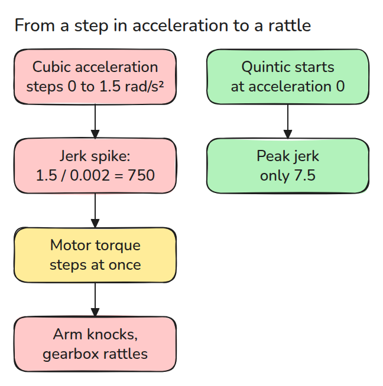
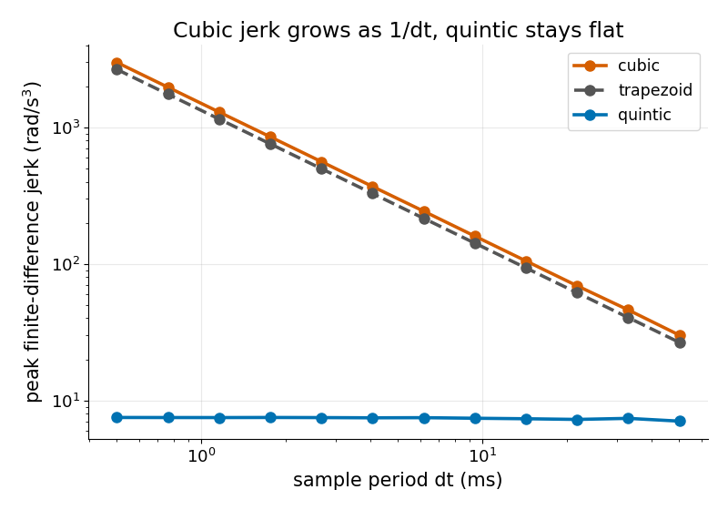

# Trajectory Profiles

> Learn why a smooth-looking move can still jolt a robot arm, and how to plan a gentler one.

**Type:** Build   **Prerequisites:** high-school calculus   **Time:** ~15 minutes

## In Plain Words

A bench arm swings from one pose to another and stops. To change speed the motor pushes, harder the faster the speed must change. That rate of change is acceleration.

If acceleration jumps from zero to a large value at once, the push jumps too and the arm gets a knock. A quintic profile starts and ends with zero acceleration, so the push grows from nothing.

## Key Terms

- **Trajectory profile**: the plan of how a joint's position changes over time between two poses.
- **Acceleration**: how fast the speed changes; the motor's push follows it.
- **Jerk**: how fast the acceleration changes. A jump in acceleration is a spike in jerk.
- **Quintic**: a polynomial of degree 5, the lowest that can fix position, speed and acceleration at both ends.
- **Torque**: the turning force a motor applies to a joint.
- **Control tick**: one step of the controller; here 0.002 s.

## The Problem

Picture a robot arm on a smooth-looking curve that still knocks at the start. Position and speed are fine; acceleration jumps from zero to a large value in one control tick.

## The Concept

A real arm is worn and shaken by sudden torque, so plans should change acceleration gradually.


*Same move, three profiles. Red marks bad acceleration.*

Each condition fixes one number of a polynomial, a sum of powers of time. Position and speed at both ends give four conditions, so a cubic (highest power 3). Acceleration at both ends makes six, so a quintic (power 5). A trapezoid speeds up, cruises, then slows down. With `s = t/T` and `d = qf - q0`, the quintic is `q0 + d(10 s^3 - 15 s^4 + 6 s^5)`.


*Acceleration (right): only the quintic starts and ends at zero.*



*The motor sees a jerk spike as a step in torque.*



*Halving the sample period doubles cubic and trapezoid jerk. The quintic stays at `60 d / T^3`.*

Take a 1 rad move in 2 s, sampled every 0.002 s. The trapezoid accelerates at 1.33 rad/s² for 0.5 s, so acceleration steps four times, each a jerk of `1.33 / 0.002 = 667`. The quintic peaks at 7.5.


*Red arrow: acceleration. Blue (trapezoid) jumps on, off, backward, off. Green (quintic) changes smoothly.*

## Build It

```python
def quintic(q0, qf, T):
    d = qf - q0
    return np.array([q0, 0.0, 0.0, 10*d/T**3, -15*d/T**4, 6*d/T**5])
```

`poly` evaluates position, velocity and acceleration; `trapezoid` accelerates for `ta`, cruises, then decelerates; `peak_jerk` assumes the joint rests before and after.

```bash
cd robotics-engineering-from-scratch
python3 -m pytest phases/09-motion-planning/01-trajectory-profiles -q
python3 phases/09-motion-planning/01-trajectory-profiles/code/main.py
```

## Use It

SciPy's `BPoly.from_derivatives` builds the same quintic; the last test compares them.

Sources: Craig, *Introduction to Robotics*, 3rd ed., ch. 7.

## Ship It

`outputs/skill-trajectory-profile-check.md` checks a profile's end conditions and jerk before it reaches a joint.

## Exercises

1. Add a seventh condition, zero jerk at both ends; find the degree.
2. For a trapezoid, find the smallest `ta` that keeps peak acceleration under a limit.
3. Time-scale a quintic to `2T`; show peak acceleration drops by four.
