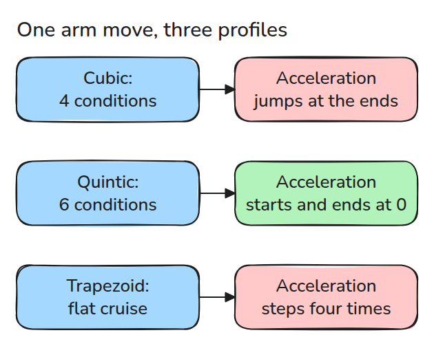
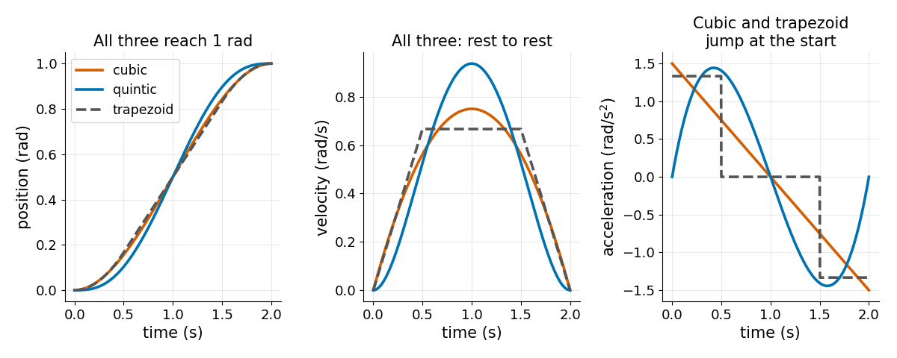
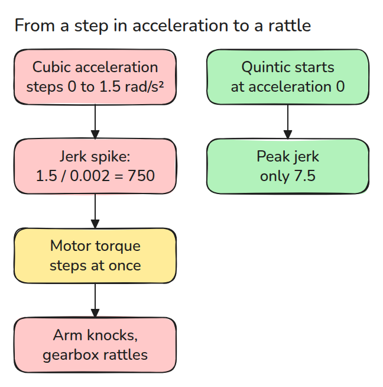
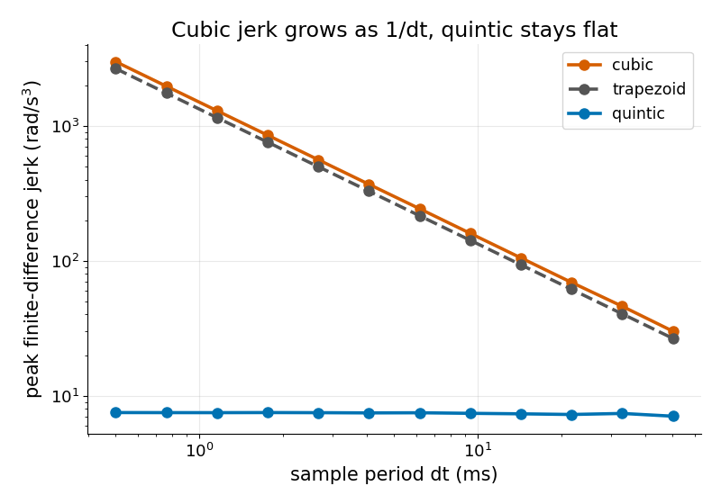

# 궤적 프로파일 (Trajectory Profiles)

> 매끄러워 보이는 움직임인데도 로봇 팔이 출발할 때 덜컥하는 이유와 더 부드럽게 계획하는 방법을 알아봅니다.

**유형:** 만들기   **선수 지식:** 없음   **시간:** 약 15분

## 쉽게 말하면

탁상 로봇 팔이 한 자세에서 다른 자세로 움직이다가 멈춰요. 모터는 속도를 바꾸려고 팔을 밀어요. 속도가 빨리 바뀌어야 할수록 더 세게 밀어요. 이 속도의 변화율이 가속도(acceleration)예요.

가속도가 한순간에 큰 값으로 뛰면 모터가 미는 힘도 같이 뛰어서 팔이 덜컥해요. quintic 프로파일은 가속도가 없는 상태에서 시작해서 가속도가 없는 상태로 끝나요. 그래서 미는 힘이 서서히 커져요.

## 핵심 용어

- **Trajectory profile**: 두 자세 사이에서 관절의 위치가 시간에 따라 어떻게 바뀔지 정한 계획입니다.
- **Acceleration**: 속도가 얼마나 빨리 바뀌는지입니다. 모터가 미는 힘이 이를 따라갑니다.
- **Jerk**: 가속도가 얼마나 빨리 바뀌는지입니다. 가속도가 뛰면 jerk가 뾰족해집니다.
- **Quintic**: 양 끝의 위치, 속도, 미는 힘이 모두 정해진 가장 간단한 곡선입니다.
- **Torque**: 모터가 관절에 가하는 회전력입니다.
- **Control tick**: 모터를 움직이는 프로그램이 한 번 계산하는 간격입니다. 여기서는 0.002초입니다.

## 문제

로봇 팔이 부드러워 보이는 곡선을 따라 두 자세 사이를 움직인다고 상상해 보세요. 목표에 정지 상태로 도착하는데도 출발할 때 덜컥합니다.

## 개념

실제 팔은 모터가 갑자기 미는 힘에 마모되고 흔들리므로 계획은 미는 힘을 서서히 키워야 합니다.

같은 이동을 하는 세 계획은 양 끝에서만 다릅니다. trapezoid(속도를 올린 뒤 일정하게 달리다가 줄이는 방식)와 cubic과 quintic입니다. 앞의 둘은 미는 힘이 없다가 한순간에 큰 값으로 뜁니다. quintic은 서서히 시작하고 서서히 끝납니다.



*같은 이동을 하는 세 계획입니다.*



*시작과 끝의 미는 힘이 0인 것은 quintic뿐입니다.*



*미는 힘이 뛰면 모터에는 강한 충격으로 전해집니다.*



*계획을 더 자주 검사하면 갑자기 뛰는 계획이 더 나빠 보입니다.*


*파랑은 켜졌다 꺼지고 초록은 서서히 시작합니다.*

<details><summary>The math (optional)</summary>

quintic은 5차 다항식입니다. 조건 하나가 다항식의 숫자 하나를 정합니다.
양 끝의 위치와 속도가 네 조건이므로 cubic이고 양 끝의 가속도까지 넣으면 여섯 조건이므로 quintic입니다.
`s = t/T`, `d = qf - q0`로 두면 quintic은 `q0 + d(10 s^3 - 15 s^4 + 6 s^5)`입니다.
jerk는 가속도가 바뀌는 빠르기입니다.
샘플 주기를 절반으로 줄이면 cubic과 trapezoid의 jerk는 두 배가 되지만 quintic은 `60 d / T^3`으로 변하지 않습니다.
2초 동안 1 rad을 움직이고 0.002초마다 샘플링한다고 해 봅니다.
이때 trapezoid는 0.5초 동안 1.33 rad/s²로 가속하므로 가속도 계단이 네 번 생기고 계단 하나의 jerk는 667입니다.
quintic의 jerk 최댓값은 7.5입니다.
이동 시간을 두 배로 늘리면 quintic의 최대 가속도는 4분의 1이 됩니다.

</details>

## 만들기

```python
def quintic(q0, qf, T):
    d = qf - q0
    return np.array([q0, 0.0, 0.0, 10*d/T**3, -15*d/T**4, 6*d/T**5])
```

`poly`는 위치, 속도, 가속도를 계산하고 `trapezoid`는 속도를 올린 뒤 일정하게 달리다가 줄입니다. `peak_jerk`는 이동 전후에 관절이 정지해 있다고 봅니다.

```bash
cd robotics-engineering-from-scratch
python3 -m pytest phases/09-motion-planning/01-trajectory-profiles -q
python3 phases/09-motion-planning/01-trajectory-profiles/code/main.py
```

## 실제 도구로 보기

Python 수학 라이브러리인 SciPy는 같은 quintic을 만들 수 있고 마지막 테스트가 둘을 비교합니다.

출처: Craig, *Introduction to Robotics*, 3판, 7장.

## 결과물

`outputs/skill-trajectory-profile-check.md`는 프로파일이 관절에 닿기 전에 경계 조건과 jerk를 확인합니다.

## 연습 문제

1. 이동 시간을 두 배로 늘리고 미는 힘의 최댓값이 어떻게 바뀌는지 보세요.
2. 샘플 주기를 줄이고 갑자기 뛰는 계획이 나빠지는 것을 보세요.
3. 이동을 더 크게 하고 미는 힘의 최댓값이 어떻게 바뀌는지 보세요.
