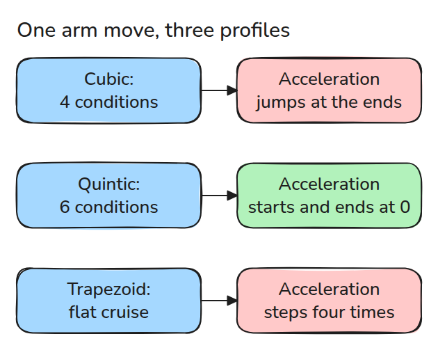
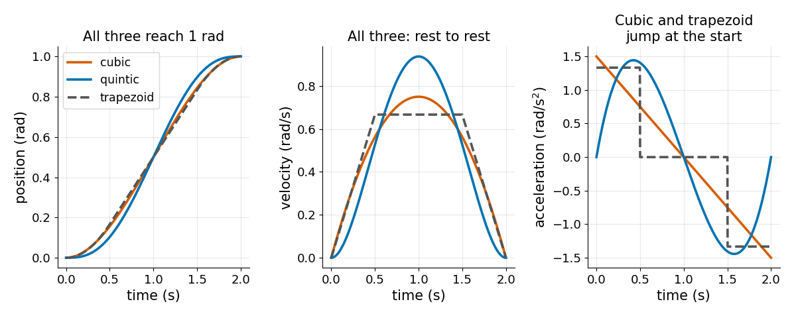
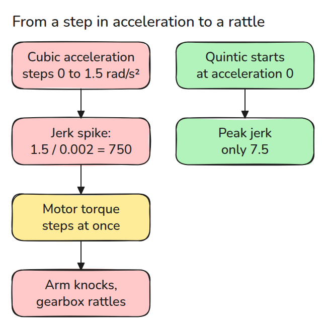
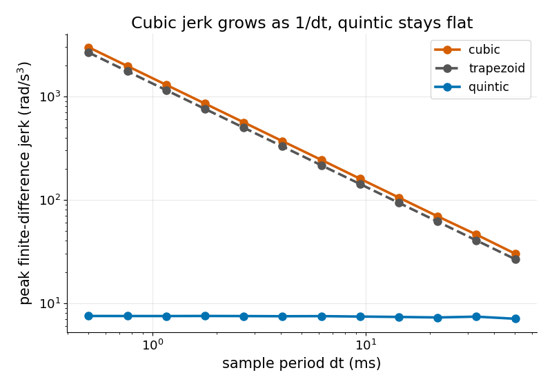

# 궤적 프로파일 (Trajectory Profiles)

> 두 점 사이의 경로를 고르는 것은 쉽습니다. 모터가 덜컥거리지 않고 따라가려면 조건이 네 개가 아니라 여섯 개 있어야 합니다.

**유형:** 만들기   **선수 지식:** 고등학교 미적분   **시간:** 약 15분

## 쉽게 말하면

탁상 로봇 팔이 한 자세에서 다른 자세로 움직이다가 멈춰요. 모터는 속도를 바꾸려고 팔을 미는데 속도가 빨리 바뀌어야 할수록 더 세게 밀어요. 이 속도의 변화율이 가속도(acceleration)예요.

계획이 가속도를 한순간에 큰 값으로 뛰게 만들면 모터가 미는 힘도 같이 뛰어서 팔이 덜컥해요. quintic profile은 가속도가 없는 상태에서 시작해서 없는 상태로 끝나는 부드러운 곡선이라 미는 힘이 서서히 커져요.

## 문제

관절이 한 자세에서 다른 자세로 부드러워 보이는 곡선을 따라 움직이는데도 출발할 때 덜컥 소리가 납니다. 곡선이 정지 상태로 제 위치에 도착하므로 위치와 속도에는 문제가 없습니다. 원인은 가속도입니다.

제어 주기 한 번(controller가 한 번 계산하는 간격, 여기서는 0.002초) 사이에 가속도가 0에서 큰 값으로 뜁니다.

## 개념

빨간 상자는 가속도에 문제가 생기는 곳입니다.



*같은 이동을 하는 세 프로파일입니다. 양 끝에서 가속도가 어떻게 움직이는지가 다릅니다.*

다항식(polynomial)은 `a + b t + c t^2`처럼 시간의 거듭제곱을 더한 식이고 우리가 요구하는 조건 하나가 식의 숫자 하나를 정합니다. 양 끝의 위치와 속도가 네 조건이므로 가장 높은 거듭제곱이 3인 cubic이 됩니다.

양 끝의 가속도까지 넣으면 여섯 조건이므로 거듭제곱이 5인 quintic입니다.

trapezoid는 일정하게 속도를 올리고 일정한 속도로 달리다가 일정하게 속도를 줄이는 방식입니다. `s = t/T`, `d = qf - q0`로 두면 quintic은 `q0 + d(10 s^3 - 15 s^4 + 6 s^5)`입니다.



*오른쪽 그림(가속도)을 보세요. 셋 다 정지 상태로 목표에 도착하지만 시작과 끝의 가속도가 0인 것은 quintic뿐입니다.*

가속도가 뛰면 jerk(가속도가 바뀌는 비율)에 뾰족한 값이 생깁니다.



*화살표를 따라가 보세요. 모터는 jerk의 뾰족한 값을 torque(관절을 돌리는 힘)의 계단으로 느낍니다.*



*샘플 주기가 짧아질수록 주황색 선이 올라가는 것을 보세요. 주기를 절반으로 줄이면 cubic과 trapezoid의 jerk는 두 배가 됩니다. quintic은 `60 d / T^3`에 머뭅니다.*

예시로 2초 동안 1 rad을 움직이고 0.002초마다 샘플링합니다. trapezoid는 0.5초 동안 1.33 rad/s²로 가속하므로 가속도가 켜지고 꺼지고 반대로 켜지고 꺼지는 계단이 네 번 생깁니다. 계단 하나의 jerk는 `1.33 / 0.002 = 667`입니다.

quintic은 계단이 없고 jerk의 최댓값이 7.5입니다.


*빨간 화살표는 관절의 가속도입니다. 파란 팔(trapezoid)은 화살표가 나타났다 사라지고 뒤로 뒤집혔다가 다시 사라집니다. 초록 팔(quintic)은 화살표가 서서히 자라고 서서히 줄어듭니다.*

## 만들기

```python
def quintic(q0, qf, T):
    d = qf - q0
    return np.array([q0, 0.0, 0.0, 10*d/T**3, -15*d/T**4, 6*d/T**5])
```

`poly`는 계수로 위치, 속도, 가속도를 계산합니다. `trapezoid`는 `ta` 동안 가속하고 `d/(T-ta)`로 순항한 뒤 감속합니다. `peak_jerk`는 이동 전후에 관절이 정지해 있다고 보고 계산하므로 계단이 바로 거기서 생깁니다.

```bash
cd robotics-engineering-from-scratch
python3 -m pytest phases/09-motion-planning/01-trajectory-profiles -q
python3 phases/09-motion-planning/01-trajectory-profiles/code/main.py
```

## 실제 도구로 보기

SciPy의 `BPoly.from_derivatives`는 양 끝의 미분값으로 같은 quintic을 만들고 마지막 테스트가 둘을 비교합니다.

출처: Craig, *Introduction to Robotics*, 3판, 7장 (궤적 생성).

## 결과물

`outputs/skill-trajectory-profile-check.md`는 프로파일이 관절에 닿기 전에 경계 조건과 jerk를 확인합니다.

## 연습 문제

1. 양 끝의 jerk 0을 일곱 번째 조건으로 더하고 필요한 차수를 말하세요.
2. trapezoid에서 최대 가속도를 주어진 한계 아래로 두는 가장 작은 `ta`를 구하세요.
3. 이동 시간을 `2T`로 두 배 늘린 quintic의 최대 가속도가 4분의 1이 되는 것을 보이세요.
