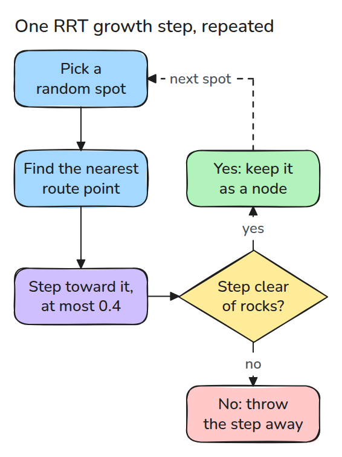
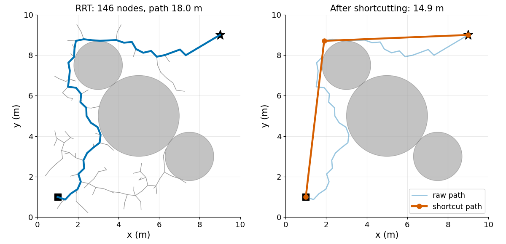
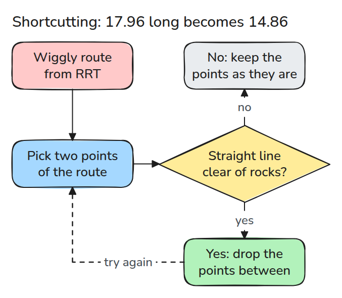
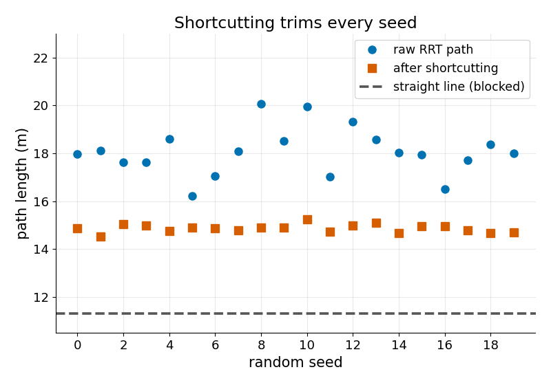

# RRT

> Grow a tree of short, collision-free steps from the start until a branch touches the goal, then straighten the result.

**Type:** Build   **Prerequisites:** none beyond basic geometry   **Time:** ~15 minutes

## In Plain Words

A rover must cross a field with three rocks, so the straight line to the flag is blocked. It plans by trial: pick a random spot, take the closest point of the route so far, and step a little toward the spot. The step stays only if it clears every rock.

RRT repeats this until a branch reaches the flag, then traces back to the start. That route wanders. A straight line between two points of it removes a detour, if the line also clears the rocks.

## The Problem

The straight line from the start pose to the goal pose (an arm's joint angles stand in for the field's x and y) passes through an obstacle, so you need a path around it. A hand-drawn detour does not carry over to the next scene. A random planner finds one quickly, but it wanders and the arm would follow every detour.

## The Concept



*Each iteration: sample, step from the nearest node toward it, keep the step if its segment is free.*

Each sample pulls its nearest node one step of at most `step`. One sample in ten is the goal itself, tilting the tree toward it. When a new node can see the goal, the path is read back through the parent links.

Worked example: `step = 0.4`, rock centre (5, 5), radius 2. Iteration 11: the sample (6.86, 6.5) pulls node (3.12, 4.07) toward the rock and the step ends at (3.46, 4.29), 1.70 from the centre, inside the radius, so the segment test `seg_free` fails and the step is dropped. Iteration 17: the sample (2.27, 6.23) pulls the same node and is 2.32 away, so the step is capped at 0.4 and ends at (2.97, 4.44), 2.10 from the centre, clear and kept.


*Close-up, five times larger than the first clip (a 0.4 step is 0.8 m). Amber arrows point to two samples off the picture. The first step ends inside the rock, so a red marker drops it; the second is clear and the rover drives it.*



*Left: tree and first path, 17.96 long. Right: after shortcutting, 14.86.*



*Pick two path points. If the straight segment between them is free, drop the points between.*



*Over 20 random runs (seeds), shortcutting shortens every path and none gets below the straight line, the shortest possible.*

## Build It

```python
new = buf[i] + d / dist * min(step, dist)
if not seg_free(buf[i], new, obstacles):
    continue
buf[n] = new; parent.append(i); n += 1
```

`seg_free` finds the closest point of the segment to each circle centre, so it catches a segment whose endpoints are both outside. Everything is seeded: the same seed gives the same tree.

```bash
cd robotics-engineering-from-scratch
python3 -m pytest phases/09-motion-planning/02-rrt -q
python3 phases/09-motion-planning/02-rrt/code/main.py
```

## Use It

Swap the brute-force nearest search for `scipy.spatial.cKDTree` once the tree has thousands of nodes; the last test checks both agree.

Sources: [RRT, Wikipedia](https://en.wikipedia.org/wiki/Rapidly-exploring_random_tree) (opened 2026-11-09: tree from the start, nearest-node connection, growth limit). [CHOMP, Ratliff et al. 2009](https://www.ri.cmu.edu/pub_files/2009/5/icra09-chomp.pdf) (opened 2026-11-09: sampled paths are post-processed, and shortcuts replace sub-paths with shorter ones).

## Ship It

`outputs/skill-rrt-path-check.md` reviews a sampling-based planner's output before it is time-parameterised.

## Exercises

1. Set `goal_bias` to 0 and to 0.5 and compare node counts over 10 seeds.
2. Check only endpoints in `seg_free`, make obstacles thinner than `step`, and find a seed where an edge cuts through.
3. Run `shortcut` twice and decide whether a second pass can still help.
