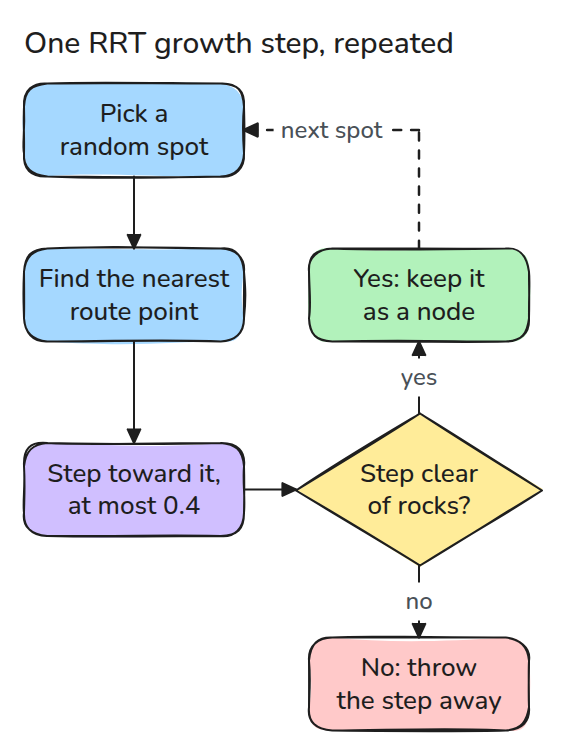
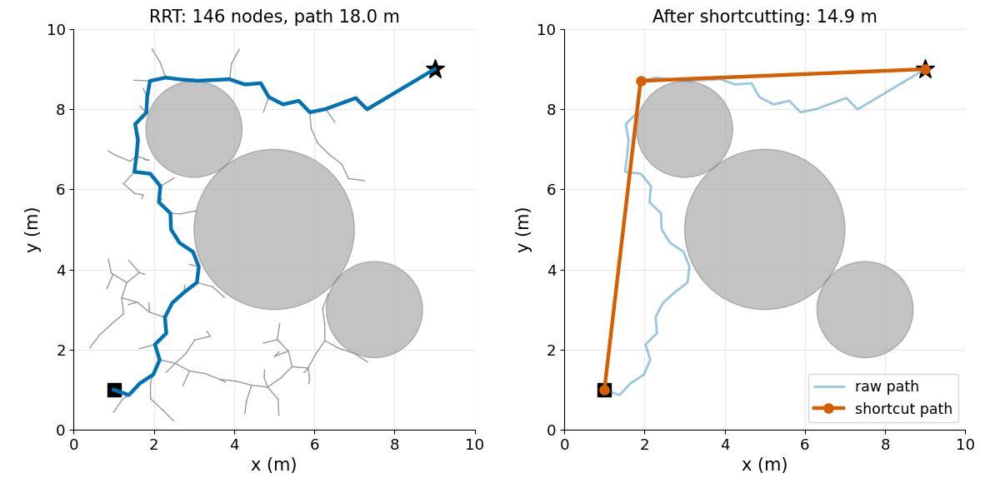
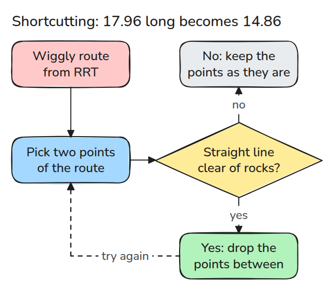
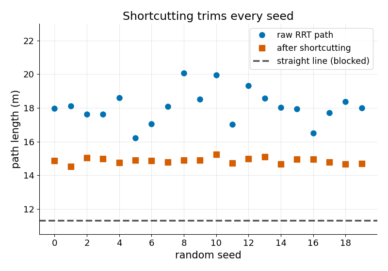

# RRT

> Learn how a robot finds a way around obstacles by trial and error, then straightens the route.

**Type:** Build   **Prerequisites:** none beyond basic geometry   **Time:** ~15 minutes

## In Plain Words

A rover must cross a field with three rocks, so the straight line to the flag is blocked. It picks a random spot, finds the closest point of its route so far, and steps a little toward the spot, keeping the step only if it clears every rock.

RRT repeats this until a branch reaches the flag. The route wanders, so straight shortcuts between its points remove detours.

## Key Terms

- **RRT**: rapidly-exploring random tree, a planner that grows a tree of short steps by random sampling.
- **Node**: one point of the tree; each new node remembers its parent.
- **Goal bias**: the share of samples that are the goal itself, tilting the tree toward it.
- **Shortcutting**: replacing part of a path with a straight segment when that segment is free.
- **Seed**: the starting number of a random generator; the same seed repeats the same run.

## The Problem

Picture a robot arm that must reach a goal past an obstacle (joint angles stand in for x and y). A random planner finds a way around fast, but the path wanders and the arm would follow every detour.

## The Concept

A real robot cannot hand-draw a detour for every new scene, so it samples one.



*Sample, step toward it from the nearest node, keep the step if free.*

Each sample pulls its nearest node one step of at most `step`. One sample in ten is the goal itself. When a new node can see the goal, the path is read back through the parent links.

Take `step = 0.4` and a rock at (5, 5) with radius 2. Iteration 11: the sample (6.86, 6.5) pulls node (3.12, 4.07) to (3.46, 4.29), 1.70 from the centre, inside the rock; `seg_free` fails and the step is dropped. Iteration 17: the sample (2.27, 6.23) pulls the same node to (2.97, 4.44), 2.10 from the centre, clear and kept.


*The first step ends inside the rock and is dropped (red); the second is clear.*



*Left: tree and first path, 17.96. Right: after shortcutting, 14.86.*



*If the straight segment between two path points is free, drop the points between.*



*Over 20 seeds, shortcutting shortens every path; none beats the straight line.*

## Build It

```python
new = buf[i] + d / dist * min(step, dist)
if not seg_free(buf[i], new, obstacles):
    continue
buf[n] = new; parent.append(i); n += 1
```

`seg_free` finds the segment's closest point to each circle centre, so it catches segments with both ends outside. One seed, one tree.

```bash
cd robotics-engineering-from-scratch
python3 -m pytest phases/09-motion-planning/02-rrt -q
python3 phases/09-motion-planning/02-rrt/code/main.py
```

## Use It

Past thousands of nodes, swap the nearest search for `scipy.spatial.cKDTree`; a test checks both agree.

Sources: [RRT, Wikipedia](https://en.wikipedia.org/wiki/Rapidly-exploring_random_tree) and [CHOMP, Ratliff et al. 2009](https://www.ri.cmu.edu/pub_files/2009/5/icra09-chomp.pdf), both opened 2026-11-09.

## Ship It

`outputs/skill-rrt-path-check.md` reviews a sampling planner's path.

## Exercises

1. Set `goal_bias` to 0 and to 0.5; compare node counts over 10 seeds.
2. Check only endpoints in `seg_free`; find an edge that cuts through a thin obstacle.
3. Run `shortcut` twice; see if a second pass helps.
