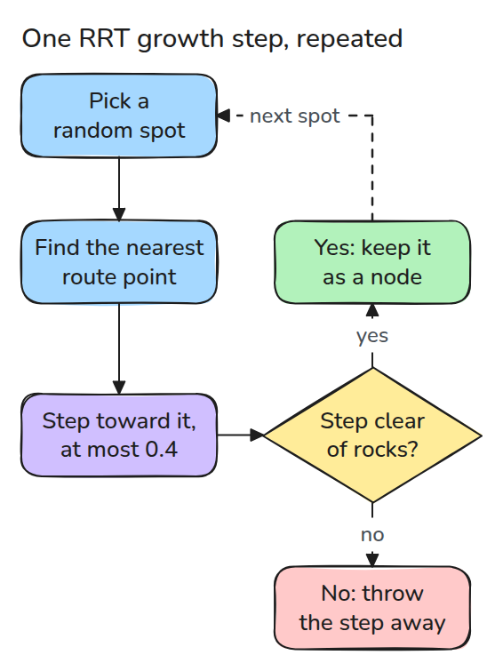

# RRT

> 로봇이 시행착오로 장애물을 돌아가는 길을 찾고 그 길을 곧게 펴는 방법을 알아봅니다.

**유형:** 만들기   **선수 지식:** 기초 기하   **시간:** 약 15분

## 쉽게 말하면

탐사 로봇이 바위 세 개가 있는 들판을 건너야 해서 깃발까지 곧장 가는 길이 막혀 있어요. 아무 지점이나 골라요. 지금까지 닿은 곳 중 가장 가까운 점을 찾아요. 그쪽으로 짧게 한 걸음 나아가요. 그 걸음은 바위를 모두 피할 때만 남겨요.

RRT는 이것을 가지(branch) 하나가 깃발에 닿을 때까지 반복해요. 이렇게 찾은 길은 이리저리 헤매요. 그래서 길 위의 두 점을 곧은 선으로 이어 우회를 없애요.

## 핵심 용어

- **RRT**: rapidly-exploring random tree입니다. 무작위 지점을 향해 짧은 걸음의 가지를 키우는 방법입니다.
- **Node**: 나무의 점 하나입니다. 새 node는 자기 부모를 기억합니다.
- **Goal bias**: 무작위 지점을 목표 자체로 고르는 빈도입니다. 그 덕분에 나무가 목표 쪽으로 끌립니다.
- **Shortcutting**: 경로의 일부를 직선 선분으로 바꾸는 일입니다. 그 선분이 비어 있어야 합니다.
- **Seed**: 난수 생성기의 시작 숫자입니다. 같은 seed는 같은 실행을 되풀이합니다.

## 문제

로봇 팔이 장애물 너머의 목표에 닿아야 한다고 상상해 보세요. 무작위 탐색은 돌아가는 길을 빨리 찾아냅니다. 하지만 경로가 이리저리 헤매서 팔이 모든 우회를 그대로 따라갑니다.

## 개념

실제 로봇은 장면이 바뀔 때마다 우회로를 손으로 그려 줄 수 없으므로 직접 시도해 가며 찾습니다.

아무 지점이나 고릅니다. 지금까지 키운 나무에서 가장 가까운 점을 찾아 그쪽으로 짧게 한 걸음 갑니다. 그 걸음이 장애물에 닿지 않을 때만 남깁니다. 가지 하나가 목표에 닿을 때까지 반복합니다.



*점을 뽑고 걸음을 내딛고 비어 있으면 남깁니다.*


*첫 번째 걸음은 바위 안에서 끝나서 버려지고 두 번째 걸음은 바위를 피해서 남습니다.*

이렇게 찾은 경로는 헤맵니다. 직선 지름길이 비어 있으면 그 부분을 지름길로 바꿉니다.


*왼쪽은 나무와 처음 찾은 경로이고 오른쪽은 지름길을 적용한 뒤입니다.*


*직선이 비어 있으면 그 사이의 점을 버립니다.*


*지름길은 모든 경로를 줄입니다.*

<details><summary>The math (optional)</summary>

샘플 하나는 가장 가까운 노드를 최대 `step`만큼 한 걸음 끌어당깁니다.
샘플 열 개 가운데 하나는 목표 자체입니다.
`step = 0.4`이고 바위의 중심이 (5, 5), 반지름이 2라고 해 봅시다.
11번째 반복에서 샘플 (6.86, 6.5)가 노드 (3.12, 4.07)를 (3.46, 4.29)로 끌어당깁니다.
그 점은 중심에서 1.70 떨어져 바위 안이라 `seg_free`가 실패하고 걸음은 버려집니다.
17번째 반복에서 샘플 (2.27, 6.23)이 같은 노드를 (2.97, 4.44)로 끌어당기고 중심에서 2.10 떨어져 있어서 남습니다.
`seg_free`는 선분에서 각 원의 중심에 가장 가까운 점을 쓰므로 두 끝점이 모두 밖에 있는 선분도 잡아냅니다.
처음 경로의 길이는 17.96이고 지름길 뒤에는 14.86입니다.
seed 20개에서 지름길은 모든 경로를 줄이고 직선보다 짧아지는 경우는 없습니다.
seed 하나는 나무 하나를 만듭니다.

</details>

## 만들기

```python
new = buf[i] + d / dist * min(step, dist)
if not seg_free(buf[i], new, obstacles):
    continue
buf[n] = new; parent.append(i); n += 1
```

`seg_free`는 한 걸음 전체를 모든 원과 대조합니다. 같은 seed는 같은 나무를 만듭니다.

```bash
cd robotics-engineering-from-scratch
python3 -m pytest phases/09-motion-planning/02-rrt -q
python3 phases/09-motion-planning/02-rrt/code/main.py
```

## 실제 도구로 보기

노드가 수천 개가 되면 이미 만들어진 더 빠른 탐색으로 가장 가까운 노드를 찾습니다. 테스트가 두 결과가 같은지 확인합니다.

출처는 [RRT, Wikipedia](https://en.wikipedia.org/wiki/Rapidly-exploring_random_tree)와
[CHOMP, Ratliff 외 2009](https://www.ri.cmu.edu/pub_files/2009/5/icra09-chomp.pdf)이고 둘 다 2026년 11월 9일에 열어 확인했습니다.

## 결과물

`outputs/skill-rrt-path-check.md`는 무작위 샘플링으로 찾은 경로를 검토합니다.

## 연습 문제

1. 목표를 얼마나 자주 뽑는지 바꾸고 나무를 보세요.
2. 장애물을 아주 얇게 만드세요. 걸음이 검사에 걸리지 않고 장애물을 통과할 수 있나요?
3. 지름길 단계를 두 번 돌리고 두 번째에도 도움이 되는지 보세요.
