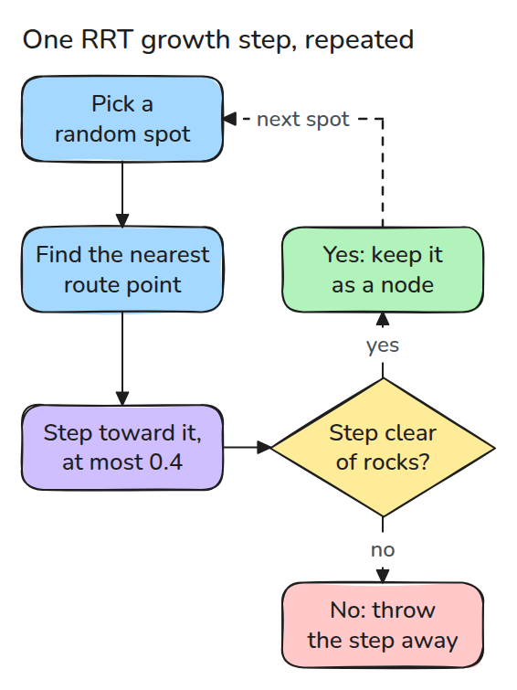
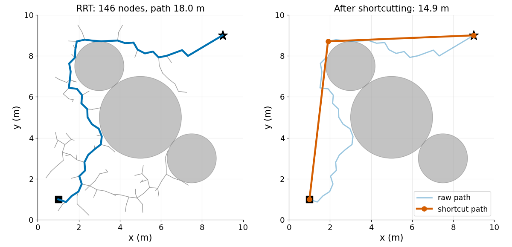
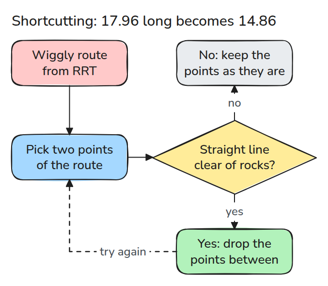
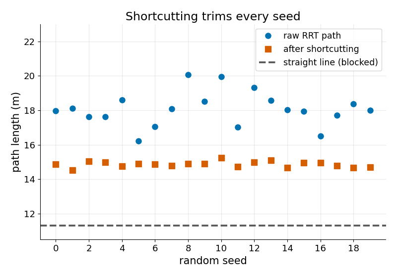

# RRT

> 시작점에서 충돌 없는 짧은 걸음으로 나무를 키우다가 가지 하나가 목표에 닿으면 멈추고 그 경로를 곧게 펴 줍니다.

**유형:** 만들기   **선수 지식:** 기초 기하   **시간:** 약 15분

## 쉽게 말하면

탐사 로봇이 바위 세 개가 있는 들판을 건너야 해서 깃발까지 곧장 가는 길이 막혀 있어요. 그래서 시행착오로 길을 찾아요. 아무 지점이나 고르고 지금까지 그린 길에서 가장 가까운 점을 찾아 그쪽으로 짧게 한 걸음을 더해요. 그 걸음은 바위에 닿지 않을 때만 남겨요.

RRT는 이것을 가지(branch) 하나가 깃발에 닿을 때까지 반복하고 가지를 거슬러 출발점으로 돌아와요. 이렇게 얻은 길은 돌아가요. 그 길 위의 두 점을 직선으로 이었을 때 바위에 닿지 않으면 그 사이의 우회를 없앨 수 있어요.

## 문제

시작 자세에서 목표 자세까지 직선을 그으면 장애물을 통과하므로 돌아가는 경로가 필요합니다(팔의 관절 각도가 이 들판의 x와 y 자리에 들어갑니다). 손으로 그린 우회로는 다음 장면에 통하지 않습니다.

무작위 planner는 경로를 빨리 찾지만 처음 찾은 경로는 이리저리 헤매고 팔은 그 우회를 하나도 빼지 않고 따라갑니다.

## 개념



*반복할 때마다 점을 하나 뽑고 가장 가까운 노드에서 그 점 쪽으로 한 걸음 가며 선분이 비어 있을 때만 그 걸음을 남깁니다.*

샘플은 가장 가까운 노드를 `step` 이하의 한 걸음만큼 끌어당깁니다. 샘플 열 개 가운데 하나쯤은 목표 자체여서 나무가 목표 쪽으로 기웁니다. 새 노드에서 목표가 보이면 부모 링크를 따라 거슬러 올라가 경로를 읽습니다.

예시는 `step = 0.4`이고 바위의 중심은 (5, 5), 반지름은 2입니다. 11번째 반복에서는 샘플 (6.86, 6.5)가 노드 (3.12, 4.07)를 바위 쪽으로 끌어당기고 걸음은 (3.46, 4.29)에서 끝납니다.

그 점은 중심에서 1.70 떨어져 반지름 안쪽이라 선분 검사 `seg_free`가 실패하고 걸음은 버려집니다.

17번째 반복에서는 샘플 (2.27, 6.23)이 같은 노드를 끌어당기고 2.32 떨어져 있어서 걸음이 0.4로 잘려 (2.97, 4.44)에서 끝납니다. 그 점은 중심에서 2.10 떨어져 있어 비어 있으므로 남습니다.


*첫 영상보다 다섯 배 크게 확대한 장면입니다(걸음 0.4가 0.8 m). 주황색 화살표 두 개가 화면 밖의 샘플 두 개를 가리킵니다. 첫 번째 걸음은 바위 안에서 끝나서 빨간 표시로 버려지고 두 번째 걸음은 비어 있어서 로봇이 그 걸음을 갑니다.*



*왼쪽은 나무와 처음 찾은 경로로 길이가 17.96입니다. 오른쪽은 shortcutting한 뒤로 길이가 14.86입니다.*



*경로 위의 두 점을 고릅니다. 둘 사이의 직선이 비어 있으면 그 사이의 점을 모두 버립니다.*



*무작위 실행 20번(seed)에서 shortcutting은 모든 경로를 줄이고 가장 짧은 경로인 직선보다 짧아지는 경우는 없습니다.*

## 만들기

```python
new = buf[i] + d / dist * min(step, dist)
if not seg_free(buf[i], new, obstacles):
    continue
buf[n] = new; parent.append(i); n += 1
```

`seg_free`는 선분에서 각 원의 중심에 가장 가까운 점을 찾으므로, 두 끝점이 모두 원 밖에 있는 선분도 잡아냅니다. 모든 것이 seed로 고정되어 있어서 같은 seed는 같은 나무를 만듭니다.

```bash
cd robotics-engineering-from-scratch
python3 -m pytest phases/09-motion-planning/02-rrt -q
python3 phases/09-motion-planning/02-rrt/code/main.py
```

## 실제 도구로 보기

나무에 노드가 수천 개가 되면 전수 비교 최근접 탐색을 `scipy.spatial.cKDTree`로 바꿉니다. 마지막 테스트가 둘이 같은 노드를 돌려주는지 확인합니다.

출처는 두 곳입니다.

- [RRT, Wikipedia](https://en.wikipedia.org/wiki/Rapidly-exploring_random_tree), 2026년 11월 9일 열람. 시작점이 뿌리인 나무, 가장 가까운 노드와의 연결, 성장 길이 제한을 확인했습니다.
- [CHOMP, Ratliff 외 2009](https://www.ri.cmu.edu/pub_files/2009/5/icra09-chomp.pdf), 2026년 11월 9일 열람. 샘플링 경로의 후처리와 shortcut 방식을 확인했습니다.

## 결과물

`outputs/skill-rrt-path-check.md`는 sampling 기반 planner의 결과를 시간 매개변수화하기 전에 검토합니다.

## 연습 문제

1. `goal_bias`를 0과 0.5로 놓고 seed 10개에서 노드 수를 비교하세요.
2. `seg_free`를 끝점만 검사하는 것으로 바꾸고 장애물을 `step`보다 얇게 만든 뒤 간선이 장애물을 뚫는 seed를 찾으세요.
3. `shortcut`을 두 번 돌리고 두 번째 패스가 아직 도움이 되는지 판단하세요.
