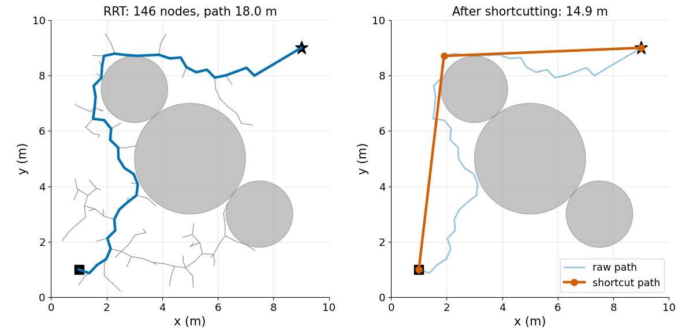
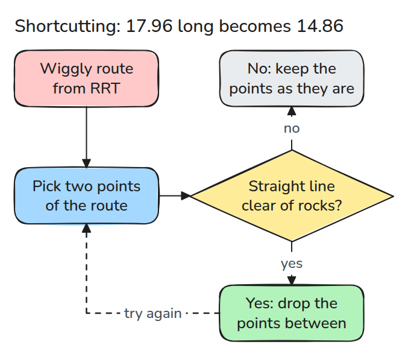
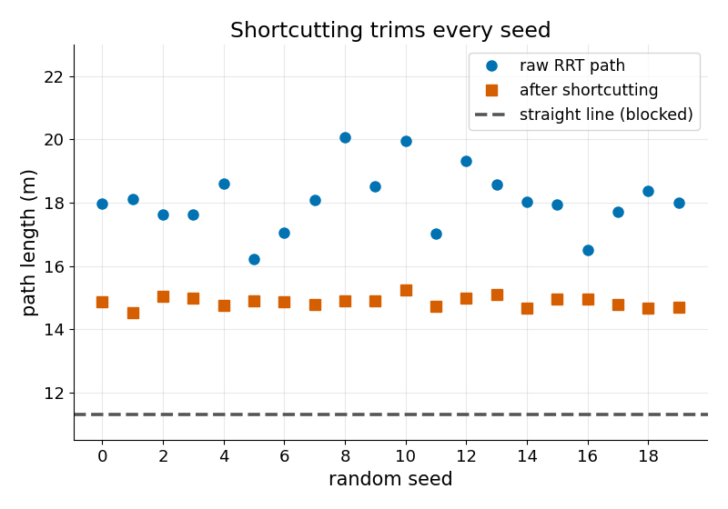

# RRT

> 로봇이 시행착오로 장애물을 돌아가는 길을 찾고 그 길을 곧게 펴는 방법을 알아봅니다.

**유형:** 만들기   **선수 지식:** 기초 기하   **시간:** 약 15분

## 쉽게 말하면

탐사 로봇이 바위 세 개가 있는 들판을 건너야 해서 깃발까지 곧장 가는 길이 막혀 있어요. 아무 지점이나 고르고 지금까지 그린 길에서 가장 가까운 점을 찾아 그쪽으로 짧게 한 걸음을 더하는데 그 걸음은 바위에 닿지 않을 때만 남겨요.

RRT는 이것을 가지(branch) 하나가 깃발에 닿을 때까지 반복해요. 얻은 길은 돌아가므로 길 위의 두 점을 직선으로 이어 우회를 없애요.

## 핵심 용어

- **RRT**: rapidly-exploring random tree입니다. 무작위 샘플로 짧은 걸음의 나무를 키우는 planner입니다.
- **Node**: 나무의 점 하나입니다. 새 node는 자기 부모를 기억합니다.
- **Goal bias**: 샘플 중에서 목표 자체인 것의 비율입니다. 나무가 목표 쪽으로 기웁니다.
- **Shortcutting**: 경로의 일부를 직선 선분으로 바꾸는 일입니다. 그 선분이 비어 있어야 합니다.
- **Seed**: 난수 생성기의 시작 숫자입니다. 같은 seed는 같은 실행을 되풀이합니다.

## 문제

로봇 팔이 길을 막은 장애물 너머의 목표에 닿아야 한다고 상상해 보세요. 직선은 장애물을 통과합니다(관절 각도가 x와 y 자리에 들어갑니다). 무작위 planner는 돌아가는 길을 빨리 찾지만 경로가 이리저리 헤매고 팔은 그 우회를 하나도 빼지 않고 따라갑니다.

## 개념

실제 로봇은 장면마다 우회로를 손으로 그릴 수 없으므로 샘플링으로 찾습니다.


*점을 하나 뽑고 가장 가까운 노드에서 그쪽으로 한 걸음 가며 선분이 비어 있을 때만 그 걸음을 남깁니다.*

샘플은 가장 가까운 노드를 `step` 이하의 한 걸음만큼 끌어당깁니다. 샘플 열 개 가운데 하나쯤은 목표 자체입니다. 새 노드에서 목표가 보이면 부모 링크를 따라 거슬러 올라가 경로를 읽습니다.

`step = 0.4`이고 바위의 중심이 (5, 5), 반지름이 2라고 해 봅시다.
11번째 반복에서는 샘플 (6.86, 6.5)가 노드 (3.12, 4.07)를 (3.46, 4.29)로 끌어당깁니다.
그 점은 중심에서 1.70 떨어져 바위 안이라 `seg_free`가 실패하고 걸음은 버려집니다.
17번째 반복에서는 샘플 (2.27, 6.23)이 같은 노드를 (2.97, 4.44)로 끌어당깁니다. 중심에서 2.10 떨어져 비어 있으므로 남습니다.


*확대한 장면입니다. 첫 번째 걸음은 바위 안에서 끝나서 버려지고(빨강) 두 번째 걸음은 비어 있어서 로봇이 갑니다.*



*왼쪽은 나무와 처음 찾은 경로로 길이가 17.96입니다. 오른쪽은 shortcutting한 뒤로 14.86입니다.*



*경로 위 두 점 사이의 직선이 비어 있으면 그 사이의 점을 모두 버립니다.*



*seed 20개에서 shortcutting은 모든 경로를 줄이고 직선보다 짧아지는 경우는 없습니다.*

## 만들기

```python
new = buf[i] + d / dist * min(step, dist)
if not seg_free(buf[i], new, obstacles):
    continue
buf[n] = new; parent.append(i); n += 1
```

`seg_free`는 선분에서 각 원의 중심에 가장 가까운 점을 찾으므로 두 끝점이 모두 원 밖에 있는 선분도 잡아냅니다. 같은 seed는 같은 나무를 만듭니다.

```bash
cd robotics-engineering-from-scratch
python3 -m pytest phases/09-motion-planning/02-rrt -q
python3 phases/09-motion-planning/02-rrt/code/main.py
```

## 실제 도구로 보기

나무에 노드가 수천 개가 되면 전수 비교 최근접 탐색을 `scipy.spatial.cKDTree`로 바꿉니다. 마지막 테스트가 둘이 같은 노드를 돌려주는지 확인합니다.

출처는 [RRT, Wikipedia](https://en.wikipedia.org/wiki/Rapidly-exploring_random_tree)와
[CHOMP, Ratliff 외 2009](https://www.ri.cmu.edu/pub_files/2009/5/icra09-chomp.pdf)이고
둘 다 2026년 11월 9일에 열람했습니다.

## 결과물

`outputs/skill-rrt-path-check.md`는 sampling 기반 planner의 결과를 검토합니다.

## 연습 문제

1. `goal_bias`를 0과 0.5로 놓고 seed 10개에서 노드 수를 비교하세요.
2. `seg_free`를 끝점만 검사하는 것으로 바꾸고 얇은 장애물을 뚫는 간선을 찾으세요.
3. `shortcut`을 두 번 돌리고 두 번째 패스가 도움이 되는지 보세요.
