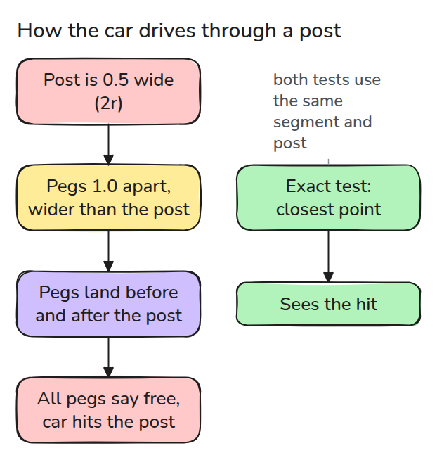
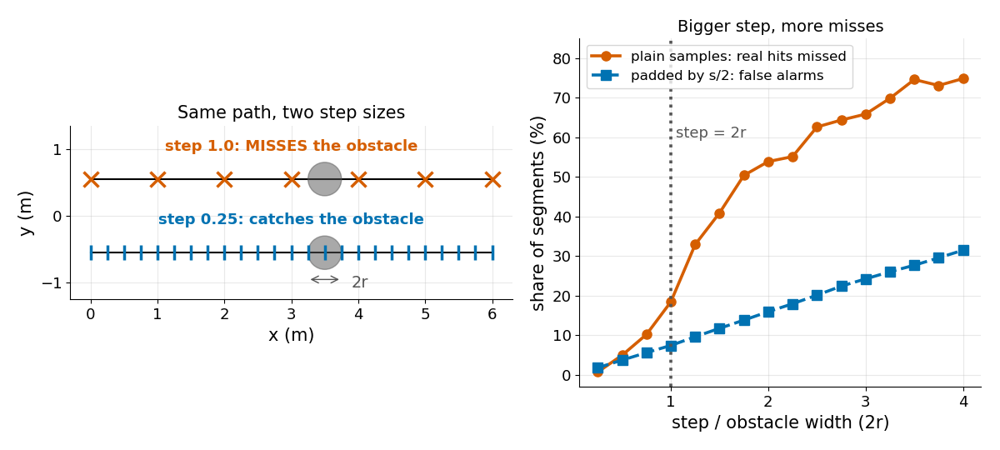
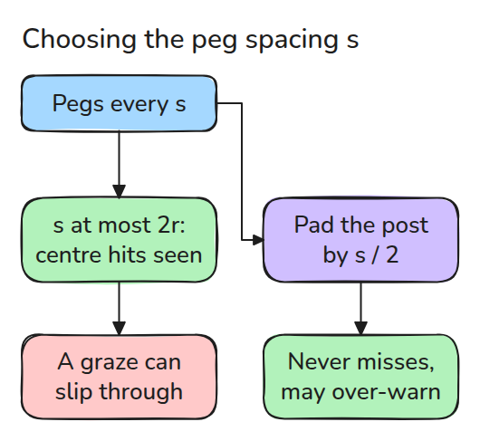

# Collision Checking

> Learn why checking a path at only a few spots can miss a thin obstacle, and how to check safely.

**Type:** Build   **Prerequisites:** 09/02 RRT   **Time:** ~15 minutes

## In Plain Words

A toy car drives past a thin post. A checker plants pegs along the route and asks at each if the car is in the post. Pegs spaced wider than the post can all land beside it, so every peg says free while the car hits the post between them.

Testing the whole stretch catches the hit. So does pretending the post is wider, but then safe routes get rejected.

## Key Terms

- **Collision checking**: testing whether a robot pose or motion touches an obstacle.
- **Tunnelling**: a motion slipping through a thin obstacle because the checks are too far apart.
- **Segment**: the straight stretch between two path points.
- **Chord**: the part of a segment that lies inside a circle.
- **Padding**: growing the obstacle by a margin so the check errs on the safe side.
- **False alarm**: a hit reported for a path that actually clears the obstacle.

## The Problem

Picture a robot arm whose planner says the path is safe, yet the arm hits a thin post. Every pose that was checked was free. The post was thinner than the gap between two checks.

## The Concept

A robot hits whatever its checker skips, so how often you check must match the thinnest obstacle.

A checker tests the path at spots along the route. If the spots are farther apart than the post is wide, they can all land beside it, and the robot hits the post between two spots.



*A wide step lets samples land on both sides.*



*Coarse steps miss. Fine steps catch.*

Two fixes: check the whole stretch between spots exactly, or pretend the post is a bit wider. The second is cheap but sometimes says blocked when the way is clear.



*Small steps catch centre hits. Padding catches all.*


*Blue's pegs stay white and it clips the post. Green's turn red and it stops.*

<details><summary>The math (optional)</summary>

Seen from above, a post is a circle of radius `r`. A segment hits it when its point closest to the centre is inside; that point is the centre's projection onto the segment, clamped to the ends, so this test is exact. A swept check tests only points at most `s` apart. A chord through the centre is `2r` long, so a step of at most `2r` puts a sample on it, but a grazing segment can slip through. Growing the circle by `s/2` never misses a hit, at the price of false alarms. Example: `r = 0.25`, a peg every `0.5 = 2r`, a segment passing 0.2 from the centre. Two pegs sit 0.25 either side of the closest point, each 0.32 from the centre, so the plain check says free while the exact test says hit. Padding by `s/2 = 0.25` catches both.

</details>

## Build It

```python
def conservative_hits(a, b, c, r, step):
    return swept_hits(a, b, c, r, step, pad=step / 2)
```

`swept_hits` places `ceil(length / step) + 1` samples on the segment. Tests compare it with the exact test.

```bash
cd robotics-engineering-from-scratch
python3 -m pytest phases/09-motion-planning/03-collision-checking -q
python3 phases/09-motion-planning/03-collision-checking/code/main.py
```

## Use It

SciPy's `minimize_scalar` finds the closest point numerically, and a test compares it.

Sources: [Motion planning, Wikipedia](https://en.wikipedia.org/wiki/Motion_planning) (opened 2026-11-09).

## Ship It

`outputs/skill-collision-step-check.md` audits a planner's collision step against its thinnest obstacle.

## Exercises

1. Make the post thinner and see when the plain check starts to miss.
2. Make the step smaller and watch the false alarms.
3. Make the robot a circle and add its size to the post.
