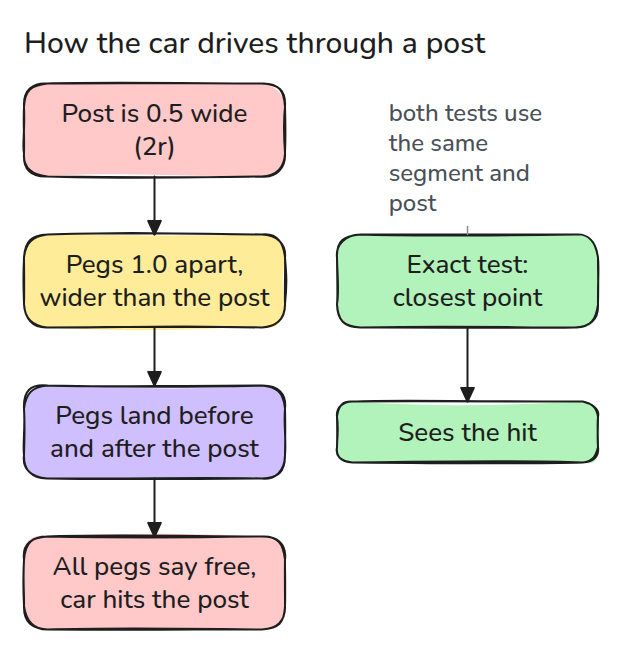
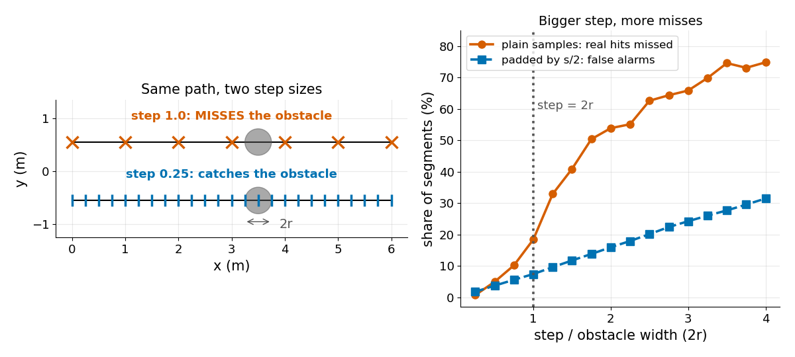
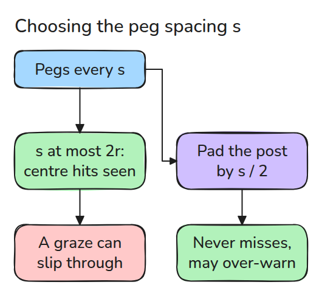

# Collision Checking

> A path that is checked only at sample points can tunnel through an obstacle thinner than the sample spacing.

**Type:** Build   **Prerequisites:** 09/02 RRT   **Time:** ~15 minutes

## In Plain Words

A toy car must drive past a thin post. A checker plants pegs along the route and asks at each peg whether the car would be in the post. Pegs farther apart than the post is wide can all land beside it. Every peg says free, yet the car hits the post between pegs.

Testing the whole stretch between pegs catches the hit. So does pretending the post is wider, but a route that really clears it may then be rejected.

## The Problem

The planner reports a collision-free path, and the robot hits a post on the way. Every pose on the path was checked and every one was free. The post is thinner than the arm's move between two checks, so the samples jumped over it and the real arm went straight through.

## The Concept



*A step wider than the obstacle lets samples land on both sides.*

Seen from above, a post is a circle of radius `r`, and a point is inside it when its distance to the centre is at most `r`. A segment hits the circle when its closest point to the centre is inside. That point is the centre's perpendicular projection onto the segment, clamped to the ends, so the test is exact. A swept check tests only points spaced at most `s` apart along the segment.



*Left: the coarse step misses the obstacle, the fine step catches it. Right: bigger steps miss more real hits.*



*A step of at most `2r` catches every crossing through the centre. Padding by `s/2` catches all crossings.*

The chord (the part of a segment inside the circle) through the centre is `2r` long, so a step of at most `2r` puts a sample on it. A grazing segment has a short chord and can still slip through. Every point of the segment is within `s/2` of a sample, so growing the circle by `s/2` never misses a hit. The price is false alarms.

Worked example: `r = 0.25`, a peg every `0.5 = 2r`, and a segment passing 0.2 from the centre (a chord only 0.3 long). Two pegs sit 0.25 either side of the closest point, so each is 0.32 from the centre. The plain check says free while `seg_hits` says hit. Padding by `s/2 = 0.25` makes the radius 0.5 and catches both pegs.


*Watch the pegs. Blue's stay white, so the car drives on and clips the post. Green's inside the amber padding ring turn red, so the car stays put.*

## Build It

```python
def conservative_hits(a, b, c, r, step):
    return swept_hits(a, b, c, r, step, pad=step / 2)
```

`swept_hits` places `ceil(length / step) + 1` samples on the segment. The tests compare it with the exact test on thousands of random segments.

```bash
cd robotics-engineering-from-scratch
python3 -m pytest phases/09-motion-planning/03-collision-checking -q
python3 phases/09-motion-planning/03-collision-checking/code/main.py
```

## Use It

SciPy's `minimize_scalar` finds the closest point numerically. The last test compares it with the closed form on random segments.

Sources: [Motion planning, Wikipedia](https://en.wikipedia.org/wiki/Motion_planning) (opened 2026-11-09: collision detection tests the robot's geometry against the environment's,).

## Ship It

`outputs/skill-collision-step-check.md` audits a planner's collision resolution against its thinnest obstacle.

## Exercises

1. Find the smallest `step` for which the padded check has under 5% false alarms.
2. Pad by the exact worst-case gap `length / (2n)` and compare false alarms.
3. Extend `seg_hits` to a moving circle robot by adding its radius to `r`.
