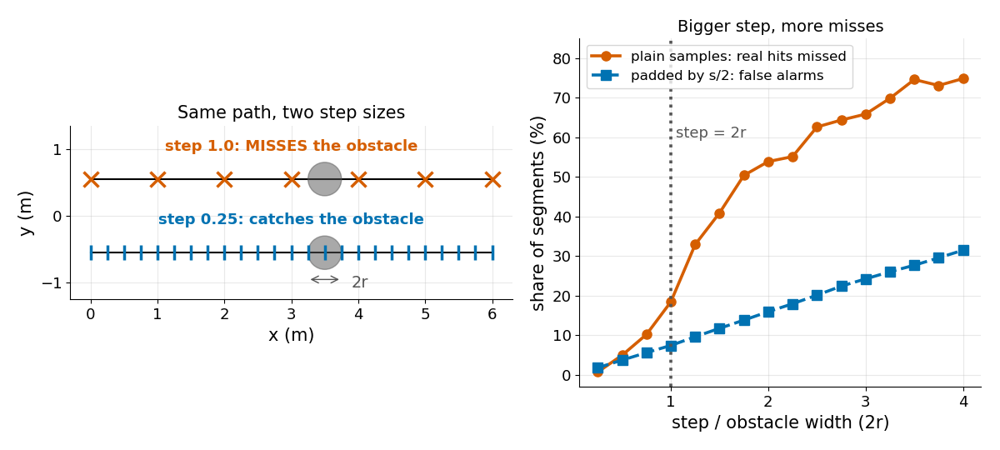

# 충돌 검사 (Collision Checking)

> 경로를 몇 군데만 검사하면 얇은 장애물을 놓칠 수 있는 이유와 안전하게 검사하는 방법을 알아봅니다.

**유형:** 만들기   **선수 지식:** 09/02 RRT   **시간:** 약 15분

## 쉽게 말하면

장난감 자동차가 얇은 기둥 옆을 지나가야 해요. 검사기는 길을 따라 말뚝을 박고 말뚝마다 자동차가 기둥 안에 들어가는지 물어요. 말뚝 간격이 기둥 너비보다 넓으면 모든 말뚝이 기둥 옆에 떨어져서 모두 비었다고 답해도 자동차는 말뚝 사이에서 기둥에 부딪혀요.

말뚝 사이 구간 전체를 검사하면 그 충돌을 잡아요. 기둥이 더 넓다고 가정해도 잡히지만 안전한 길까지 막혀요.

## 핵심 용어

- **Collision checking**: 로봇의 자세나 움직임이 장애물에 닿는지 검사하는 일입니다.
- **Tunnelling**: 검사 간격이 너무 넓어서 움직임이 얇은 장애물을 통과해 버리는 일입니다.
- **Segment**: 경로 위 두 점 사이의 곧은 구간입니다.
- **Chord**: 선분 가운데 원 안에 있는 부분입니다.
- **Padding**: 검사가 안전한 쪽으로 틀리도록 장애물을 여유만큼 키우는 일입니다.
- **False alarm**: 장애물을 실제로는 피하는 경로에 충돌이라고 알리는 일입니다.

## 문제

planner가 충돌 없는 경로라고 보고했는데 로봇 팔이 얇은 기둥을 친다고 상상해 보세요. 검사한 자세는 모두 비어 있었고 기둥이 검사 사이의 움직임보다 얇았습니다.

## 개념

실제 로봇은 검사기가 건너뛴 것에 부딪히므로 검사 간격은 가장 얇은 장애물에 맞아야 합니다.


*걸음이 장애물 너비보다 크면 샘플이 장애물 양쪽에 떨어질 수 있습니다.*

위에서 보면 기둥은 반지름이 `r`인 원입니다. 선분에서 중심에 가장 가까운 점이 원 안에 있으면 선분이 원에 닿습니다. 그 점은 중심에서 선분에 수선을 내리고 양 끝으로 잘라서 구하므로 이 검사는 정확합니다. swept 검사는 간격이 `s` 이하인 점만 검사합니다.



*왼쪽은 굵은 걸음이 놓치고 가는 걸음이 잡는 모습입니다. 오른쪽은 걸음이 클수록 더 많이 놓치는 모습입니다.*


*걸음이 `2r` 이하이면 중심을 지나는 교차를 잡고 `s/2`만큼 패딩하면 모두 잡습니다.*

중심을 지나는 현의 길이가 `2r`이므로 걸음이 `2r` 이하이면 그 현 위에 샘플이 하나 놓이지만 원을 스치는 선분은 빠져나갈 수 있습니다. 원을 `s/2`만큼 키우면 충돌을 놓치지 않고 대가는 false alarm입니다.

`r = 0.25`이고 말뚝이 `0.5 = 2r`마다 있으며 선분이 중심에서 0.2 떨어져 지나간다고 해 봅시다.
말뚝 두 개가 가장 가까운 점에서 양쪽으로 0.25씩, 즉 각각 중심에서 0.32 떨어져 있어서 기본 검사는 비었다고 답하지만 `seg_hits`는 충돌이라고 답합니다.
`s/2 = 0.25`만큼 패딩하면 반지름이 0.5가 되어 둘 다 잡힙니다.


*파란 차의 말뚝은 흰색으로 남아서 자동차가 기둥을 스칩니다. 초록 차의 말뚝은 빨갛게 변해서 자동차가 출발하지 않습니다.*

## 만들기

```python
def conservative_hits(a, b, c, r, step):
    return swept_hits(a, b, c, r, step, pad=step / 2)
```

`swept_hits`는 선분 위에 `ceil(length / step) + 1`개의 샘플을 놓습니다. 테스트는 무작위 선분 수천 개로 이것을 정확한 검사와 비교합니다.

```bash
cd robotics-engineering-from-scratch
python3 -m pytest phases/09-motion-planning/03-collision-checking -q
python3 phases/09-motion-planning/03-collision-checking/code/main.py
```

## 실제 도구로 보기

SciPy의 `minimize_scalar`는 가장 가까운 점을 수치로 찾고 마지막 테스트가 그 결과를 닫힌 식과 비교합니다.

출처는 [Motion planning, Wikipedia](https://en.wikipedia.org/wiki/Motion_planning)이고 2026년 11월 9일에 열람했습니다.

## 결과물

`outputs/skill-collision-step-check.md`는 planner의 충돌 검사 해상도를 가장 얇은 장애물과 대조해 점검합니다.

## 연습 문제

1. 패딩한 검사의 false alarm이 5% 아래가 되는 가장 작은 `step`을 찾으세요.
2. 실제 최악 간격 `length / (2n)`만큼 패딩하고 false alarm을 비교하세요.
3. `r`에 로봇 반지름을 더해서 `seg_hits`를 원형 로봇으로 확장하세요.
