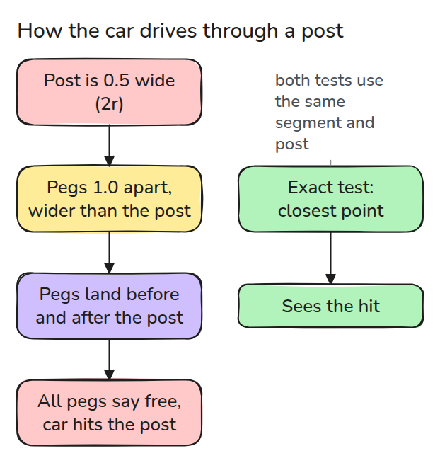
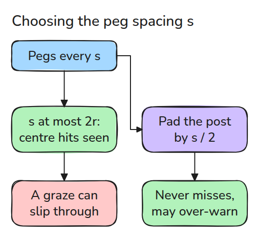
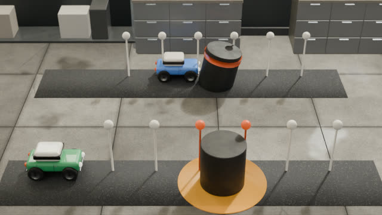

# 충돌 검사 (Collision Checking)

> 경로를 몇 군데만 검사하면 얇은 장애물을 놓칠 수 있는 이유와 안전하게 검사하는 방법을 알아봅니다.

**유형:** 만들기   **선수 지식:** 09/02 RRT   **시간:** 약 15분

## 쉽게 말하면

장난감 자동차가 얇은 기둥을 스치는 길을 달려요. 검사기는 길을 따라 말뚝을 박고 말뚝마다 자동차가 기둥 안에 들어가는지 물어요. 말뚝 간격이 기둥 너비보다 넓으면 모든 말뚝이 기둥 옆에 떨어질 수 있어요. 그러면 말뚝이 모두 비었다고 답하는데도 자동차는 말뚝 사이에서 기둥에 부딪혀요.

말뚝 사이 구간 전체를 검사하면 그 충돌을 잡아요. 기둥이 더 넓다고 가정해도 잡히지만 안전한 길까지 막혀요.

## 핵심 용어

- **Collision checking**: 로봇의 자세나 움직임이 장애물에 닿는지 검사하는 일입니다.
- **Tunnelling**: 검사 간격이 너무 넓어서 움직임이 얇은 장애물을 통과해 버리는 일입니다.
- **Segment**: 경로 위 두 점 사이의 곧은 구간입니다.

- **Padding**: 검사가 안전한 쪽으로 틀리도록 장애물을 여유만큼 키우는 일입니다.
- **False alarm**: 장애물을 실제로는 피하는 경로에 충돌이라고 알리는 일입니다.

## 문제

안전하다고 검사를 통과한 경로인데 로봇 팔이 얇은 기둥을 치는 모습을 상상해 보세요. 검사한 자세는 모두 비어 있었고 기둥이 두 검사 사이의 간격보다 얇았습니다.

## 개념

로봇은 검사기가 건너뛴 것에 부딪히므로 검사 간격은 가장 얇은 장애물에 맞아야 합니다.

검사기는 경로를 따라 몇 군데를 검사합니다. 그 간격이 기둥 너비보다 넓으면 모두 기둥 옆에 떨어질 수 있고 로봇은 두 지점 사이에서 기둥에 부딪힙니다.



*걸음이 넓으면 샘플이 장애물 양쪽에 떨어질 수 있습니다.*


*큰 걸음은 놓치고 작은 걸음은 잡습니다.*

해결책은 둘입니다. 지점 사이 구간 전체를 정확히 검사하거나 기둥이 조금 더 넓다고 가정합니다. 두 번째는 싸지만 길이 비어 있는데도 막혔다고 말할 때가 있습니다.



*기둥 너비(2r) 이하의 걸음은 한가운데를 지나는 충돌을 잡고 패딩은 스치는 충돌도 잡습니다.*

[](../assets/clip-example.mp4)

*파란 차의 말뚝은 흰색으로 남아 기둥을 스칩니다. 초록 차의 말뚝은 빨갛게 변해서 멈춥니다.*

<details><summary>The math (optional)</summary>

위에서 보면 기둥은 반지름이 `r`인 원입니다.
선분에서 중심에 가장 가까운 점이 원 안에 있으면 선분이 원에 닿습니다.
그 점은 중심을 선분에 수직으로 내린 점을 양 끝 범위로 제한해서 구하므로 이 검사는 정확합니다.
swept 검사는 간격이 `s` 이하인 점만 검사합니다.
중심을 지나는 현(선분 중 원 안에 있는 부분)의 길이가 `2r`이므로 걸음이 `2r` 이하이면 그 현 위에 샘플이 하나 놓입니다.
하지만 원을 스치는 선분은 빠져나갈 수 있습니다.
원을 `s/2`만큼 키우면 충돌을 절대 놓치지 않지만 그 대가로 false alarm이 생깁니다.
예: `r = 0.25`이고 말뚝이 `0.5 = 2r`마다 있으며 선분이 중심에서 0.2 떨어져 지나갑니다.
말뚝 두 개가 가장 가까운 점의 양쪽으로 0.25씩 벌어져 있고 각각 중심에서 0.32 떨어져 있어서 기본 검사는 비었다고 답하지만 정확한 검사는 충돌이라고 답합니다.
`s/2 = 0.25`만큼 패딩하면 둘 다 잡힙니다.

</details>

## 만들기

```python
def conservative_hits(a, b, c, r, step):
    return swept_hits(a, b, c, r, step, pad=step / 2)
```

`swept_hits`는 선분을 따라 `step`마다 샘플을 하나씩 놓고 끝에 하나를 더 놓습니다. 테스트는 이것을 정확한 검사와 비교합니다.

```bash
cd robotics-engineering-from-scratch
python3 -m pytest phases/09-motion-planning/03-collision-checking -q
python3 phases/09-motion-planning/03-collision-checking/code/main.py
```

## 실제 도구로 보기

이미 만들어진 SciPy 함수가 선분에서 기둥에 가장 가까운 점을 찾아 주고 테스트가 그 결과를 비교합니다.

출처는 [Motion planning, Wikipedia](https://en.wikipedia.org/wiki/Motion_planning)이고 2026년 11월 9일에 열어 확인했습니다.

## 결과물

`outputs/skill-collision-step-check.md`는 경로 탐색의 충돌 검사 간격을 가장 얇은 장애물과 대조해 점검합니다.

## 연습 문제

1. 기둥을 더 얇게 만들고 말뚝만 쓰는 검사가 언제 놓치기 시작하는지 보세요.
2. 걸음을 더 작게 만들고 false alarm을 보세요.
3. 로봇을 원으로 보고 그 반지름을 기둥의 반지름에 더해 보세요.
