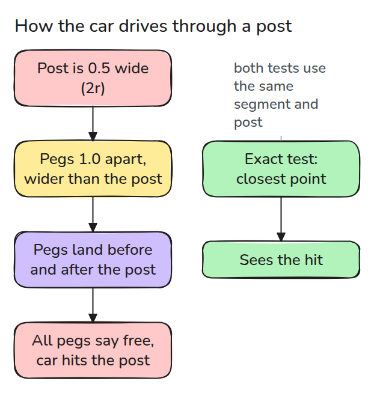
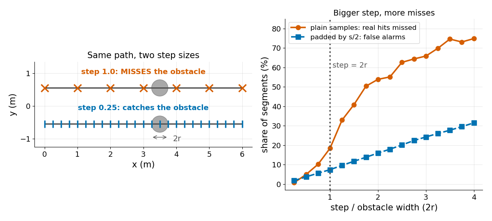
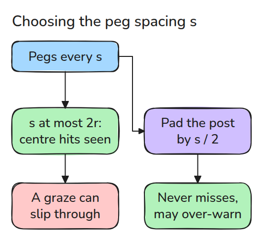

# 충돌 검사 (Collision Checking)

> 샘플 점에서만 검사한 경로는 샘플 간격보다 얇은 장애물을 터널처럼 통과할 수 있습니다.

**유형:** 만들기   **선수 지식:** 09/02 RRT   **시간:** 약 15분

## 쉽게 말하면

장난감 자동차가 얇은 기둥 옆을 지나가야 해요. 검사기는 길을 따라 말뚝을 박고 말뚝마다 자동차가 기둥 안에 들어가는지 물어요. 말뚝 간격이 기둥 너비보다 넓으면 모든 말뚝이 기둥 옆에 떨어질 수 있어요. 모든 말뚝이 비었다고 답해도 자동차는 두 말뚝 사이에서 기둥에 부딪혀요.

말뚝 사이 구간 전체를 검사하면 그 충돌을 잡아요. 기둥이 더 넓다고 가정해도 잡히지만 실제로는 지나갈 수 있는 길까지 막힌 것으로 볼 수 있어요.

## 문제

planner가 충돌 없는 경로라고 보고했는데 로봇이 가는 길에 기둥을 칩니다. 경로의 자세는 하나하나 검사했고 하나도 막히지 않았습니다. 기둥이 두 검사 사이에 팔이 움직이는 거리보다 얇아서 검사기의 샘플은 기둥을 건너뛰었고 실제 팔은 그대로 통과했습니다.

## 개념



*걸음이 장애물 너비보다 크면 샘플이 장애물 양쪽에 떨어질 수 있습니다.*

위에서 보면 기둥은 반지름이 `r`인 원이고 점이 원 안에 있다는 것은 중심까지 거리가 `r` 이하라는 뜻입니다. 선분이 원에 닿는다는 것은 선분에서 중심에 가장 가까운 점이 원 안에 있다는 뜻입니다.

그 점은 중심에서 선분에 수선을 내리고 양 끝으로 잘라서 구하므로 이 검사는 정확합니다.

swept 검사는 선분 위에서 간격이 `s` 이하인 점만 검사합니다.



*왼쪽은 굵은 걸음이 장애물을 놓치고 가는 걸음이 잡아내는 모습입니다. 오른쪽은 걸음이 클수록 실제 충돌을 더 많이 놓치는 모습입니다.*



*걸음이 `2r` 이하이면 중심을 지나는 교차를 모두 잡습니다. `s/2`만큼 패딩하면 모든 교차를 잡습니다.*

중심을 지나는 현(원 위의 두 점을 잇는 선분)의 길이가 `2r`이므로 걸음이 `2r` 이하이면 그 현 위에 샘플이 하나 놓입니다. 원을 스치는 선분은 현이 짧아서 여전히 빠져나갈 수 있습니다.

선분 위의 모든 점은 샘플에서 `s/2` 이내에 있으므로 원을 `s/2`만큼 키우면 충돌을 놓치지 않습니다. 대가는 false alarm입니다.

예시로 `r = 0.25`이고 말뚝이 `0.5 = 2r`마다 있으며 선분이 중심에서 0.2 떨어져 지나갑니다. 이때 현의 길이는 0.3밖에 되지 않습니다. 말뚝 두 개가 가장 가까운 점에서 양쪽으로 0.25씩 떨어져 있어서 각각 중심에서 0.32 떨어집니다.

기본 검사는 비었다고 답하지만 `seg_hits`는 충돌이라고 답합니다.

`s/2 = 0.25`만큼 패딩하면 반지름이 0.5가 되어 두 말뚝이 모두 잡힙니다.


*말뚝을 보세요. 파란 차의 말뚝은 흰색으로 남아서 자동차가 그대로 가다 기둥을 스칩니다. 주황색 패딩 고리 안에 든 초록 차의 말뚝은 빨갛게 변해서 자동차가 출발하지 않습니다.*

## 만들기

```python
def conservative_hits(a, b, c, r, step):
    return swept_hits(a, b, c, r, step, pad=step / 2)
```

`swept_hits`는 선분 위에 `ceil(length / step) + 1`개의 샘플을 놓습니다. 테스트는 무작위 선분 수천 개로 이것을 정확한 검사와 비교합니다.

```bash
cd robotics-engineering-from-scratch
python3 -m pytest phases/09-motion-planning/03-collision-checking -q
python3 phases/09-motion-planning/03-collision-checking/code/main.py
```

## 실제 도구로 보기

SciPy의 `minimize_scalar`는 가장 가까운 점을 수치로 찾습니다. 마지막 테스트가 무작위 선분에서 그 결과를 닫힌 식의 검사와 비교합니다.

출처는 [Motion planning, Wikipedia](https://en.wikipedia.org/wiki/Motion_planning)이고 2026년 11월 9일에 열람했습니다.

이 페이지는 충돌 검사를 로봇의 형상이 환경의 형상과 충돌하는지 검사하는 일로 설명하고 grid 방식은 grid 해상도를 정해야 한다고 설명합니다.

## 결과물

`outputs/skill-collision-step-check.md`는 planner의 충돌 검사 해상도를 가장 얇은 장애물과 대조해 점검합니다.

## 연습 문제

1. 패딩한 검사의 false alarm이 5% 아래가 되는 가장 작은 `step`을 찾으세요.
2. 실제 최악 간격 `length / (2n)`만큼 패딩하고 false alarm을 비교하세요.
3. `r`에 로봇 반지름을 더해서 `seg_hits`를 원형 로봇으로 확장하세요.
