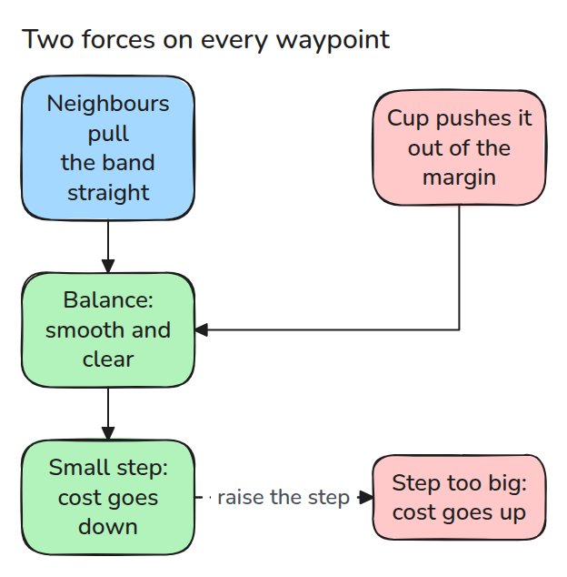
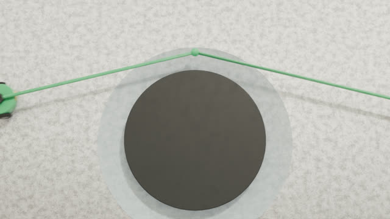

# Trajectory Optimisation

> Learn how to smooth a zigzag path without pushing it back into an obstacle.

**Type:** Build   **Prerequisites:** 09/03 Collision Checking   **Time:** ~15 minutes

## In Plain Words

A rover's route is a chain of waypoints pinned at the start and the flag, like a rubber band with obstacles in the way. The band pulls each waypoint toward the line between its neighbours. An obstacle pushes nearby waypoints outward.

The route settles where pull and push balance. Small moves lower the cost, a score of how bad the route is. Moves that are too big raise it.

## Key Terms

- **Waypoint**: one point on the route; the route is a chain of them.
- **Cost**: a single number scoring how bad a route is; lower is better.
- **Gradient**: the direction in which the cost rises fastest. Step the opposite way and the cost drops.
- **Gradient descent**: repeating small steps the opposite way to the gradient.
- **Penalty**: extra cost added when a waypoint gets too close to an obstacle.
- **Clearance**: the spare distance kept between the path and an obstacle.

## The Problem

Picture a robot arm following a path that avoids every obstacle but zigzags, wasting time and shaking the arm. Straightening it by hand pushes it back into an obstacle.

## The Concept

A real robot saves time and wear on a smooth path.

Think of the path as a rubber band pinned at both ends. It pulls each point toward its neighbours, and an obstacle pushes nearby points away.


*Smoothness and obstacles each push every point.*

The path settles where pull and push balance, reached by moving points a little at a time. Too big a move overshoots.



*Pull and push balance at rest.*

[](../assets/clip-example.mp4)

*Red arrows: pull and push. The push starts huge and shrinks.*


*Before: through both obstacles. After: around them.*

<details><summary>The math (optional)</summary>

Smoothness cost is half the sum of squared steps between neighbours; its gradient at a waypoint is `2 x_i - x_{i-1} - x_{i+1}`, so stepping the opposite way pulls the point toward the line through its neighbours. The obstacle penalty is `w (r + margin - d)^2` when a waypoint is closer than `r + margin` to a centre, else zero (`w` = 8). Steps of size `lr` = 0.04 repeat; too large a step makes the cost rise. Example: a waypoint between pins at (0, 0) and (10, 0), an obstacle of radius 1 at (5, 0), `margin = 0.4`, starts at (5, 0.2). Smoothness pulls down with 0.4, the obstacle pushes up with 19.2. After 8 steps it rests at (5, 1.24), both forces 2.49, 0.24 outside the obstacle. Only waypoints are penalised, so a segment between two can still clip an obstacle. With no obstacles the path becomes an evenly spaced straight line.

</details>

## Build It

```python
g[1:-1] = ws * (2*X[1:-1] - X[:-2] - X[2:])
g[1:-1] -= 2 * wo * np.maximum(0, r + margin - d) * v / d
X -= lr * g
```

Endpoints get zero gradient, so they never move. A test checks the gradient by nudging each point and measuring the change.

```bash
cd robotics-engineering-from-scratch
python3 -m pytest phases/09-motion-planning/04-trajectory-optimisation -q
python3 phases/09-motion-planning/04-trajectory-optimisation/code/main.py
```

## Use It

A ready-made SciPy minimiser takes the same cost and gradient. A test checks it reaches a cost no worse than 4000 plain steps.

Sources: [CHOMP, Ratliff et al. 2009](https://www.ri.cmu.edu/pub_files/2009/5/icra09-chomp.pdf) (opened 2026-11-09).

## Ship It

`outputs/skill-path-smoothing-check.md` reviews a smoothed path for clearance, endpoints and step size.

## Exercises

1. Move the obstacle closer to the path and watch the path bend away.
2. Make the step bigger until the score gets worse.
3. Check the straight stretch between each pair of points for a hit, as in 09/03.
