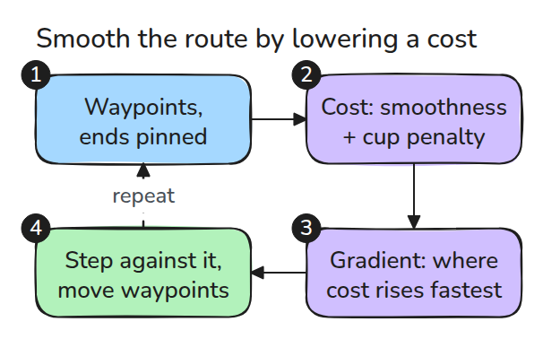
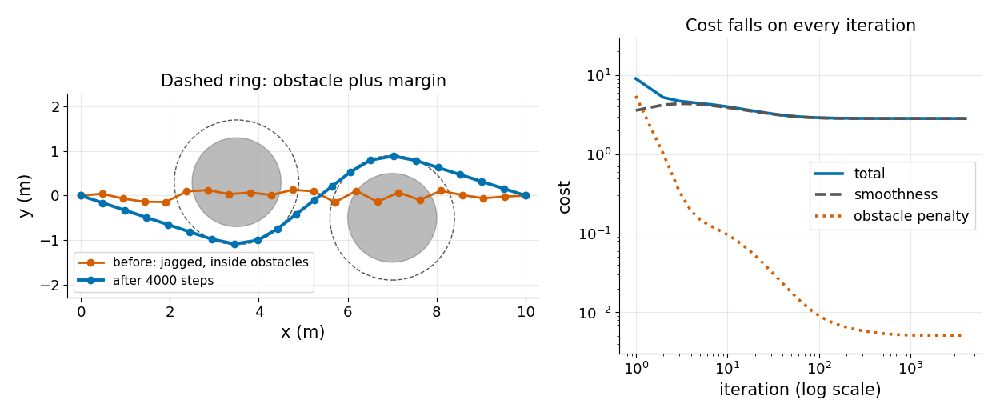

# Trajectory Optimisation

> Learn how to smooth a zigzag path without pushing it back into an obstacle.

**Type:** Build   **Prerequisites:** 09/03 Collision Checking   **Time:** ~15 minutes

## In Plain Words

A rover's route is a chain of waypoints pinned at the start and the flag, like a rubber band with cups in the way. The band pulls each waypoint toward the line between its neighbours; a cup pushes nearby waypoints outward.

The route settles where pull and push balance. Small moves lower the cost, a score of how bad the route is. Moves that are too big raise it.

## Key Terms

- **Waypoint**: one point on the route; the route is a chain of them.
- **Cost**: a single number scoring how bad a route is; lower is better.
- **Gradient**: the direction in which the cost rises fastest. Stepping against it lowers the cost.
- **Gradient descent**: repeating small steps against the gradient.
- **Penalty**: extra cost added when a waypoint gets too close to an obstacle.
- **Clearance**: the spare distance kept between the path and an obstacle.

## The Problem

Picture an arm following a path that avoids every obstacle but zigzags, wasting time. Straightening it by hand pushes it into an obstacle.

## The Concept

A real robot saves time and wear on a smooth path, so we score smoothness.



*Fixed ends; smoothness and obstacle penalty give one gradient.*

Smoothness cost is half the sum of squared steps between neighbours. Its gradient is `2 x_i - x_{i-1} - x_{i+1}`, so stepping against it pulls a point toward the line through its neighbours. The obstacle penalty is `w (r + margin - d)^2` when a waypoint is closer than `r + margin` to a centre, else zero (`w` = 8 is the weight). Stepping against its gradient pushes the point out. Steps of size `lr` = 0.04 are repeated.


*Pull and push balance at rest; too large a step overshoots. Only waypoints are checked; a segment between two can still clip the obstacle.*

One waypoint between pins at (0, 0) and (10, 0), a cup of radius 1 at (5, 0), `margin = 0.4`. It starts at (5, 0.2), inside the cup: smoothness pulls down with 0.4, the cup pushes up with 19.2. After 8 steps it rests at (5, 1.24), both forces 2.49, 0.24 outside the cup.


*Red arrows: pull, push.*



*Left: start runs through both obstacles, result bends around. Right: cost falls.*

## Build It

```python
g[1:-1] = ws * (2*X[1:-1] - X[:-2] - X[2:])
g[1:-1] -= 2 * wo * np.maximum(0, r + margin - d) * v / d
X -= lr * g
```

Endpoints get zero gradient, so they never move; a test checks the gradient against finite differences.

```bash
cd robotics-engineering-from-scratch
python3 -m pytest phases/09-motion-planning/04-trajectory-optimisation -q
python3 phases/09-motion-planning/04-trajectory-optimisation/code/main.py
```

## Use It

SciPy's `minimize` with `method="L-BFGS-B"` takes the same cost and gradient. A test checks it reaches a cost no worse than 4000 plain steps.

Sources: [CHOMP, Ratliff et al. 2009](https://www.ri.cmu.edu/pub_files/2009/5/icra09-chomp.pdf) (opened 2026-11-09).

## Ship It

`outputs/skill-path-smoothing-check.md` reviews a smoothed path for clearance, endpoints and step size.

## Exercises

1. Raise `margin` to 0.8; report how the closest approach changes.
2. Check segments with lesson 03's exact test; report the smallest clearance.
3. Use `scipy.optimize.minimize`; compare iterations with plain descent.
