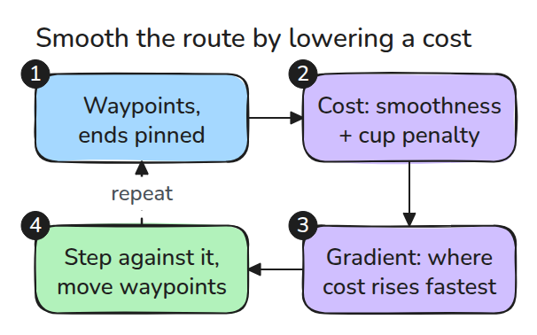
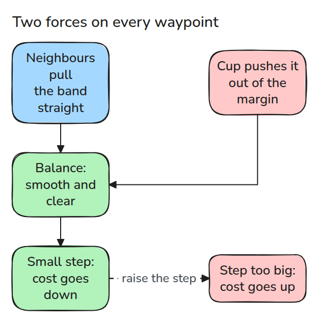
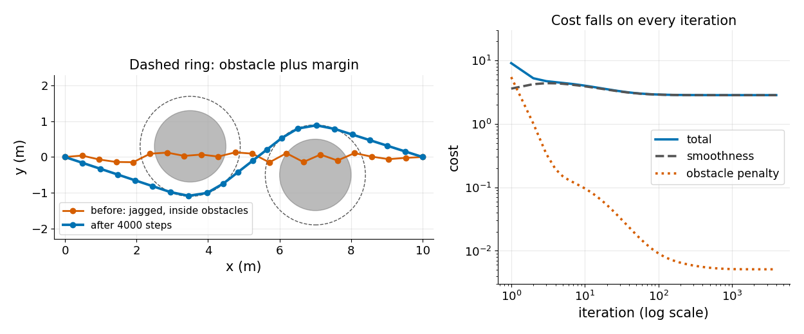

# Trajectory Optimisation

> A planner's path is feasible but jagged. Gradient descent on a smoothness cost and an obstacle penalty turns it into a path a robot can follow.

**Type:** Build   **Prerequisites:** 09/03 Collision Checking   **Time:** ~15 minutes

## In Plain Words

Stretch a rubber band between fixed pins on a table with cups in the way. Tension pulls the band straighter, while the cups keep it
from taking the direct route.

Trajectory optimisation balances similar effects on path waypoints. Smoothness pulls each point toward its neighbours; an obstacle
penalty pushes nearby points away from cup-shaped obstacles. Small adjustments can reduce the combined cost. Large adjustments may
raise it, and checking waypoints alone still leaves the segments between them unchecked.

## The Problem

A sampling planner hands you a path that avoids every obstacle but zigzags. Following it wastes time and shakes the arm. Straightening the zigzag by hand puts the path back inside an obstacle, so the two goals fight each other.

## The Concept



*The path is a list of waypoints with fixed ends. Two cost terms, smoothness and obstacle penalty, give one gradient that moves the waypoints.*

Smoothness is half the sum of squared steps between neighbours. Its gradient at a waypoint is `2 x_i - x_{i-1} - x_{i+1}`, which pulls the point toward the line through its neighbours. The obstacle penalty is `w (r + margin - d)^2` when a waypoint is closer than `r + margin` to a centre, and zero otherwise. Its gradient pushes the point straight out.



*The path settles where the pull and the push balance. A step that is too large makes the cost go up.*



*Left: the jagged start runs through both obstacles and the result bends around them. Right: the total cost falls every iteration.*

This is a small cousin of CHOMP. It uses a plain gradient, where CHOMP uses a covariant one, and it penalises waypoints only, not the segments between them.

## Build It

```python
g[1:-1] = ws * (2*X[1:-1] - X[:-2] - X[2:])
g[1:-1] -= 2 * wo * np.maximum(0, r + margin - d) * v / d
X -= lr * g
```

The endpoints get zero gradient, so they never move. A test compares the analytic gradient with finite differences.

```bash
cd robotics-engineering-from-scratch
python3 -m pytest phases/09-motion-planning/04-trajectory-optimisation -q
python3 phases/09-motion-planning/04-trajectory-optimisation/code/main.py
```

## Use It

SciPy's `minimize` with `method="L-BFGS-B"` takes the same cost and gradient. The last test checks that it reaches a cost no worse than 4000 plain steps.

Sources: [CHOMP, Ratliff et al. 2009](https://www.ri.cmu.edu/pub_files/2009/5/icra09-chomp.pdf) (opened 2026-11-09: elastic-band planning gives a path an internal energy for length or smoothness and an external energy from obstacles, and CHOMP uses covariant gradient techniques).

## Ship It

`outputs/skill-path-smoothing-check.md` reviews a smoothed path for clearance, endpoints and step size.

## Exercises

1. Raise `margin` to 0.8 and report how the closest approach changes.
2. Check the segments between waypoints with the exact test from lesson 03 and report the smallest clearance.
3. Use `scipy.optimize.minimize` and compare iterations with plain descent.
